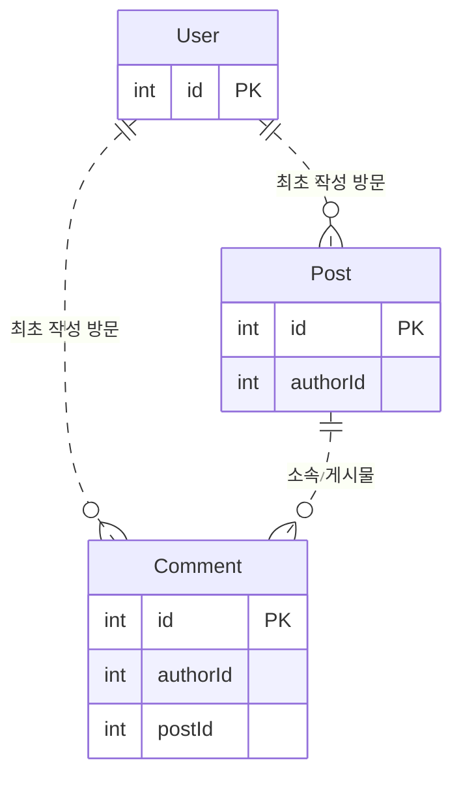

# 비회원 게시판 ERD 설계

게시물과 댓글을 저장하는 테이블만 있으면 게시판의 기본 관계를 표현할 수 있어요. 실제 서비스를 생각하면 그다음 질문이 생겨요. 같은 글을 동시에 수정하면 어떻게 될까요? 신고한 글이 바뀌거나 삭제되면 무엇을 보고 판단해야 할까요?

이 저장소는 Leets 8기 백엔드 2주차 과제를 바탕으로 **ERD를 어떻게 설계하고 무엇을 고려해야 하는지** 알아보는 교육용 자료입니다. 문제가 생길 수 있는 상황을 먼저 묻고, 필요한 보장을 정한 뒤 테이블·관계·키·제약으로 답해요.

여기서 정한 기준이 과제의 공식 정답이거나 모든 서비스에 필요한 구조는 아니에요. API 명세나 구현 후 검증 시나리오를 제공하는 자료도 아니에요.

- [과제와 설계 범위](#교육-과제에서-출발했어요)
- [설계 문서](#설계-문서)
- [실무 고민 지도](#실무-고민-지도)
- [문서 생성](#문서는-db-없이-다시-만들-수-있어요)
- [자료의 범위](#설계와-실제-보장을-구분해요)

## 교육 과제에서 출발했어요

[교육 자료](https://weeth-s3-prod.s3.ap-northeast-2.amazonaws.com/POST/2026-09/605e66cb-be4b-42cd-8602-c9c9a5b5cb16_Leets_8th_BE_2%EC%A3%BC%EC%B0%A8.pdf)의 기본 과제는 User·Post·Comment의 관계를 ERD로 설계하고, 이를 Spring Entity 코드로 표현하는 거예요. 대댓글과 신고는 선택 과제예요. 신고가 늘어났을 때 숨김이나 관리자 검수를 어떻게 처리할지도 고민하도록 안내하고 있어요. 관련 내용은 PDF 69~74쪽에서 확인할 수 있어요.

교육 과제에서는 로그인·세션·토큰·권한 검증을 다루지 않아요. 이 저장소에서는 서비스를 운영한다고 가정하고 비회원 권한, 수정 이력, 신고 증거와 데이터 정리까지 범위를 넓혔어요. Spring/JPA 구현 대신 MySQL 대상의 데이터 구조를 Prisma 스키마와 문서로 표현했어요.

## 작은 구조에서 질문을 이어가요

다음은 기본 관계만 담은 출발 구조예요. 최종 ERD를 먼저 정답처럼 제시하지 않고, 각 문서에서 이 구조가 실패할 수 있는 상황을 확인해요.



[설계 문서](#설계-문서)는 최소 테이블에서 시작해요. 질문은 닫힌 토글로 두고 답변과 필요한 단계별 Mermaid ERD를 함께 보여줘요. 먼저 답을 생각해 보고, 토글을 열어 어떤 구조와 보장이 필요한지 확인할 수 있어요.

각 문서는 출발 구조 → 질문과 사례 → 설계 선택과 한계 → 정리 순서로 읽을 수 있어요. 목차는 주제별로 찾아볼 때 사용해요.

비회원 문서는 User의 최소 구조에서 시작해 같은 방문의 유지와 공용 접속 환경의 한계를 살펴봐요. 요청 실패 문서는 신고 저장 뒤 서버 종료나 응답 유실이 생겼을 때, 저장된 작업과 완료된 효과를 어떻게 구분할지 이어서 설명해요.

필요한 보장을 만족하면 더 복잡한 구조를 추가하지 않습니다. 수정 이력·환경 분류·Outbox가 필요한 이유도 각 문서의 요구와 실패 상황에서 차근차근 살펴봐요.

## 설계 문서

아래 여섯 문서에서 각 구조를 선택한 이유와 고려할 점을 설명해요. 파일 바이트는 비공개 S3 호환 스토리지에, 메타데이터와 개정별 사용 관계는 MySQL에 두는 설계예요. NAS와 댓글 첨부는 포함하지 않아요.

순서는 앞 문서의 개념을 뒤 문서가 이어받도록 정했어요. 댓글은 게시물의 수정 이력·버전 규칙을 재사용하므로 게시물 문서를 먼저 읽어요.

| 순서 | 문서 | 대표 질문
| --- | --- | --- |
| 1 | [비회원 관리 테이블](docs/guest-management.md) | 로그인하지 않은 사람의 글을 무엇으로 구분할까요? |
| 2 | [게시물 관리 테이블](docs/post-management.md) | 수정·동시 저장·삭제 뒤에도 글의 정본을 어떻게 지킬까요? |
| 3 | [댓글 관리 테이블](docs/comment-management.md) | 대댓글과 지워진 부모 댓글의 대화를 어떻게 유지할까요? |
| 4 | [신고 관리 테이블](docs/report-management.md) | 글이 바뀌거나 지워져도 신고 당시 내용을 어떻게 남길까요? |
| 5 | [요청 실패 관리 테이블](docs/request-failure-management.md) | 저장은 끝났는데 후속 처리나 응답이 끊기면 어떻게 할까요? |
| 6 | [파일 관리 테이블](docs/file-management.md) | 업로드한 파일을 언제 믿고, 누구에게 보여줄까요? |

공통으로 고려할 [저장 타입과 제약](docs/post-management.md#저장-타입과-제약), [관계 무결성](docs/post-management.md#관계-무결성과-삭제), [조회와 인덱스 설계](docs/post-management.md#조회와-인덱스-설계)은 게시물 문서에서 한 번만 관리해요. 각 문서는 이 설계 기준을 참조하고 자신에게 필요한 관계와 인덱스를 설명해요.

단계별 그림은 질문에 필요한 컬럼만 보여줘요. 생략한 컬럼을 삭제한다는 뜻이나 DB 변경 순서는 아니에요. 전체 컬럼과 키는 각 문서 `정리` 절의 최종 구조에서 확인해요.

**모든 관계선은 물리 FK가 아닌 논리 관계입니다.** FK를 빼면 얻고 잃는 것은 [관계 무결성](docs/post-management.md#관계-무결성과-삭제)의 첫 질문에서 설명해요. 신고의 POST·COMMENT 증거 선은 종류에 따른 선택 분기이며 원본 행의 계속된 존재를 요구하지 않아요.

## 실무 고민 지도

각 문서의 질문 제목 앞에는 난이도를 표시했어요. 처음 읽는다면 `[과제]`와 `[실무 기본]` 질문을 먼저 따라가고, `[심화]` 질문은 해당 요구가 생겼을 때 돌아와도 돼요.

| 표시 | 뜻 |
| --- | --- |
| `[과제]` | 교육 과제의 필수·선택 요구에서 바로 나오는 질문 |
| `[실무 기본]` | 규모와 관계없이 대부분의 게시판이 마주치는 질문 |
| `[심화]` | 공유 IP 분류·파일 변환·비동기 후속 처리처럼 특정 요구가 있을 때 필요한 질문 |

아래 표는 문서에 흩어진 실무 고민을 일반적으로 쓰는 용어와 함께 모은 거예요. 같은 고민을 다른 자료에서 찾아볼 때 용어 열을 검색어로 사용할 수 있어요.

| 실무 고민 | 일반 용어 | 난이도 | 다루는 곳 |
| --- | --- | --- | --- |
| 로그인하지 않은 작성자를 무엇으로 구분할까 | 방문 식별 | 실무 기본 | [비회원](docs/guest-management.md) 1~2 |
| 대댓글을 같은 게시물 안에서만 달게 하려면 | 자기참조(self-referencing) | 과제 | [댓글](docs/comment-management.md) 2 |
| 게시물과 댓글의 같은 ID를 어떻게 구분할까 | 다형 연관(polymorphic association) | 과제 | [신고](docs/report-management.md) 1 |
| 수정 전 내용을 남길까 | 이력 테이블(history table) | 실무 기본 | [게시물](docs/post-management.md#게시물-변경-설계) 1~2, [댓글](docs/comment-management.md) 3 |
| 같은 글을 동시에 고치면 누구의 수정을 남길까 | 낙관적 동시성 제어(optimistic concurrency control) | 실무 기본 | [게시물](docs/post-management.md#게시물-변경-설계) 4, [댓글](docs/comment-management.md) 4 |
| 여러 행을 함께 저장하다 실패하면 | 트랜잭션·원자성(atomicity) | 실무 기본 | [게시물](docs/post-management.md#게시물-변경-설계) 4, [저장 타입과 제약](docs/post-management.md#저장-타입과-제약) 11 |
| 삭제해도 남겨야 하는 데이터는 | 소프트 삭제(soft delete) | 실무 기본 | [게시물](docs/post-management.md#게시물-변경-설계) 5, [댓글](docs/comment-management.md) 5 |
| 원본이 바뀌어도 당시 내용을 증거로 남기려면 | 스냅샷 복사·비정규화(denormalization) | 실무 기본 | [신고](docs/report-management.md) 2~3 |
| 응답이 끊겨 같은 요청이 다시 오면 | 멱등 키(idempotency key) | 실무 기본 | [신고](docs/report-management.md) 4, [요청 실패](docs/request-failure-management.md) 3 |
| 목록을 빠르고 빠짐없이 보여주려면 | 키셋 페이지네이션(keyset pagination)·복합 인덱스 | 실무 기본 | [조회와 인덱스](docs/post-management.md#조회와-인덱스-설계) 9, 각 문서의 조회 질문 |
| 문자열 비교와 시각을 어떻게 맞출까 | collation·UTC 저장 | 실무 기본 | [공통 저장](docs/post-management.md#저장-타입과-제약) 12~13 |
| 물리 FK를 쓸까 | 참조 무결성(referential integrity) | 실무 기본 | [관계 무결성](docs/post-management.md#관계-무결성과-삭제) 15~16, 19 |
| 파일 이름과 저장 위치를 어떻게 나눌까 | 메타데이터와 객체 저장소 분리 | 실무 기본 | [파일](docs/file-management.md#파일-메타데이터와-저장-위치) 1~2 |
| 한 개정이 여러 첨부를, 한 첨부가 여러 개정을 쓰면 | 다대다(N:M)·조인 테이블(join table) | 심화 | [게시물](docs/post-management.md#게시물-변경-설계) 6 |
| 확인 직후 다른 요청이 부모를 지우면 | 잠금 순서·교착 상태(deadlock) | 심화 | [관계 무결성](docs/post-management.md#관계-무결성과-삭제) 17 |
| 저장 뒤 후속 작업을 잃지 않으려면 | 트랜잭셔널 아웃박스(transactional outbox) | 심화 | [요청 실패](docs/request-failure-management.md) 2 |
| 같은 이벤트를 두 번 처리하지 않으려면 | 멱등 소비자(idempotent consumer) | 심화 | [요청 실패](docs/request-failure-management.md) 5 |
| 접속 정보를 어디까지 저장할까 | 데이터 최소화(data minimization) | 심화 | [접속 정보의 보존](docs/guest-management.md#접속-정보의-보존) 8 |

각 문서 끝의 `정리` 절에는 그 문서에서 가져갈 결정과 한계, 다룬 테이블의 최종 구조를 모아 두었어요.

## 최종 구조와 설계 이유를 나눠요

[ERD](erd.md)에는 최종 테이블·컬럼·관계·키·인덱스와 데이터의 저장·참조·복사 흐름을 남겨요. 위 여섯 문서는 구조가 필요한 이유와 설계 선택의 장단점을 설명해요. JSON 필드 계약, API 요청·응답 명세, 상세 인증·워커 절차와 구현 후 검증 시나리오는 다루지 않아요.

테이블 구조와 흐름 요약의 정본은 [Prisma 스키마](prisma/schema.prisma)입니다. `erd.md`는 여기서 생성하므로 수동 수정하지 않아요. 물리 FK 없이 논리 관계를 표현하며 참조 검증과 삭제의 동시성은 서비스가 책임져요.

## 문서는 DB 없이 다시 만들 수 있어요

Node.js 22.12+ 또는 24.x LTS와 npm을 사용해요. 로컬 환경에 MySQL 형식의 `DATABASE_URL`을 설정한 뒤 아래 명령을 실행하면 돼요. 스키마 검사와 Markdown 생성은 DB에 접속하지 않아요.

```sh
npm ci
npm run schema:format
npm run schema:validate
npm run erd:build
```

필수 생성기인 `scripts/generate-erd.mjs`는 Git에 포함해요. 다른 로컬 스크립트와 생성물, 환경 파일은 제외해요.

## 설계와 실제 보장을 구분해요

**현재 결과물은 스키마와 설계 문서입니다.** Spring/JPA Entity, 인증·인가 서비스, CRUD API, 이벤트·파일 변환 워커, 실제 스토리지 연결과 데이터 점검 배치는 구현하지 않았어요. 개인 과제의 Spring Entity 구현까지 완료한 결과물은 아니에요.

스키마 검사는 구조의 문법과 관계 선언을 확인할 뿐, 실제 서비스 동작이나 성능을 보장하지 않습니다.

현재 마이그레이션 파일은 없으며 MySQL DB에 마이그레이션을 적용하지 않았어요.
