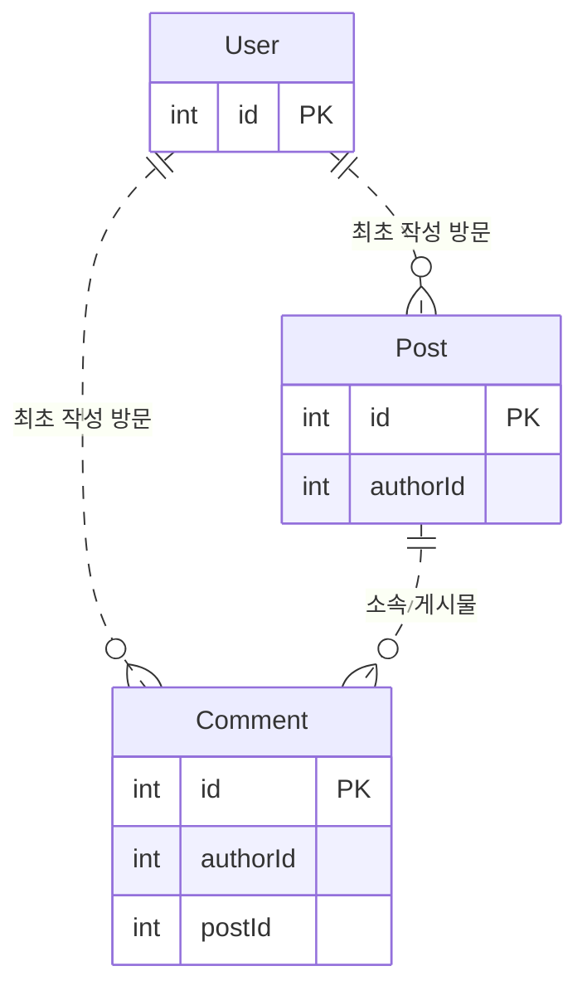

# 비회원 게시판 ERD 설계

이 저장소는 ERD 설계와 백엔드 개발을 공부하는 학생을 위한 MySQL 설계 자료입니다. Leets 8기 백엔드 2주차 과제의 User·Post·Comment 관계에서 출발해요. 기능에 필요한 보장을 정하고 테이블·관계·키·인덱스·제약으로 표현합니다.

현재 결과물은 스키마와 설계 문서예요. 과제의 공식 정답이나 API 구현 결과물이 아니에요. 모든 서비스가 여기의 확장 구조를 필요로 하지는 않아요.

- [과제와 설계 범위](#교육-과제에서-출발합니다)
- [기본 학습 경로](#기본-학습-경로)
- [요구별 확장 경로](#요구별-확장-경로)
- [문서 책임과 공통 기준](#문서-책임과-공통-기준)
- [문서 생성](#문서는-db-없이-다시-만들-수-있어요)
- [설계와 실제 보장](#설계와-실제-보장을-구분해요)

## 교육 과제에서 출발합니다

[교육 자료](https://weeth-s3-prod.s3.ap-northeast-2.amazonaws.com/POST/2026-09/605e66cb-be4b-42cd-8602-c9c9a5b5cb16_Leets_8th_BE_2%EC%A3%BC%EC%B0%A8.pdf)의 기본 과제는 User·Post·Comment의 관계를 ERD로 설계하고 Spring Entity 코드로 표현하는 것입니다. 대댓글과 신고는 선택 과제입니다. 자료는 신고가 늘어날 때 숨김과 관리자 검수를 어떻게 처리할지도 다룹니다. 관련 내용은 PDF 69~74쪽에 있습니다.

교육 과제는 로그인·세션·토큰·권한 검증을 다루지 않습니다. 이 저장소는 서비스 운영을 가정하고 비회원 권한, 수정 이력, 신고 증거, 데이터 정리까지 범위를 넓힙니다. Spring/JPA 구현 대신 MySQL용 데이터 구조를 Prisma 스키마와 문서로 표현합니다.

## 기본 학습 경로

다음 그림은 과제의 기본 관계예요. 모든 선은 물리 FK가 아닌 논리 관계입니다. 행 ID는 작성 관계를 표현할 뿐, 사람의 신원이나 관리 권한을 증명하지 않아요.



문서 전체를 한 번에 읽기보다 아래 기본 절을 순서대로 읽어요. 각 문서는 작은 구조에서 실패 사례를 살펴보고 필요한 보장과 가장 작은 선택을 설명해요. 답변은 질문 토글 안에 있어요.

| 순서 | 먼저 읽을 절 | 설계할 내용 |
| --- | --- | --- |
| 1 | [비회원: 사람과 방문](docs/guest-management.md#사람과-방문의-구분)부터 [유효기간과 권한](docs/guest-management.md#방문-유효기간과-콘텐츠-권한)까지 | 방문 식별·권한의 구분·만료 |
| 2 | [게시물: 작성 관계](docs/post-management.md#작성-관계와-관리-권한)부터 [삭제와 관계 보존](docs/post-management.md#삭제와-관계-보존)까지 | 작성·조회·수정·삭제·참조 검증 |
| 3 | [댓글: 소속 관계](docs/comment-management.md#게시물작성-방문과의-관계)부터 [수정·삭제](docs/comment-management.md#수정삭제와-대화-보존)까지 | 게시물 소속·답글·조회·대화 보존 |
| 4 | [신고: 대상 식별](docs/report-management.md#신고-대상의-식별)부터 [검수 목록](docs/report-management.md#검수-목록과-검색-정보)까지 | 독립 증거·숨김·검수·중복 기준 |

대댓글과 신고는 과제의 선택 요구입니다. 해당 기능을 선택했다면 기본 절에서 필요한 관계부터 설계해요. 기능을 선택하지 않았다면 그 테이블을 미리 추가할 필요는 없어요.

질문의 [기본]은 해당 기능을 설계할 때 먼저 판단할 내용이에요. [확장]은 추가 요구가 있을 때 읽고, [참고]는 여러 테이블에 적용할 기준을 찾아볼 때 읽어요. 과제의 필수·선택 여부는 각 문서의 설명에서 별도로 구분합니다.

기본 그림은 최종 스키마의 일부 컬럼만 생략하거나, 현재 본문을 한 행에 둔 학습용 출발점을 보여줄 수 있어요. 실제 DB 변경 순서나 최종 스키마의 축소를 뜻하지 않아요.

## 요구별 확장 경로

기본 구조로 요구를 만족하면 멈출 수 있어요. 아래 경로는 서비스가 반드시 모두 거쳐야 하는 발전 단계가 아니에요. 추가 요구가 생길 때 필요한 절만 이어 읽어요.

| 추가 요구 | 읽을 순서 |
| --- | --- |
| 모든 과거 수정 내용을 다시 읽어야 함 | [게시물 이력](docs/post-management.md#수정-이력과-현재-내용) → [댓글 이력](docs/comment-management.md#댓글-수정-이력) → [신고의 관찰 개정](docs/report-management.md#관찰-개정의-식별) |
| 게시물에 파일을 첨부해야 함 | [파일 저장](docs/file-management.md#파일-정보와-바이트의-저장) → [검증](docs/file-management.md#업로드와-검증) → [연결·접근](docs/file-management.md#게시물-연결과-접근-권한) → [정리](docs/file-management.md#미사용-파일과-삭제-조건) |
| 과거 개정의 첨부나 당시 표시 결과도 필요함 | [게시물 이력](docs/post-management.md#수정-이력과-현재-내용)과 파일 기본 절 → [본문·첨부](docs/post-management.md#본문과-첨부) → [신고 파일 증거](docs/report-management.md#파일-증거와-보존) → [파일 보존](docs/file-management.md#과거-개정과-신고의-파일-보존) |
| 원본 외 표시용 파일이 필요함 | 파일 기본 절 → [원본·파생 파일](docs/file-management.md#원본과-파생-파일) → [변환 작업의 실패](docs/request-failure-management.md#파일-변환-작업의-저장) |
| 저장 이후 별도 작업을 실행해야 함 | [도입 조건](docs/request-failure-management.md#별도-후속-작업의-도입-조건) → [작업 기록](docs/request-failure-management.md#변경과-작업-기록의-원자-저장) → [재시도·효과 기록](docs/request-failure-management.md#재시도와-효과-완료-기록) → [할당·순서](docs/request-failure-management.md#작업-할당과-이벤트-순서) → [외부 작업의 한계](docs/request-failure-management.md#외부-작업과-파일-변환의-한계) |
| 새 방문에서 환경설정을 복구해야 함 | [설정 복구](docs/guest-management.md#환경설정의-복구) → 필요한 경우 [접속 환경 분류](docs/guest-management.md#접속-환경의-분류와-기록) |
| 회원가입 후 비회원 글을 연결해야 함 | [회원 연결의 범위](docs/guest-management.md#회원가입-이후의-연결). 현재 스키마에는 회원 연결 구조가 없어요. |

신고 순간의 내용만 필요하면 전체 수정 이력과 별개로 독립 증거 복사를 검토해요. 저장 뒤 응답이 끊기는 문제도 비동기 작업을 도입하지 않아도 생겨요. [요청 재전송](docs/report-management.md#재전송과-반복-신고)과 [응답 수신의 구분](docs/request-failure-management.md#저장-성공과-응답-수신의-구분)을 함께 읽을 수 있어요.

## 문서 책임과 공통 기준

여섯 문서는 같은 개념의 이유를 반복해서 관리하지 않아요. 다른 문서의 원리가 필요하면 담당 절을 참조해요.

| 문서 | 담당 범위 |
| --- | --- |
| [비회원 관리](docs/guest-management.md) | 독립 방문·유효기간·환경설정 복구·접속 환경·회원 연결의 한계 |
| [게시물 관리](docs/post-management.md) | 게시물 변경·이력·개정별 첨부·표시 결과와 공통 설계 기준 |
| [댓글 관리](docs/comment-management.md) | 소속 게시물·부모 댓글·댓글 변경·대화 보존 |
| [신고 관리](docs/report-management.md) | 대상 식별·독립 증거·중복 신고·숨김·검수·증거 보존 |
| [파일 관리](docs/file-management.md) | 파일 메타데이터·객체 위치·검증·연결·접근·바이트 보존 |
| [저장 이후의 후속 작업과 실패](docs/request-failure-management.md) | 작업 도입 조건·유실·재시도·효과 완료 기록·외부 작업의 한계 |

공통 [조회와 인덱스](docs/post-management.md#목록상세-조회와-인덱스), [변경의 일관성](docs/post-management.md#변경의-일관성), [저장 타입과 제약](docs/post-management.md#저장-타입과-제약), [관계 무결성과 삭제](docs/post-management.md#관계-무결성과-삭제)는 게시물 문서에서 관리해요.

파일 바이트는 비공개 S3 호환 스토리지에 저장해요. 파일 메타데이터와 개정별 사용 관계는 MySQL에 둬요. NAS와 댓글 첨부는 포함하지 않아요.

각 문서의 정리에는 결정과 한계, 선택한 최종 구조를 모아요. 단계별 그림과 최종 스키마는 구분해서 읽어요.

## 최종 구조와 설계 이유

[Prisma 스키마](prisma/schema.prisma)는 테이블·컬럼·관계·키·인덱스와 흐름 요약의 정본이에요. [erd.md](erd.md)는 스키마에서 생성하며 수동 수정하지 않아요. 여섯 문서는 구조를 선택하는 이유와 한계를 설명해요.

물리 FK 없이 논리 관계를 표현해요. 서비스가 참조 존재·소유자·권한·생성 완결성·삭제의 동시성을 검사해야 해요. 신고의 증거 복사선은 대상 종류에 따른 선택 분기이며 원본 행의 계속된 존재를 요구하지 않아요.

JSON 필드 계약·API 요청 및 응답 명세·상세 인증 및 워커 절차·구현 후 검증 시나리오는 다루지 않아요.

## 문서는 DB 없이 다시 만들 수 있어요

Node.js 22.12+ 또는 24.x LTS와 npm을 사용해요. 로컬 환경에 MySQL 형식의 `DATABASE_URL`을 설정한 뒤 아래 명령을 실행하면 돼요. 스키마 검사와 Markdown 생성은 DB에 접속하지 않아요.

```sh
npm ci
npm run schema:format
npm run schema:validate
npm run erd:build
```

필수 생성기인 `scripts/generate-erd.mjs`는 Git에 포함해요. 다른 로컬 스크립트와 생성물, 환경 파일은 제외해요.

## 설계와 실제 보장을 구분해요

**현재 결과물은 스키마와 설계 문서입니다.** Spring/JPA Entity, 인증·인가 서비스, CRUD API, 이벤트·파일 변환 워커, 실제 스토리지 연결과 데이터 점검 배치는 구현하지 않았어요. 개인 과제의 Spring Entity 구현까지 완료한 결과물은 아니에요.

스키마 검사는 구조의 문법과 관계 선언을 확인할 뿐, 실제 서비스 동작이나 성능을 보장하지 않습니다.

현재 마이그레이션 파일은 없으며 MySQL DB에 마이그레이션을 적용하지 않았어요.
