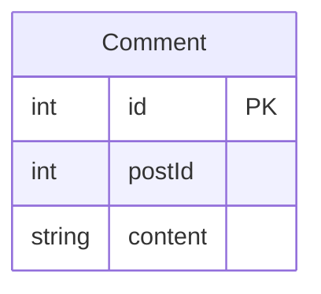
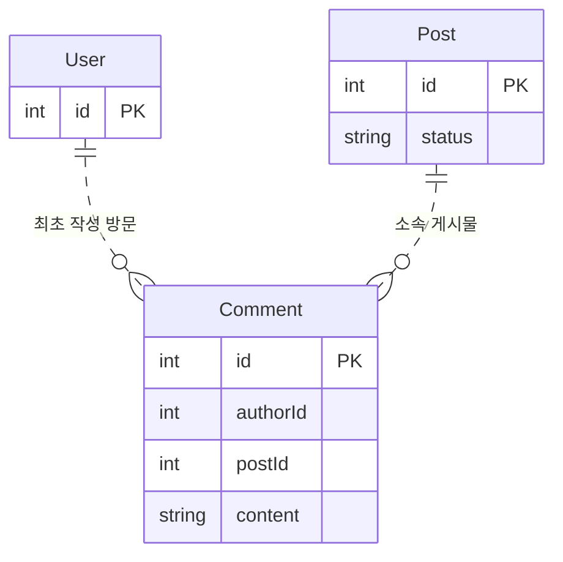
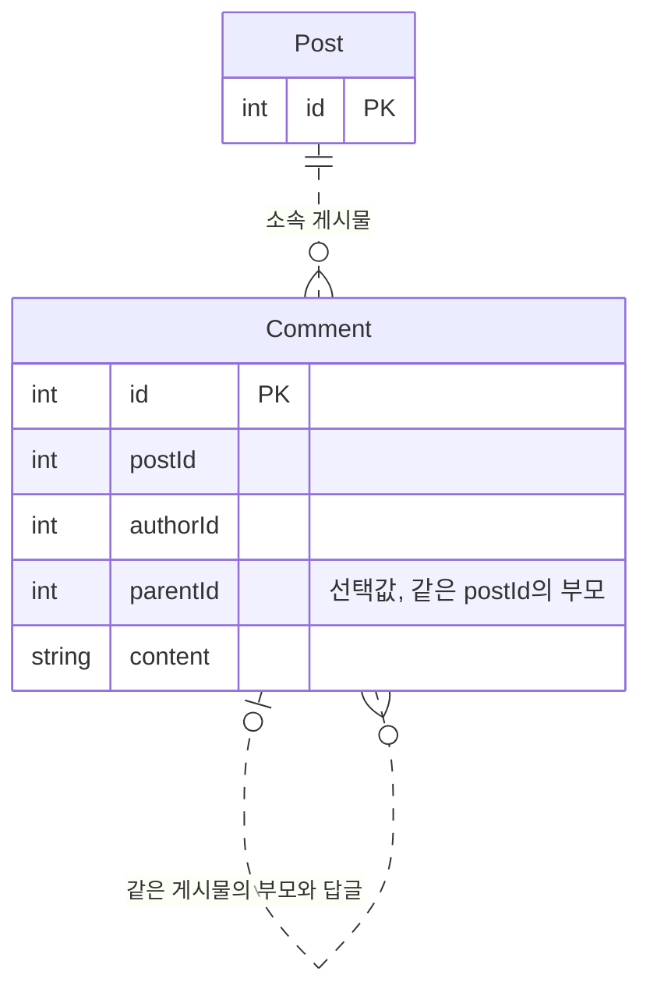
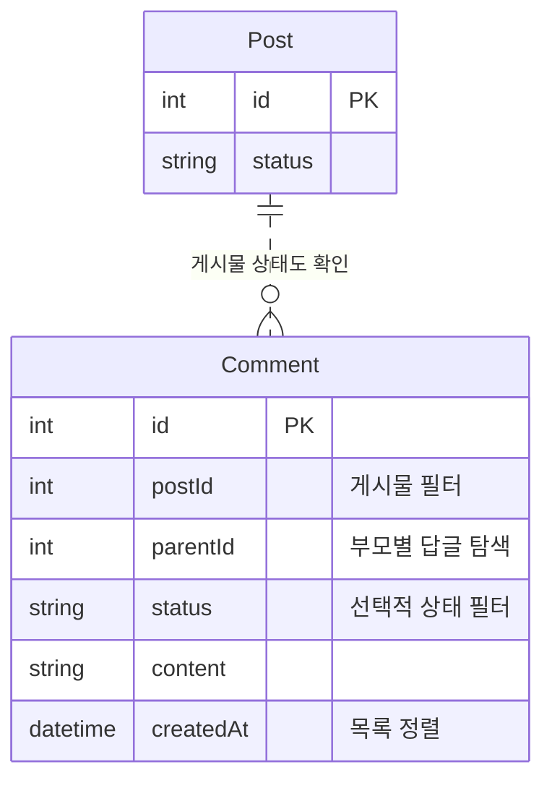
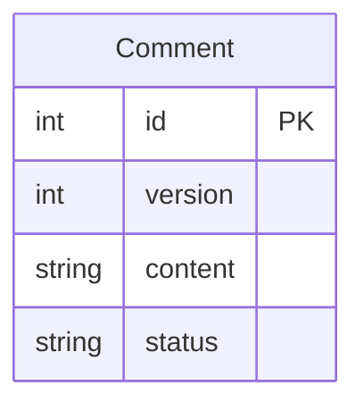
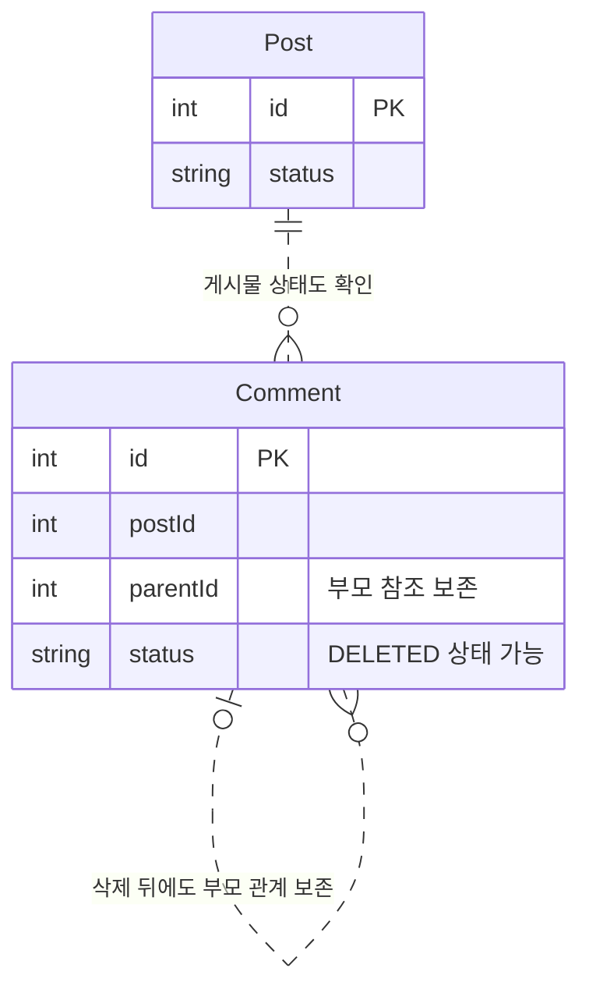
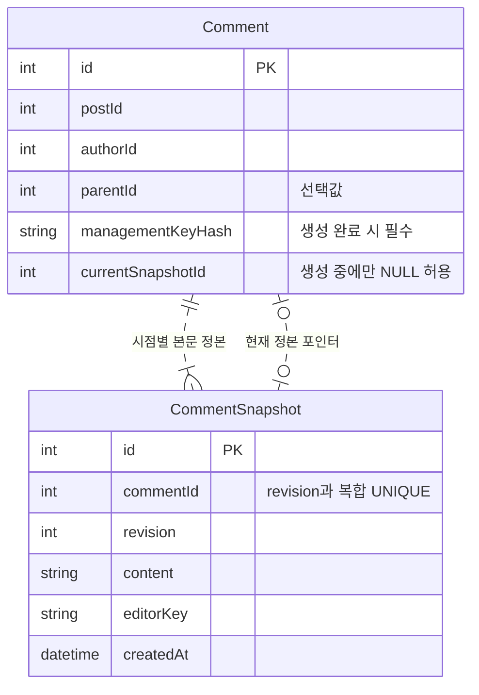
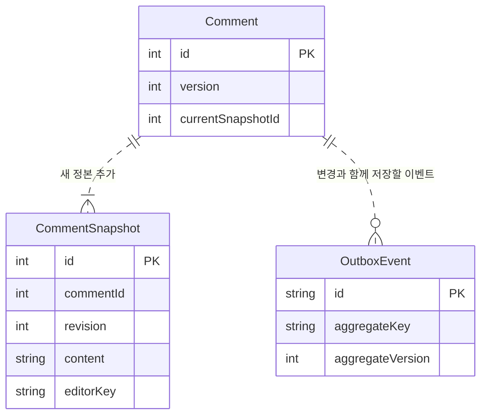
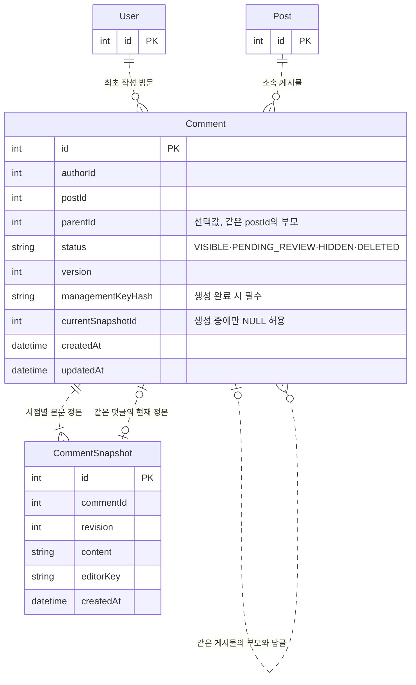

# 3. 댓글 관리 테이블

댓글은 게시물에 속하고 최초 작성 방문을 기록합니다. 먼저 소속·대댓글·조회·수정·삭제를 설계합니다. 과거 본문을 모두 다시 읽어야 할 때 수정 이력을 추가합니다.

기본 절의 그림은 본문을 Comment 한 행에 둔 학습용 출발점입니다. 최종 스키마의 CommentSnapshot 구조를 변경한다는 뜻은 아닙니다. 공통 변경 원리는 [게시물 관리](post-management.md#변경의-일관성)에서 설명합니다.

- [출발 구조](#출발-구조)
- [게시물·작성 방문과의 관계](#게시물작성-방문과의-관계)
- [대댓글의 부모 관계](#대댓글의-부모-관계)
- [댓글 목록과 조회 순서](#댓글-목록과-조회-순서)
- [수정·삭제와 대화 보존](#수정삭제와-대화-보존)
- [댓글 수정 이력](#댓글-수정-이력)
- [정리](#정리)

## 출발 구조

다음 그림은 본문과 소속 게시물 ID만 둔 시작점입니다. 작성자 관계, 변경 이력, 댓글 상태는 생략했습니다. 이 구조만으로는 그 값들을 확인하거나 보존할 수 없습니다.

## 게시물·작성 방문과의 관계

교육 과제의 기본 작성 관계를 다루는 절입니다.

1. [기본] 존재하지 않는 게시물에도 댓글이 연결될 수 있을까요?

게시물이 삭제되거나 요청에 잘못된 ID가 들어오면 댓글의 `postId`는 존재하지 않는 게시물을 가리킬 수 있습니다. 숫자 컬럼은 ID를 저장할 뿐, 대상의 존재나 댓글 작성 허용 상태를 확인하지 않습니다.

댓글은 최초 작성 방문과 소속 게시물을 기록합니다. 작성 뒤 다른 방문이나 게시물로 옮기면 작성 이력과 소속이 달라집니다. 그러므로 `authorId`와 `postId`는 생성할 때 정하고 변경하지 않는 설계입니다.

DB의 논리 관계는 참조 대상을 표현합니다. 물리 FK는 사용하지 않습니다. 서비스는 작성 방문과 게시물의 존재, 게시물 상태, 올바른 연결을 확인해야 합니다.

## 대댓글의 부모 관계

대댓글은 교육 과제의 선택 요구입니다. 답글 기능이 있을 때 자기참조 관계를 추가합니다.

2. [기본] 대댓글의 부모가 다른 게시물에 속하면요?

게시물 10의 댓글에 게시물 20의 댓글을 부모로 연결하면, 답글은 다른 대화에 붙습니다. 부모 ID가 실제로 존재하는지만 확인해서는 이 오류를 막지 못합니다.

`parentId`가 NULL이면 일반 댓글입니다. 값이 있으면 대댓글입니다. 부모와 답글은 같은 `postId`를 가져야 합니다. Comment의 자기참조(self-reference)는 별도 부모 테이블 없이 이 관계를 표현합니다.

스키마는 `(id, postId)`를 UNIQUE로 두고 `(parentId, postId)`를 인덱싱합니다. 복합 논리 관계는 부모와 답글을 비교할 기준입니다. 물리 FK가 이 조건을 강제하지는 않습니다. 서비스는 부모의 존재와 게시물 일치, 자기 자신을 부모로 두지 않는 조건을 확인해야 합니다. 최초 작성 방문, 부모, 게시물 소속은 생성 뒤 바꾸지 않습니다.

다음 그림은 한 게시물 안의 부모와 답글만 연결하는 관계를 보여줍니다.

## 댓글 목록과 조회 순서

3. [기본] 게시물별 댓글과 부모별 답글은 어떻게 읽을까요?

게시물 하나의 댓글을 시간순으로 읽는다고 가정해 보세요. `postId`로 댓글 범위를 좁히고 `createdAt`으로 정렬합니다. 같은 시각에 생성된 댓글도 순서를 정하려면 `id`를 정렬 기준에 추가합니다.

상태별 목록은 `status` 조건도 사용합니다. 그래서 게시물과 생성 시각으로 읽는 인덱스와 게시물·상태·생성 시각으로 읽는 인덱스는 별도 요구입니다.

| 조회 요구 | 스키마 인덱스 |
| --- | --- |
| 게시물별 시간순 댓글 | `(postId, createdAt, id)` |
| 게시물·상태별 시간순 댓글 | `(postId, status, createdAt, id)` |
| 부모별 답글 탐색 | `(parentId, postId)` |

인덱스는 조건에 맞는 행을 찾는 비용을 줄이기 위한 구조입니다. 인덱스만으로 댓글의 존재, 소유자, 노출 권한을 확인하지 않습니다. 서비스는 댓글·게시물의 상태를 확인하고 노출 여부를 정해야 합니다. 공통 조회 원리는 [조회와 인덱스 설계](post-management.md#조회와-인덱스-설계)를 따릅니다.

## 수정·삭제와 대화 보존

4. [기본] 두 요청이 같은 댓글을 동시에 고치면요?

두 요청이 `version=4`인 댓글을 읽고 서로 다른 본문을 저장한다고 생각해 보세요. 한 요청이 먼저 저장해도 다른 요청은 같은 이전 버전을 기준으로 합니다. 뒤 요청이 앞선 내용을 덮으면 한 수정이 사라질 수 있습니다. 이를 갱신 손실(lost update)이라고 합니다.

| 요청 | 읽은 버전 | 저장하려는 본문 |
| --- | --- | --- |
| A | 4 | 본문 A |
| B | 4 | 본문 B |

`Comment.version`은 충돌을 구분하는 기준입니다. 버전 비교는 어떤 변경이 오래된 기준에서 시작했는지 식별합니다. 이 비교만으로 여러 행의 저장을 원자적으로 만들지는 않습니다.

현재 본문과 변경 버전은 함께 저장해야 합니다. 서비스는 해당 변경을 한 DB 트랜잭션에 묶어야 합니다. 버전 비교는 동시 충돌을 다루고 트랜잭션은 부분 저장을 다룹니다. 상세 원리는 [변경의 일관성](post-management.md#변경의-일관성)을 참고합니다.

5. [기본] 부모 댓글을 삭제하면 답글의 부모도 지워야 할까요?

부모 행을 물리 삭제하면 답글에서 대화의 맥락을 잃을 수 있습니다. 부모 본문을 숨기는 일과 답글 관계를 지우는 일은 다릅니다.

이 설계는 일반 삭제를 `DELETED` 상태로 표현합니다. 댓글 행과 부모 관계를 보존하며 자동 연쇄 삭제를 전제로 하지 않습니다. 게시물이 숨겨지거나 댓글이 삭제된 경우 서비스가 게시물·댓글의 상태를 함께 확인해 노출을 정해야 합니다.

수정 이력이나 신고 증거도 남겨야 한다면 각각의 보존 요구를 따릅니다. 독립 증거는 [신고 관리](report-management.md#신고-증거의-보존과-저장-방식)에서 설명합니다.

## 댓글 수정 이력

신고 순간만 보존한다면 독립 증거 복사도 선택지입니다. 전체 이력은 별도 요구입니다.

6. [확장] 댓글을 수정해도 이전 내용을 확인하려면요?

본문을 한 행에 덮어쓰면 이전 내용을 다시 읽을 수 없습니다. 댓글의 전체 수정 이력을 다시 읽어야 한다면, 댓글 정보와 시점별 본문을 분리해야 합니다. 신고 순간의 내용만 보존하면 된다면 [신고 관리](report-management.md)의 독립 증거 복사가 별도 선택지입니다.

이 저장소는 `Comment`와 `CommentSnapshot`을 분리한 구조를 선택했습니다. `Comment`는 최초 작성자, 게시물, 부모, 상태, 버전, 현재 정본 포인터를 저장합니다. `CommentSnapshot`은 댓글 본문을 개정별로 저장합니다. 수정할 때 새 정본을 추가하고 기존 정본은 수정하거나 삭제하지 않는 설계입니다. `(commentId, revision)`은 댓글 안에서 유일합니다.

`authorId`는 최초 작성 방문입니다. `editorKey`는 각 정본을 실제 작성하거나 수정한 방문의 논리 키입니다. `managementKeyHash`는 댓글 관리 키의 해시입니다. 세 값은 서로 다른 역할을 합니다.

댓글을 만드는 동안에는 `currentSnapshotId`와 `managementKeyHash`가 NULL일 수 있습니다. 생성 트랜잭션이 끝날 때 두 값과 최소 한 개의 정본이 있어야 합니다. 현재 포인터가 같은 댓글의 최신 정본을 가리키는지 서비스가 확인합니다. DB의 UNIQUE 제약은 댓글별 개정 번호와 정본 ID의 중복을 막습니다.

7. [확장] 댓글 이력을 추가하면 함께 저장하고 보존할 것은 무엇일까요?

새 정본·현재 포인터·댓글 메타데이터는 함께 저장해야 합니다. 일부만 남으면 현재 내용과 이력이 어긋날 수 있습니다.

별도 후속 작업이 필요할 때만 Outbox 도입을 검토합니다. 이 저장소가 선택한 구조에서는 서비스가 새 정본·현재 포인터·댓글 메타데이터·OutboxEvent를 같은 DB 트랜잭션에 저장해야 합니다. 트랜잭션은 해당 DB 변경 묶음의 부분 저장을 막는 범위입니다. 외부 후속 효과까지 보장하지는 않습니다.

일반 삭제 뒤에도 댓글 행·부모 관계·정본 이력을 보존합니다. 이전 정본을 없애면 과거 내용을 댓글 이력에서 확인할 수 없습니다. 신고 당시 내용은 원본 댓글과 별도로 복사하는 증거입니다.

후속 작업을 도입하는 이유는 [별도 후속 작업의 도입 조건](request-failure-management.md#별도-후속-작업의-도입-조건)에서 설명합니다. 다음 그림은 이력과 후속 작업까지 선택한 경우의 구조입니다. 실제 원자 저장이나 작업 실행이 구현되었다는 뜻은 아닙니다.

## 정리

- `authorId`, `postId`, `parentId`는 최초 작성 방문, 게시물, 부모 댓글의 논리 참조입니다. 생성 뒤 바꾸지 않습니다.
- `parentId`가 있으면 부모와 답글은 같은 게시물에 속해야 합니다. 서비스가 존재와 일치를 확인합니다.
- `Comment`는 메타데이터를 저장합니다. `CommentSnapshot`은 불변 본문 이력을 저장합니다.
- 생성 중 `managementKeyHash`와 `currentSnapshotId`는 NULL일 수 있습니다. 생성 완료 시 관리 키 해시, 최소 정본, 최신 정본 포인터가 필요합니다.
- 버전 비교는 충돌을 구분합니다. 트랜잭션은 함께 저장할 DB 변경의 부분 기록을 막습니다.
- 삭제 상태에서도 부모 관계와 정본을 보존합니다. 노출 여부와 삭제의 동시성은 관계 선언만으로 보장되지 않습니다.

### 최종 테이블 구조

다음 그림은 댓글 관련 전체 컬럼과 논리 관계를 보여줍니다. 질문별 그림에서 생략한 컬럼도 포함합니다. 다른 문서의 테이블은 참조 키만 표시합니다.

스키마의 키와 인덱스는 다음과 같습니다. UNIQUE는 중복을 막는 DB 제약입니다. 인덱스는 조회 조건을 위한 구조입니다. 관계 존재와 소유자 일치는 서비스가 확인합니다.

| 테이블 | PK·UNIQUE | 인덱스 |
| --- | --- | --- |
| Comment | `id`, `(id, postId)`, `(id, currentSnapshotId)` | `authorId`, `(postId, createdAt, id)`, `(postId, status, createdAt, id)`, `(parentId, postId)` |
| CommentSnapshot | `id`, `(commentId, revision)`, `(commentId, id)` | 없음 |

모든 관계선은 물리 FK가 아닌 논리 관계입니다. 컬럼과 데이터 흐름은 [Comment](../erd.md#comments)와 [CommentSnapshot](../erd.md#comment_snapshots)에서 확인합니다. 신고 당시 내용의 보존은 [신고 관리](report-management.md), 공통 참조와 삭제 기준은 [관계 무결성과 삭제](post-management.md#관계-무결성과-삭제)에서 설명합니다.
