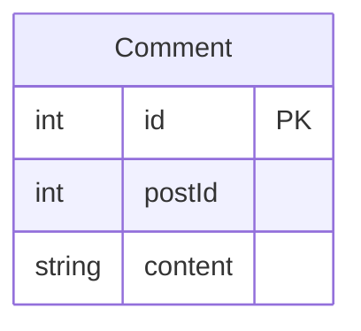
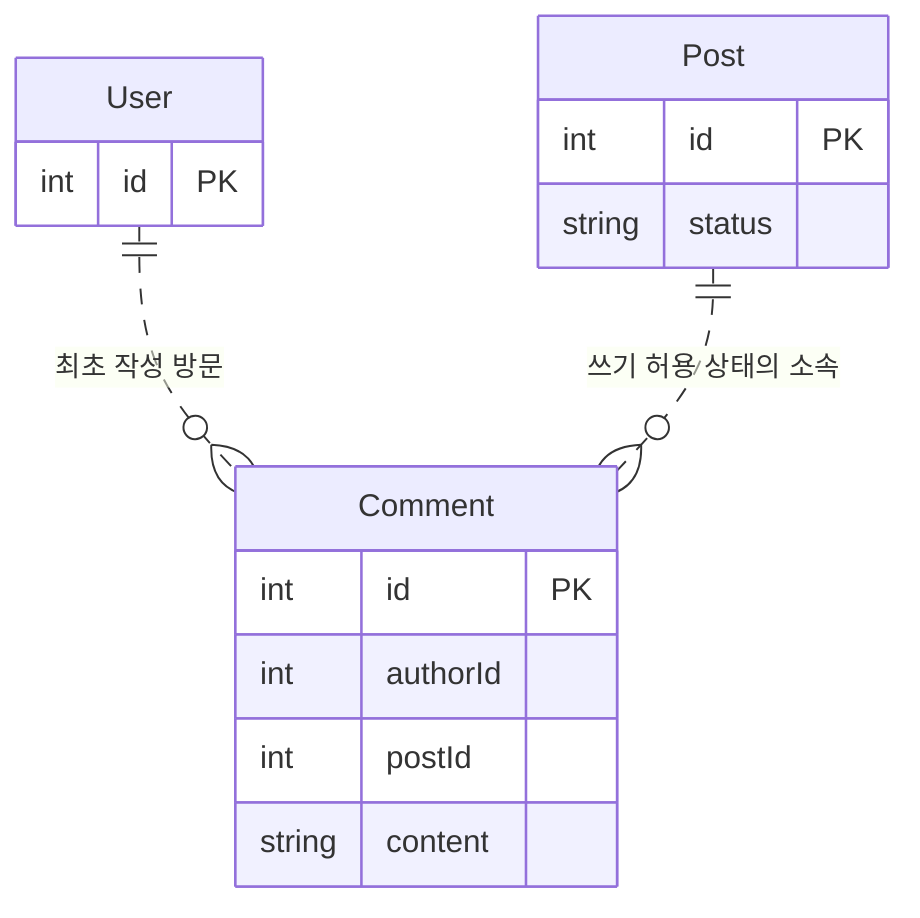
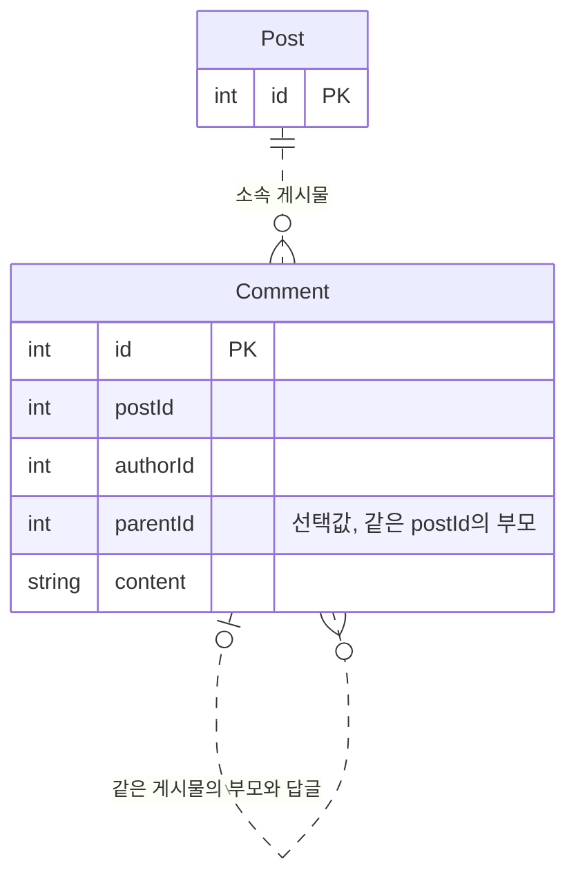
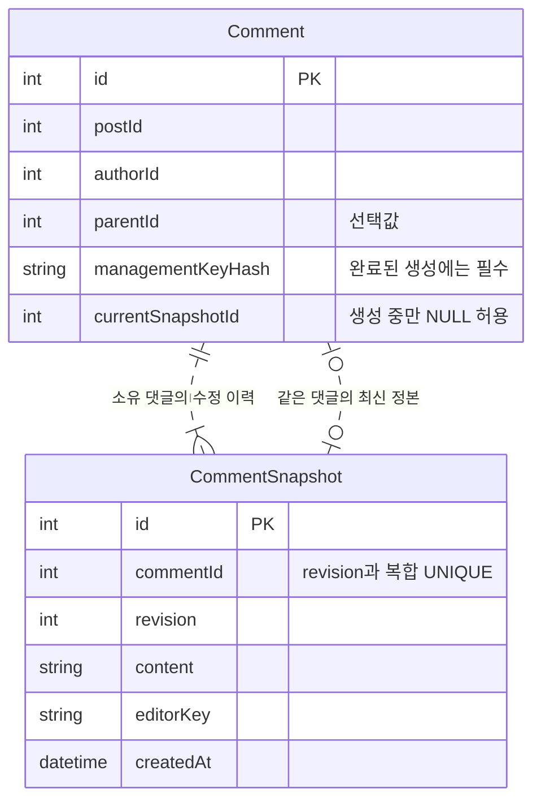
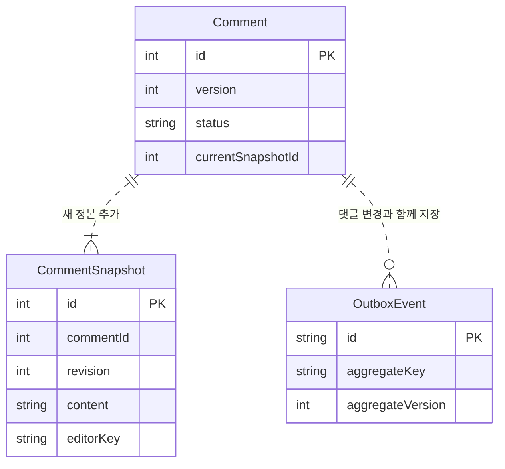
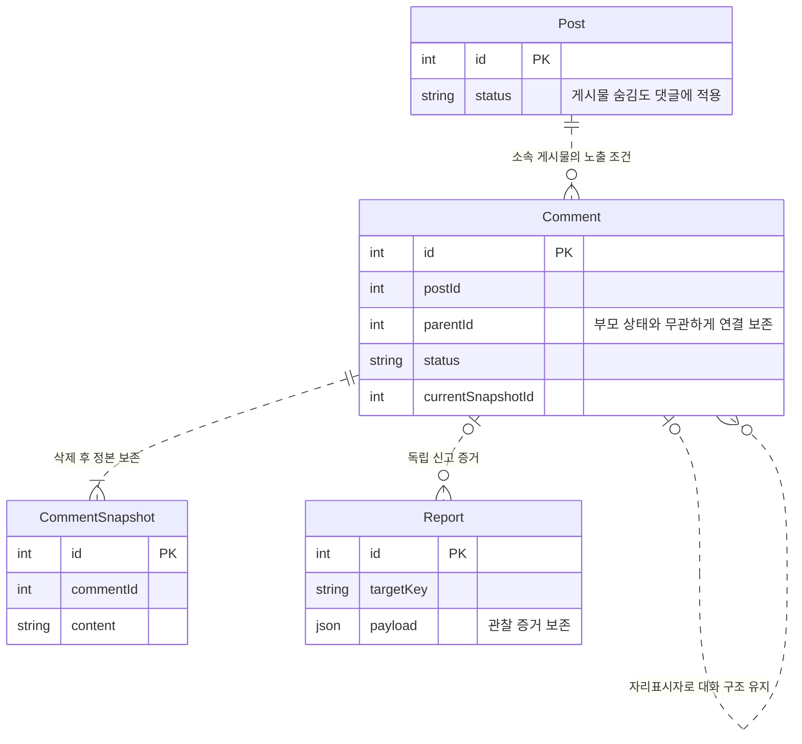
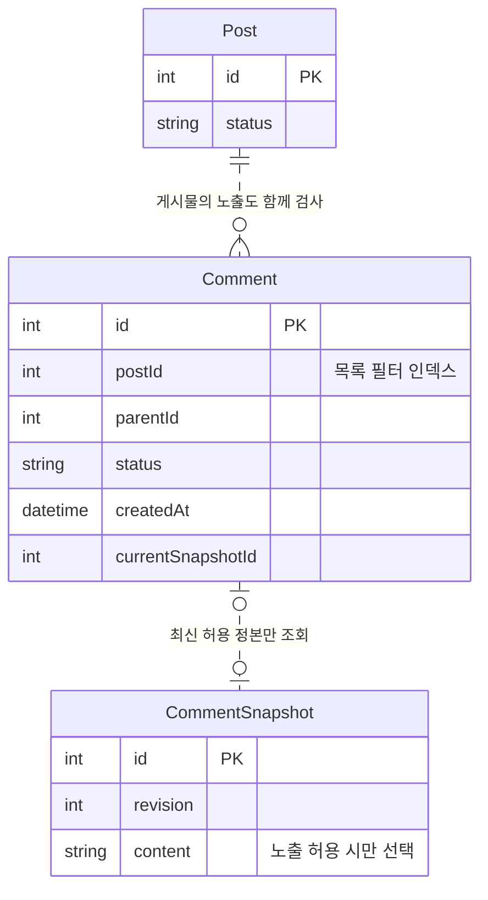
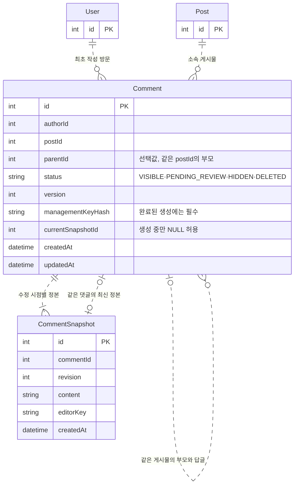

# 3. 댓글 관리 테이블

댓글은 게시물과 작성자를 참조하는 구조에서 시작해요. 대댓글·수정 이력·삭제를 추가하면 어떤 관계와 제약이 필요해질까요? 수정 이력과 버전의 기본 개념은 [게시물 관리](post-management.md#게시물-변경-설계)를 이어받아요.

- [출발 구조](#출발-구조)
- [댓글 관계와 변경](#댓글-관계와-변경)
- [댓글 조회와 인덱스](#댓글-조회와-인덱스)
- [정리](#정리)

## 출발 구조

다음 그림은 본문과 소속 게시물 ID만 가진 출발 구조예요. 최종 스키마는 아니에요. 이 설계에서 댓글은 텍스트 본문만 다루고 첨부·렌더 구조는 추가하지 않아요.

## 댓글 관계와 변경

1. [과제] 존재하지 않는 게시물에도 댓글이 연결될 수 있을까요?

Comment.postId는 댓글이 속한 게시물을 가리켜요. 숫자 컬럼만 둔다고 실제 게시물의 존재까지 보장되지는 않아요. Post와의 관계를 표현하고 참조를 검사할 주체도 정해야 해요.

최초 작성 방문은 authorId에 따로 남겨요. 소속 게시물과 최초 작성 방문은 댓글의 정체성을 이루므로, 생성 뒤 임의로 다른 대상으로 옮기지 않는 설계예요.

**설계 포인트:** 관계선·참조 컬럼·인덱스와 함께 존재·소속을 누가 검사할지 정해요. 이 저장소의 관계선은 물리 FK가 아닌 논리 관계입니다.

2. [과제] 대댓글의 부모가 다른 게시물에 속한 댓글이면요?

parentId가 NULL이면 일반 댓글이고, 값이 있으면 대댓글이에요. 별도 대댓글 테이블 대신 Comment가 같은 테이블을 참조하는 자기참조(self-referencing)로 표현할 수 있어요.

하지만 부모 ID가 존재하는지만 확인하면 다른 게시물의 댓글에 답글이 연결될 수 있어요. 부모와 자식의 postId가 같은지도 확인해야 해요. 자기 자신을 부모로 두거나 순환 구조가 생기는 것도 고려해야 해요.

**설계 포인트:** 부모의 ID뿐 아니라 같은 게시물에 속한다는 조건도 표현해요. 복합 키는 함께 비교할 기준을 제공하지만, 이 설계의 실제 소속 검사는 서비스가 맡아요.

3. [실무 기본] 댓글을 수정해도 이전 내용을 확인하려면요?

본문을 덮어쓰면 신고자가 읽었던 내용을 다시 확인할 수 없어요. 이전 내용이 필요한 요구라면 본문을 CommentSnapshot으로 분리해 개정마다 새 행을 저장할 수 있어요.

**Comment는 댓글의 메타데이터, CommentSnapshot은 시점별 본문입니다.** currentSnapshotId는 그 이력 중 현재 내용을 가리켜요. 스냅샷에는 실제 작성·수정 방문을 남기고 최초 authorId와 구분해요.

콘텐츠별 관리 키도 방문 식별과 별개의 역할이에요. 최초 작성 방문이 아니라 새 방문에서 수정하더라도, 최초 작성 기록까지 바꾸는 구조는 아니에요.

**설계 포인트:** 이력의 소유 댓글·개정 번호·현재 포인터와 실제 수정자를 나눠 표현해요.

4. [실무 기본] 두 요청이 동시에 같은 댓글을 고치면요?

두 요청이 같은 내용을 읽고 저장하면 나중 수정이 앞선 수정을 덮어쓸 수 있어요. 이를 갱신 손실(lost update)이라고 해요. Comment.version으로 어떤 변경을 기준으로 수정했는지 비교할 수 있어요.

새 스냅샷만 저장되거나 현재 포인터만 바뀌어도 문제가 생겨요. 정본·포인터·버전처럼 함께 일관돼야 하는 데이터는 한 트랜잭션으로 묶어야 해요. 후속 작업이 필요하다면 같은 변경의 OutboxEvent도 함께 고려해요.

**설계 포인트:** 버전은 충돌을 구분하고 트랜잭션은 변경 묶음의 일부만 남는 일을 막아요. 자세한 이유는 [게시물 변경 설계](post-management.md#게시물-변경-설계)와 [요청 실패 관리](request-failure-management.md)에서 살펴봐요.

5. [실무 기본] 부모 댓글이 삭제되면 답글도 함께 지워야 할까요?

부모의 본문을 없애면서 답글까지 지우면 대화의 연결을 잃어요. 그래서 일반 삭제는 DELETED 상태로 표현하고 parentId와 이력을 남기는 방식을 택했어요. 이런 방식을 소프트 삭제(soft delete)라고 해요.

부모의 본문을 숨기는 것과 답글 관계를 유지하는 것은 다른 문제예요. 소속 게시물이 숨겨졌을 때 댓글도 노출할지, 부모가 사라졌을 때 답글의 맥락을 어떻게 남길지 함께 고려해야 해요.

**설계 포인트:** 상태 변경과 물리 삭제를 구분해요. 자동 연쇄 삭제가 대화 구조와 신고 증거를 잃게 하는지 먼저 확인해요.

## 댓글 조회와 인덱스

6. [실무 기본] 게시물별 댓글 목록에는 어떤 인덱스가 필요할까요?

인덱스는 관계가 있다는 이유만으로 정하지 않아요. 어떤 값으로 범위를 좁히고 어떤 순서로 읽을지 먼저 생각해야 해요.

| 조회 요구 | 고려할 인덱스 |
| --- | --- |
| 게시물별 시간순 댓글 | (postId, createdAt, id) |
| 게시물·상태별 시간순 댓글 | (postId, status, createdAt, id) |

같은 시각의 댓글을 구분하려면 createdAt과 id를 함께 정렬 기준으로 사용할 수 있어요. 부모별 답글을 찾을 인덱스도 필요해요. 부모·게시물의 상태까지 읽어야 한다면 필요한 관계와 조회 범위를 함께 고려해요.

**설계 포인트:** 필터·정렬·관계 탐색이 인덱스의 출발점이에요. 공통 개념은 [조회와 인덱스 설계](post-management.md#조회와-인덱스-설계)를 따라요.

## 정리

- **소속과 자기참조:** 부모 댓글은 같은 게시물에 속해야 해요.
- **메타데이터와 이력:** Comment와 CommentSnapshot의 역할을 나눠요.
- **충돌과 원자성:** 버전 비교와 변경 묶음의 저장은 서로 다른 보장이에요.
- **대화 구조 보존:** 부모 삭제가 답글의 관계까지 지우는지 고려해요.
- **한계:** 관계 선언만으로 권한이나 삭제의 동시성이 보장되지는 않아요.

### 최종 테이블 구조

다음 그림은 이 문서에서 다룬 테이블의 전체 컬럼과 논리 관계예요. 질문별 그림에서 생략한 컬럼도 모두 포함했고, 다른 문서의 테이블은 참조 키만 표시했어요.

키와 인덱스는 다음과 같아요.

| 테이블 | PK·UNIQUE | 인덱스 |
| --- | --- | --- |
| Comment | id, (id, postId), (id, currentSnapshotId) | authorId, (postId, createdAt, id), (postId, status, createdAt, id), (parentId, postId) |
| CommentSnapshot | id, (commentId, revision), (commentId, id) | - |

컬럼 설명과 데이터 흐름은 [Comment](../erd.md#comments)·[CommentSnapshot](../erd.md#comment_snapshots)에서 확인해요. 신고 당시 내용의 보존은 [신고 관리](report-management.md), 참조와 삭제는 [관계 무결성과 삭제](post-management.md#관계-무결성과-삭제)에서 설명해요.
