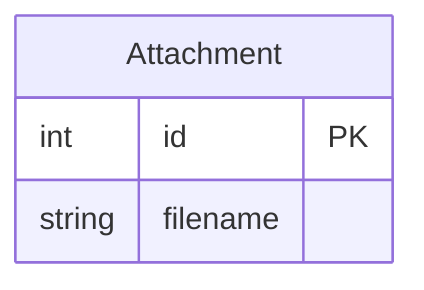
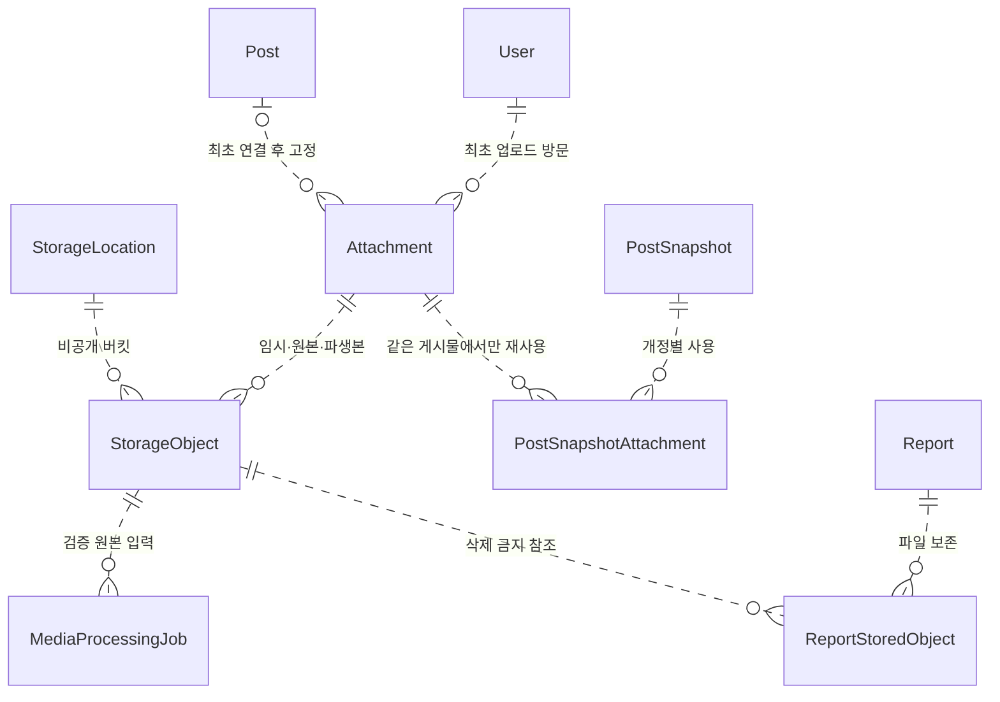
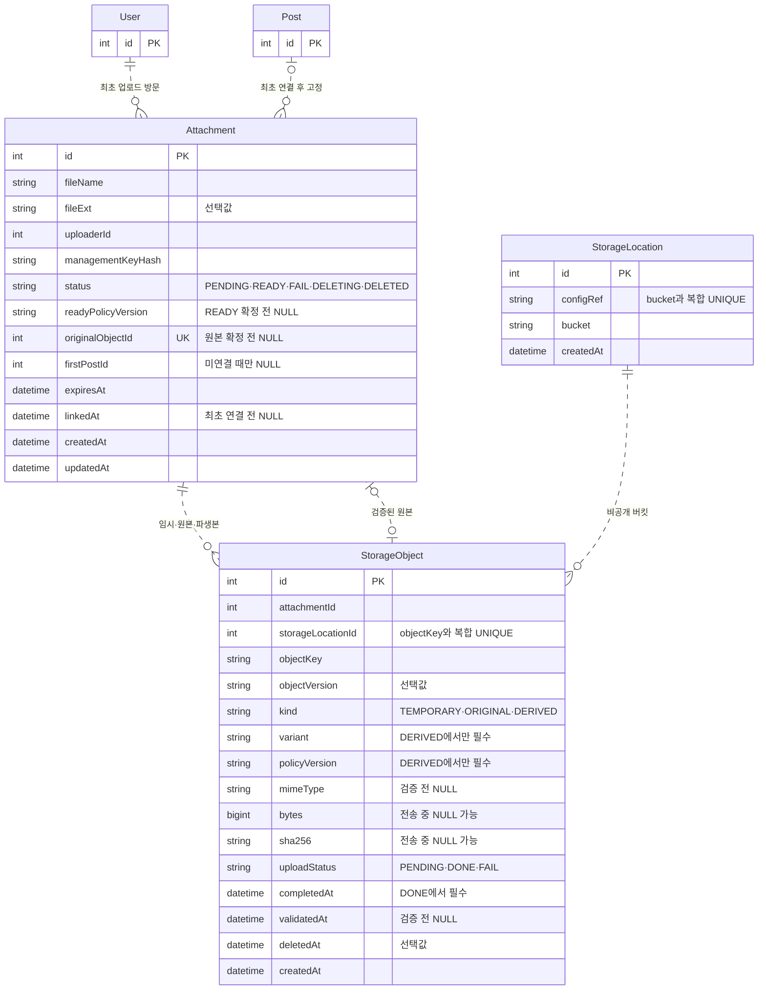

# 6. 파일 관리 테이블

회의사진.jpg를 게시물에 첨부한다고 생각해 봐요. 사람이 보는 이름, 바이트가 저장되는 위치, 게시물과의 연결은 같은 정보일까요? 이 문서는 파일의 역할을 나누고 준비 상태·관계·보존을 ERD로 표현할 때 고려할 점을 설명해요.

- [출발 구조](#출발-구조)
- [파일 메타데이터와 저장 위치](#파일-메타데이터와-저장-위치)
- [업로드와 사용 준비](#업로드와-사용-준비)
- [파일 접근과 보존](#파일-접근과-보존)
- [정리](#정리)

## 출발 구조

파일 번호와 표시명만 저장하는 구조부터 시작해요. 이 두 값만으로는 바이트의 저장 위치나 게시물의 사용 관계를 알 수 없어요. 다음 그림은 최종 스키마가 아니라 역할을 나누기 전의 최소 구조예요.

## 파일 메타데이터와 저장 위치

1. [실무 기본] 파일명·저장 키·접근 주소는 같은 값일까요?

파일명은 사람이 보는 표시 정보예요. 같은 이름을 다시 업로드해도 다른 파일일 수 있으므로 저장소의 식별 키와 분리해야 해요. 접근 주소도 파일을 찾는 방법이지 소유권을 나타내는 값은 아니에요.

**DB는 메타데이터와 관계를, 스토리지는 실제 바이트를 관리합니다.** 이 설계는 비공개 S3 호환 저장소를 사용하고, NAS와 댓글 첨부는 범위에 넣지 않았어요.

| 모델 | 설계상 역할 |
| --- | --- |
| Attachment | 파일명·업로드 방문·관리 키·준비 상태·최초 연결 게시물 |
| StorageLocation | 저장소 설정 참조와 버킷 |
| StorageObject | 저장 키·객체 버전·원본 또는 파생 역할·크기·해시 |
| PostSnapshotAttachment | 개정과 첨부의 사용 관계 |
| MediaProcessingJob | 원본을 가공하는 작업과 선택 결과 |
| PostSnapshotRender | 개정별 가공된 표시 결과 |
| ReportStoredObject | 신고 증거가 사용하는 객체의 보존 참조 |

파일명이나 확장자를 실제 파일 형식의 증거로 취급하지 않아요. 저장 키를 바꾸거나 재사용하면 과거 개정·신고가 다른 바이트를 가리킬 수도 있어요. 그래서 (storageLocationId, objectKey)의 중복 방지와 키·버전의 불변성을 고려해요.

다음 그림은 파일 바이트가 아니라 메타데이터의 논리 관계예요.

## 업로드와 사용 준비

2. [실무 기본] 전송이 끝난 파일은 곧바로 사용할 수 있을까요?

전송이 끝났다고 실제 파일 형식이나 표시용 파생본까지 준비된 것은 아니에요. 하나의 완료 상태로 묶으면 무엇이 끝났는지 알기 어려워져요.

이 설계는 StorageObject.uploadStatus와 Attachment.status를 나눠요. 전자는 객체 전송의 상태이고, 후자는 첨부 전체의 사용 준비 상태예요. READY에 필요한 원본·파생본·검증 정보가 무엇인지도 먼저 정해야 해요.

| 구분 | ERD에서 표현할 내용 |
| --- | --- |
| 준비 전 | 아직 확정하지 않은 원본 포인터·검증 정보는 NULL 가능 |
| 원본 확정 | 같은 Attachment에 속한 ORIGINAL 객체 선택 |
| 사용 준비 | 필요한 원본·가공 결과와 준비 정책 버전 연결 |
| 최초 게시물 연결 | firstPostId·linkedAt으로 연결 대상을 기록 |
| 정리 중 | 새 연결이나 결과 선택과 충돌하지 않게 상태 구분 |

최초 연결 전과 연결 후의 소유·관리 범위도 다를 수 있어요. 이 설계는 같은 첨부를 같은 게시물의 여러 개정에서 재사용하지만, 다른 게시물로 옮기지는 않아요.

**설계 포인트:** 객체 한 개의 전송 완료와 첨부 전체의 사용 준비를 구분해요. 선택 포인터의 소유자가 같은지도 서비스가 검사해야 해요.

3. [심화] 이미지와 영상의 원본과 표시용 파일을 나누려면요?

원본은 다운로드나 증거 보존에 필요하고, 화면 표시에는 축소 이미지나 변환 영상이 필요할 수 있어요. 하나의 행을 덮어쓰면 원본이나 이전 결과를 잃게 돼요. 그래서 각각을 독립 StorageObject로 저장해요.

kind는 임시·원본·파생본의 역할을 구분하고 variant는 파생 종류를 나타내요. 어떤 정책으로 만든 결과인지도 남기면 정책 변경 전후의 결과를 구분할 수 있어요.

**설계 포인트:** 변환 요구가 없다면 작업 테이블부터 추가하지 않아요. 요구가 있다면 원본·변환 종류·정책별 작업과 결과를 연결해요. 중복 작업과 재처리는 [파일 변환 작업의 저장](request-failure-management.md#파일-변환-작업의-저장)에서 살펴봐요.

## 파일 접근과 보존

4. [실무 기본] 글을 숨겨도 첨부 주소만 알면 파일을 열 수 있을까요?

첨부 주소가 있다고 공개 가능한 파일인 것은 아니에요. 현재 게시물의 상태와 사용 개정, 파일 소유 관계를 함께 고려해야 해요. 비공개 저장소를 쓰더라도 DB의 관계선만으로 접근 권한이 적용되지는 않아요.

| 판단 대상 | 필요한 관계 |
| --- | --- |
| 현재 게시물의 첨부 | 현재 스냅샷과 PostSnapshotAttachment |
| 과거 개정의 첨부 | 해당 스냅샷의 사용 관계와 게시물 |
| 신고 파일 증거 | ReportStoredObject에 남긴 보존 객체 |

**설계 포인트:** 보존할 파일과 공개할 파일은 같은 집합이 아닐 수 있어요. 파일이 남아 있어도 현재 노출과 접근 권한은 서비스가 판단해야 해요. 이미 전달된 바이트까지 회수할 수 있다고 보장할 수는 없어요.

5. [실무 기본] 본문에서 첨부를 뺐다면 바로 지워도 될까요?

현재 본문에서 빠진 파일도 과거 개정이나 신고가 참조할 수 있어요. Attachment가 한 번이라도 사용됐다는 정보와 개정마다 어떤 첨부를 사용했는지를 모두 살펴봐야 해요.

미완료·미연결 업로드는 만료 시각으로 정리 후보를 찾을 수 있어요. 하지만 만료만 확인해서 지우면 동시에 새 연결이나 변환 결과가 생길 수 있어요. 정리 상태와 역참조를 함께 고려해야 해요.

| 정리 전 고려할 참조 | 이유 |
| --- | --- |
| 개정별 사용 관계 | 과거 본문이 사용하는 파일일 수 있음 |
| 렌더의 사용 객체 | 관찰한 표시 결과에 필요한 파일일 수 있음 |
| 신고의 보존 참조 | 증거 확인에 필요한 파일일 수 있음 |
| 작업의 선택 결과 | 이미 채택된 변환 결과일 수 있음 |

**설계 포인트:** 파일 삭제는 저장소의 바이트와 DB의 메타데이터를 함께 생각해야 해요. 연결·보존·정리가 경합하는 문제는 [관계 무결성과 삭제](post-management.md#관계-무결성과-삭제), DB 밖 작업의 한계는 [요청 실패 관리](request-failure-management.md)에서 이어서 설명해요.

## 정리

- **이름·키·주소의 분리:** 표시명, 저장 식별자, 접근 방법을 구분해요.
- **전송과 준비의 분리:** 객체 전송이 끝나도 첨부 전체가 준비된 것은 아닐 수 있어요.
- **원본과 파생본의 분리:** 가공 결과로 원본을 덮어쓰지 않아요.
- **개정별 사용 관계:** 첨부를 어느 개정이 쓰는지 조인 테이블로 남겨요.
- **보존과 접근의 분리:** 파일이 남아 있다는 사실이 공개 권한을 뜻하지는 않아요.
- **한계:** DB 관계만으로 스토리지의 가용성이나 접근 제어를 보장할 수는 없어요.

### 최종 테이블 구조

다음 그림은 이 문서에서 다룬 테이블의 전체 컬럼과 논리 관계예요. 질문별 그림에서 생략한 컬럼도 모두 포함했고, 다른 문서의 테이블은 참조 키만 표시했어요. 개정별 사용·변환 작업·신고 보존 관계는 각 담당 문서의 최종 구조에 있어요.

키와 인덱스는 다음과 같아요.

| 테이블 | PK·UNIQUE | 인덱스 |
| --- | --- | --- |
| Attachment | id, originalObjectId | uploaderId, (firstPostId, status, expiresAt, id) |
| StorageLocation | id, (configRef, bucket) | - |
| StorageObject | id, (storageLocationId, objectKey) | (attachmentId, kind), (uploadStatus, createdAt, id), (deletedAt, createdAt, id) |

컬럼 설명과 데이터 흐름은 [Attachment](../erd.md#attachments)·[StorageLocation](../erd.md#storage_locations)·[StorageObject](../erd.md#storage_objects)에서 확인해요. 개정별 연결은 [게시물 관리](post-management.md#본문과-첨부), 신고 보존은 [신고 관리](report-management.md#파일-증거와-보존)를 참고해요.
