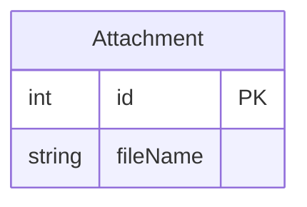
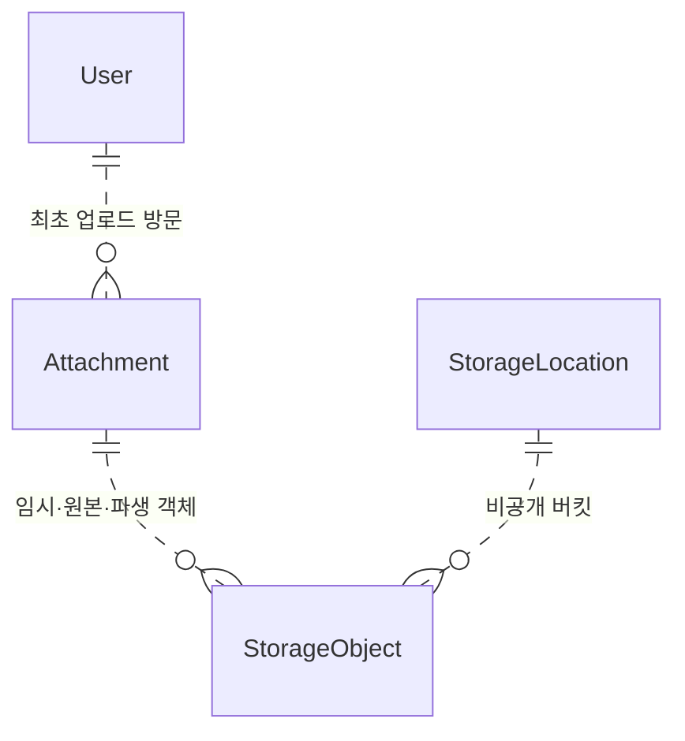
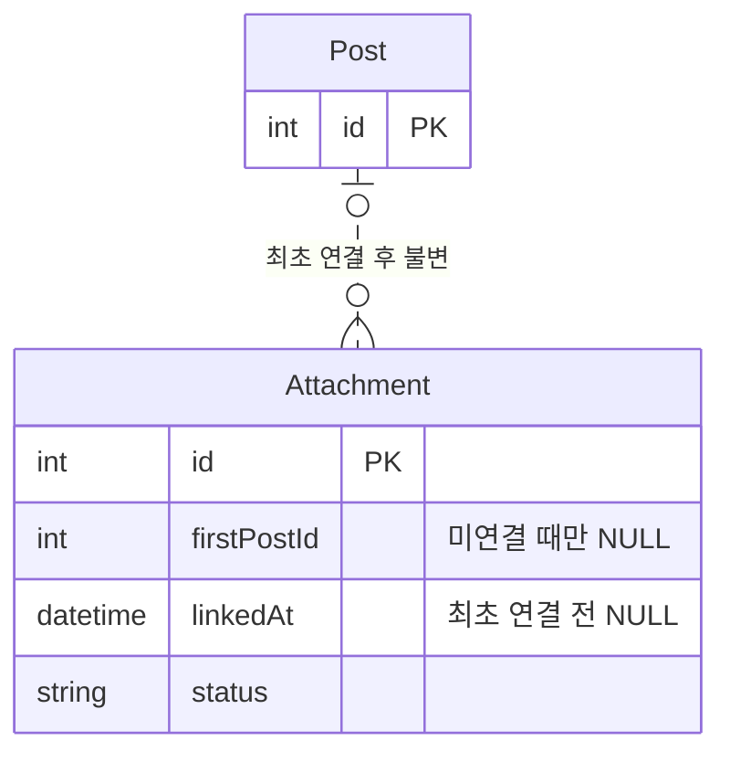
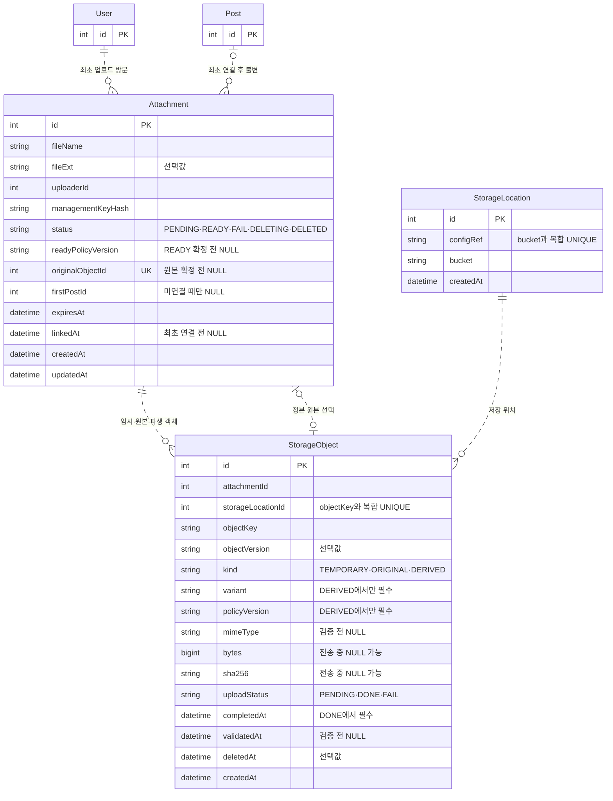

# 5. 파일 관리 테이블

게시물에 파일을 첨부하려면 표시할 이름과 실제 바이트의 위치를 구분해야 해요. 먼저 저장·검증·연결·접근·정리를 설계해요. 파생본과 과거 개정·신고의 파일 보존은 추가 요구가 있을 때 살펴봐요.

- [출발 구조](#출발-구조)
- [파일 정보와 바이트의 저장](#파일-정보와-바이트의-저장)
- [업로드와 검증](#업로드와-검증)
- [게시물 연결과 접근 권한](#게시물-연결과-접근-권한)
- [미사용 파일과 삭제 조건](#미사용-파일과-삭제-조건)
- [원본과 파생 파일](#원본과-파생-파일)
- [과거 개정과 신고의 파일 보존](#과거-개정과-신고의-파일-보존)
- [정리](#정리)

## 출발 구조

처음에는 첨부 번호와 사람이 볼 파일명만 저장할 수 있어요. 하지만 이 구조는 실제 바이트의 위치를 찾지 못해요. 게시물의 어느 개정이 파일을 사용했는지도 남기지 못해요.

다음 그림은 설명을 시작하기 위한 구조예요. 최종 테이블 구성이 아니에요.

이름을 저장하면 사용자가 올린 파일을 식별할 수 있을까요? 같은 `회의사진.jpg`를 두 번 올리면 서로 다른 바이트일 수 있어요. 파일명은 표시 정보로 남기고, 저장소 안에서 객체를 찾는 키는 따로 둬야 해요.

## 파일 정보와 바이트의 저장

1. [기본] 파일명·저장 키·접근 주소는 같은 값일까요?

같은 이름의 사진을 두 번 올렸다고 해 봐요. 파일명으로 저장 위치까지 정하면 두 번째 파일이 첫 번째 파일을 덮어쓸 수 있어요. 과거 게시물이나 신고가 가리키는 내용도 달라질 수 있어요.

그래서 DB와 스토리지가 다른 일을 맡아요. DB는 파일의 표시 정보와 관계를 저장해요. 비공개 S3 호환 스토리지는 실제 바이트를 저장해요. NAS와 댓글 첨부는 이 설계의 범위가 아니에요.

`Attachment.fileName`은 사용자가 볼 원본 파일명이에요. 선택 확장자 `fileExt`도 실제 파일 형식의 증거가 아니에요. 서비스는 바이트를 검사해 형식을 확인해요. 원본 파일명은 저장 경로에 사용하지 않아요.

저장 키는 객체를 찾는 식별자예요. 저장 위치와 키의 조합은 UNIQUE예요. 키와 선택적 객체 버전은 확정한 뒤 바꾸지 않아요. 저장 키를 덮어쓰거나 다시 사용하면 과거 기록이 다른 바이트를 가리킬 수 있기 때문이에요.

`StorageLocation`은 비밀이 아닌 설정 참조와 비공개 버킷 이름을 저장해요. 접근 비밀은 DB에 넣지 않고 외부 설정에 둬요. 참조 중인 설정이나 버킷의 의미를 바꾸지 않아요. 새 저장 위치가 필요하면 새 행을 만들어요. 실제 비공개 설정과 접근은 서비스와 운영 환경이 확인해야 해요.

이제 각 모델이 답하는 질문을 나눌 수 있어요. 앞의 세 모델은 파일 정보와 바이트의 위치를 표현해요. 나머지 모델은 게시물 사용, 변환 결과, 신고 보존을 표현하며 각 요구가 생길 때 이어서 살펴봐요.

| 모델 | 답하는 질문 |
| --- | --- |
| Attachment | 어떤 파일인가요? 누가 올렸고, 사용할 준비가 되었나요? |
| StorageLocation | 어느 설정과 비공개 버킷을 사용하나요? |
| StorageObject | 어떤 불변 객체를 그 위치에서 찾아야 하나요? |

다음 그림은 DB에 저장하는 논리 관계를 보여줘요. 선은 물리 외래 키가 아니에요. 실제 파일 바이트는 그림에 나타나지 않아요.

## 업로드와 검증

2. [기본] 전송이 끝난 파일은 곧바로 사용할 수 있을까요?

사진 전송이 중간에 끊기거나, 확장자는 JPG지만 실제 바이트는 다른 형식일 수 있어요. 전송이 끝났다는 사실만으로 게시물에 안전하게 표시할 수는 없어요.

이 설계는 객체 전송 상태와 첨부 전체의 준비 상태를 나눠요. `StorageObject.uploadStatus`는 객체 하나의 전송 상태예요. `Attachment.status`는 검증을 포함한 첨부의 준비·정리 상태예요. 먼저 파생본이 필요하지 않은 경우를 살펴봐요. 변환이 필수인 경우의 추가 완료 조건은 [원본과 파생 파일](#원본과-파생-파일)에서 설명해요.

| 상태 | 의미와 막으려는 실패 |
| --- | --- |
| `StorageObject.uploadStatus = PENDING` | 전송 중이에요. 아직 완전한 객체라고 볼 수 없어요. |
| `StorageObject.uploadStatus = DONE` | 전송이 끝났어요. 실제 형식과 사용 가능 여부는 아직 확인해야 해요. |
| `StorageObject.uploadStatus = FAIL` | 전송이 실패했어요. 이 객체를 사용 가능한 결과로 취급하지 않아요. |
| `Attachment.status = PENDING` | 사용 준비 중이에요. 기본 사례에서는 업로드와 원본 검증을 확인해요. |
| `Attachment.status = READY` | 사용에 필요한 결과를 확정했어요. 필수 파생본 요구가 있으면 그 준비도 포함해요. |
| `Attachment.status = FAIL` | 검증이 실패했어요. 변환을 요구한 경우에는 필수 변환 실패도 포함해요. |
| `Attachment.status = DELETING` | 새 연결과 작업 공개를 막고 정리 중이에요. |
| `Attachment.status = DELETED` | 객체 정리를 확인한 뒤 재사용을 막는 표식이에요. |

전송 중에는 `bytes`, `sha256`, `completedAt`이 NULL일 수 있어요. `DONE`인 객체에는 `completedAt`이 필요해요. 검증 전에는 실제 바이트로 확인한 `mimeType`과 `validatedAt`이 NULL일 수 있어요. 실제 바이트를 확인한 사용 객체에는 파일의 미디어 형식(MIME type), 양수 크기, SHA-256 해시, 완료 시각, 검증 시각이 필요해요.

`DONE`은 전송 완료만 뜻해요. 서비스는 사용을 확정하기 전에 MIME, 크기, 해시, 완료 시각, `validatedAt`을 확인해요. 실패나 불완전한 업로드를 READY 파일로 취급하지 않도록 두 상태를 구분해요.

검증한 객체 중 어느 것을 정본 원본으로 쓸지도 기록해야 해요. `Attachment.originalObjectId`는 정본을 선택하기 전까지 NULL일 수 있어요. 이 포인터는 같은 첨부에 속한 `ORIGINAL` 객체를 가리켜야 해요. DB의 선택적 UNIQUE 제약은 같은 객체를 여러 첨부의 정본으로 선택하는 일을 막아요. 포인터가 같은 첨부의 원본인지 서비스가 검사해요.

확정한 `originalObjectId`는 불변입니다. 서비스는 확정 후 포인터 변경을 거부해야 해요. UNIQUE 제약만으로 이 불변성을 강제하지는 않아요.

READY는 단순한 업로드 성공 표시가 아니에요. 기본 사례에서는 서비스가 검증한 원본을 확정해야 해요. 스키마만으로 실제 검증이나 사용 준비가 완료되지는 않아요.

## 게시물 연결과 접근 권한

3. [기본] 어느 게시물에 연결한 파일인지 어떻게 남길까요?

업로드만 하고 게시물에 연결하지 않은 파일이 있을 수 있어요. 업로드 방문과 사용 게시물은 다른 정보예요.

서비스는 최초 연결 시 `firstPostId`와 `linkedAt`을 함께 확정해야 해요. `firstPostId`는 미연결 때만 NULL이고, 확정 후에는 불변입니다. 서비스는 다른 게시물로의 연결 변경을 거부해야 해요.

이 설계는 다른 게시물로 첨부를 옮기지 않아요. 서비스는 게시물·첨부의 존재, 관리 권한, 사용 준비 상태와 본문에 쓰인 첨부의 일치를 확인해야 해요. 최초 연결을 확정하는 동안에는 새 연결과 정리의 경합도 고려해야 해요.

4. [기본] 게시물을 숨겨도 첨부 주소만 알면 파일을 열 수 있을까요?

게시물을 숨긴 뒤에도 누군가 이전 첨부 주소로 바이트를 요청할 수 있어요. 주소를 안다는 사실은 그 파일을 볼 권한을 뜻하지 않아요. DB의 논리 관계선도 접근 권한을 자동으로 적용하지 않아요.

접근 여부는 게시물의 현재 상태, 파일의 연결·소유·준비 상태를 함께 확인해야 해요. 서비스가 사용자 권한과 공개 가능 여부를 판단해요. 수정 이력을 도입했다면 사용 중인 개정도 확인해야 해요. 저장소는 비공개로 두지만, 이 스키마만으로 실제 접근 제어가 적용된다고 보장할 수는 없어요.

파일이 보존되어도 공개할 필요는 없어요. 반대로 공개를 막아도 이미 전달한 바이트를 회수할 수 있다고 보장할 수는 없어요.

## 미사용 파일과 삭제 조건

5. [기본] 미연결 파일이나 본문에서 뺀 파일을 바로 지워도 될까요?

업로드 뒤 게시물에 연결하지 않은 파일이 남을 수 있어요. 미연결 첨부는 `expiresAt`으로 정리 후보를 찾을 수 있어요. 본문에서 빠진 파일도 다른 사용이나 보존 참조가 남았는지 먼저 확인해야 해요.

만료 시각만 확인하면 충분하지 않아요. 정리 중에 새 연결이나 변환 결과가 확정될 수 있기 때문이에요. 서비스는 새 연결과 작업 공개를 막고 정리 상태를 확인해야 해요. 관계가 남아 있으면 삭제를 허용하지 않는 설계입니다.

바이트 삭제와 DB 행 삭제는 같은 작업이 아니에요. DB는 메타데이터를 저장하며 실제 바이트는 외부 스토리지에 있어요. 한쪽 삭제가 성공해도 다른 쪽은 실패할 수 있어요. DB 밖 작업의 한계는 [외부 작업과 파일 변환의 한계](request-failure-management.md#외부-작업과-파일-변환의-한계)에서 설명해요.

## 원본과 파생 파일

표시용 파일이 필요하지 않다면 원본 검증에서 멈출 수 있어요. 이 절은 변환을 요구한 경우에 추가할 구조와 완료 조건을 설명해요.

6. [확장] 원본을 유지하면서 표시용 파일도 만들려면요?

화면에 사진을 작게 표시하려고 원본을 덮어쓰면 큰 원본이나 이전 결과를 잃을 수 있어요. 원본 다운로드나 신고 증거에 원래 바이트가 필요할 수도 있어요.

변환이 필요한 경우 원본과 파생 결과를 각각 별도 `StorageObject`로 표현해요. `kind`는 임시 객체, 정본 원본, 파생 객체를 구분해요. 파생 객체는 `variant`로 이미지 축소본이나 영상 재생본 같은 종류를 나타내요. `policyVersion`은 어떤 변환 정책으로 만들었는지 구분해요.

`variant`와 `policyVersion`은 `DERIVED` 객체에서 필요하며 서비스가 조건을 확인해요. 파생본이 필요하지 않은 서비스라면 이 구조를 필수로 추가할 필요가 없어요. 변환 작업의 저장과 중복 작업 방지는 [파일 변환 작업의 저장](request-failure-management.md#파일-변환-작업의-저장)에서 다뤄요. 여기서는 워커의 실행 절차를 정하지 않아요.

READY는 단순한 업로드 성공 표시가 아니에요. 필요한 원본과 필수 파생본이 완결되었는지 서비스가 확인한 상태예요. `readyPolicyVersion`은 READY를 확정하기 전까지 NULL이고, 확정할 때 적용한 변환 정책 버전을 기록해요. 스키마는 이 완결성 검사 자체를 강제하지 않아요.

## 과거 개정과 신고의 파일 보존

먼저 [수정 이력과 현재 내용](post-management.md#수정-이력과-현재-내용)과 [신고 증거의 보존](report-management.md#신고-증거의-보존과-저장-방식)을 읽어요.

7. [확장] 과거 개정이나 신고가 쓰는 파일도 정리해도 될까요?

현재 본문에서 사진을 뺐더라도 과거 개정이 그 사진을 사용했을 수 있어요. 신고 증거가 같은 객체를 참조할 수도 있어요. 현재 화면에서 보이지 않는다는 이유만으로 바이트를 지우면 과거 기록이나 증거가 사라질 수 있어요.

`PostSnapshotAttachment`는 개정별 사용을 기록해요. `PostSnapshotRender`는 개정과 렌더 정책별 결과 및 그 결과가 사용하는 객체 ID를 남겨요. 렌더 결과의 `retainUntil`은 최소 보존 종료 시각이에요. 사용 객체 목록과 실제 HTML·첨부의 일치, 렌더와 참조 객체의 보존은 서비스가 확인해요. 렌더 구조는 [본문과 첨부](post-management.md#본문과-첨부)에서 설명해요.

`ReportStoredObject`는 신고가 보존해야 하는 객체를 참조해요. 신고가 끝났다는 이유만으로 이 객체를 지울 수는 없어요. 증거 보존 정책이 끝날 때까지 원본과 파생본을 유지해야 해요. 신고에 필요한 이유는 [파일 증거와 보존](report-management.md#파일-증거와-보존)을 참고해요.

개정별 첨부 사용은 `PostSnapshotAttachment`가 나타내요. 한 게시물의 여러 개정이 같은 첨부를 재사용할 수 있어요. 다른 게시물로 옮길 수는 없어요. 어떤 개정이 파일을 사용했는지와 현재 공개해도 되는지는 서로 다른 판단이에요. 같은 게시물인지와 본문·첨부 관계가 맞는지 서비스가 검사해요. 자세한 관계 설계는 [본문과 첨부](post-management.md#본문과-첨부)를 참고해요.

| 확인할 대상 | 저장되는 관계 | 관계만으로 정하지 못하는 것 |
| --- | --- | --- |
| 현재 게시물 첨부 | 현재 개정과 `PostSnapshotAttachment` | 지금 공개해도 되는지 |
| 과거 개정 첨부 | 해당 개정과 첨부의 사용 관계 | 과거 바이트에 대한 접근 권한 |
| 신고 파일 증거 | `ReportStoredObject`의 객체 보존 참조 | 누가 열 수 있는지 |

만료만으로 삭제하지 않는 기본 원리는 [미사용 파일과 삭제 조건](#미사용-파일과-삭제-조건)을 따릅니다. 이력·신고 보존까지 추가하면 서비스는 개정·렌더·신고의 참조도 함께 확인해야 해요. 연결·보존·정리가 겹칠 때 고려할 관계는 [관계 무결성과 삭제](post-management.md#관계-무결성과-삭제)를 참고해요.

바이트 삭제와 DB 행 삭제도 같은 작업이 아니에요. DB는 객체 메타데이터와 논리 보존 참조를 저장해요. 서비스는 개정, 렌더, 신고 참조가 남은 객체의 삭제를 막아야 해요. 스키마만으로 실제 스토리지 삭제와 DB 변경이 한 번에 성공한다고 보장하지는 않아요.

## 정리

파일 이름으로 바이트를 식별하지 않아요. `Attachment`는 표시 정보와 업로드·연결 상태를 저장해요. `StorageLocation`은 저장 설정과 버킷을 나타내고, `StorageObject`는 위치 안의 불변 객체를 나타내요.

전송 완료와 사용 준비를 구분해요. `DONE`은 객체 전송이 끝났다는 뜻이에요. `READY`는 필요한 원본·검증·파생본을 서비스가 확인한 상태예요. 전송 중 일부 값과 검증 전 포인터는 NULL일 수 있어요.

개정 사용, 렌더, 신고 보존은 각각 다른 관계예요. 파일이 남아 있다는 사실은 공개 권한을 뜻하지 않아요. 관계 무결성·접근 권한·보존·삭제 검사는 서비스가 맡아요. 이미 전달된 바이트를 회수하거나 외부 스토리지의 가용성을 보장하지는 않아요.

### 최종 테이블 구조

다음 그림은 이 문서의 파일 메타데이터와 객체에 필요한 전체 컬럼을 보여줘요. 앞의 그림은 질문에 필요한 관계만 나타냈어요. 아래 관계선도 물리 외래 키가 아니라 논리 관계예요. 다른 문서가 소유하는 개정별 사용·변환 작업·신고 보존 테이블은 이 그림에서 생략했어요.

| 테이블 | PK·UNIQUE | 인덱스 |
| --- | --- | --- |
| Attachment | `id`, `originalObjectId` | `uploaderId`, `(firstPostId, status, expiresAt, id)` |
| StorageLocation | `id`, `(configRef, bucket)` | 없음 |
| StorageObject | `id`, `(storageLocationId, objectKey)` | `(attachmentId, kind)`, `(uploadStatus, createdAt, id)`, `(deletedAt, createdAt, id)` |

컬럼 설명과 흐름은 [Attachment](../erd.md#attachments), [StorageLocation](../erd.md#storage_locations), [StorageObject](../erd.md#storage_objects)에서 확인할 수 있어요. 개정별 사용은 [게시물 관리](post-management.md#본문과-첨부), 변환 작업은 [요청 실패 관리](request-failure-management.md#파일-변환-작업의-저장), 신고 보존은 [신고 관리](report-management.md#파일-증거와-보존)를 참고해요.
