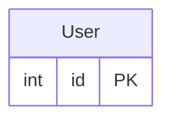
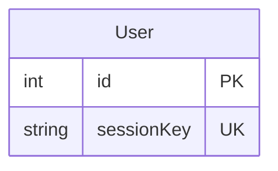
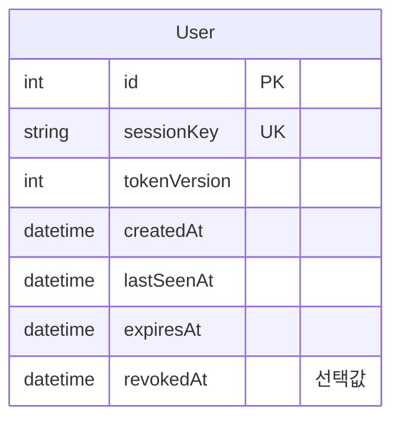
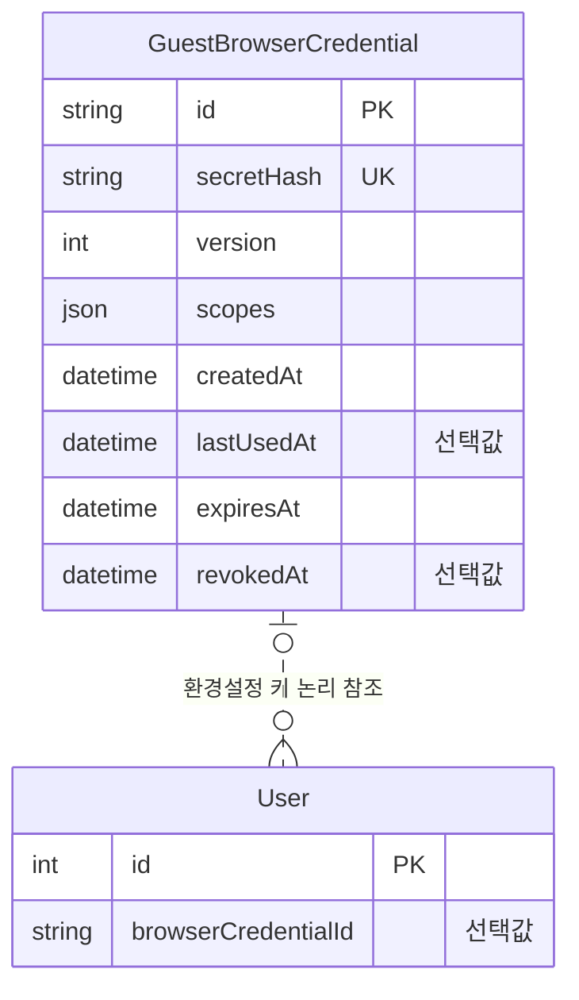
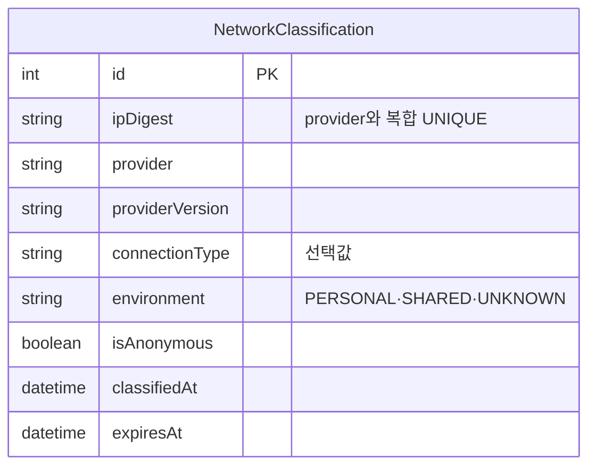
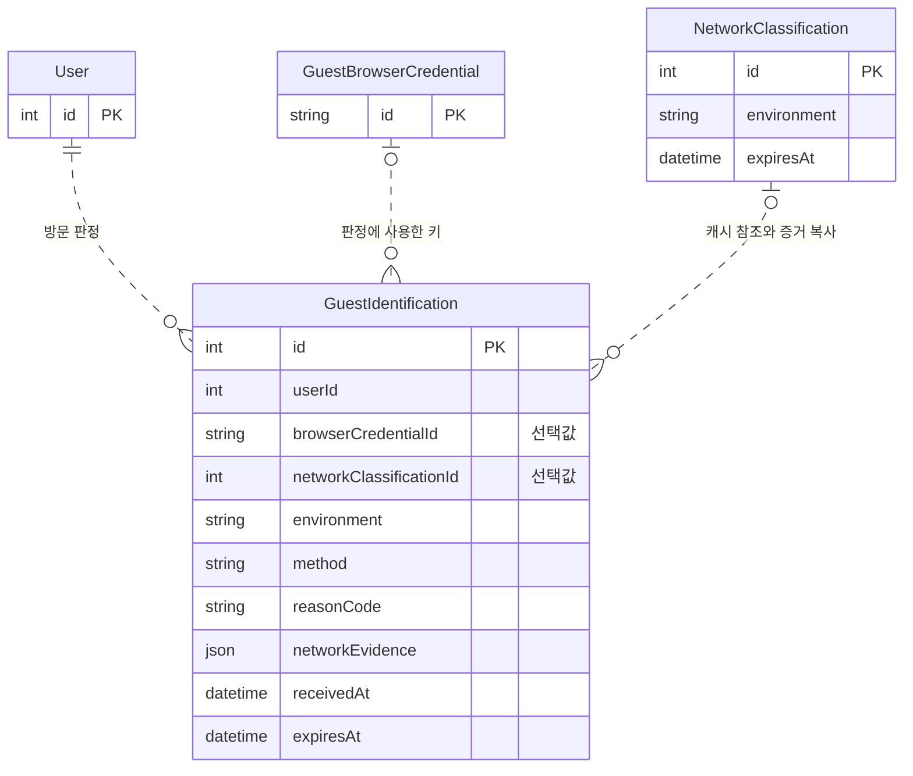
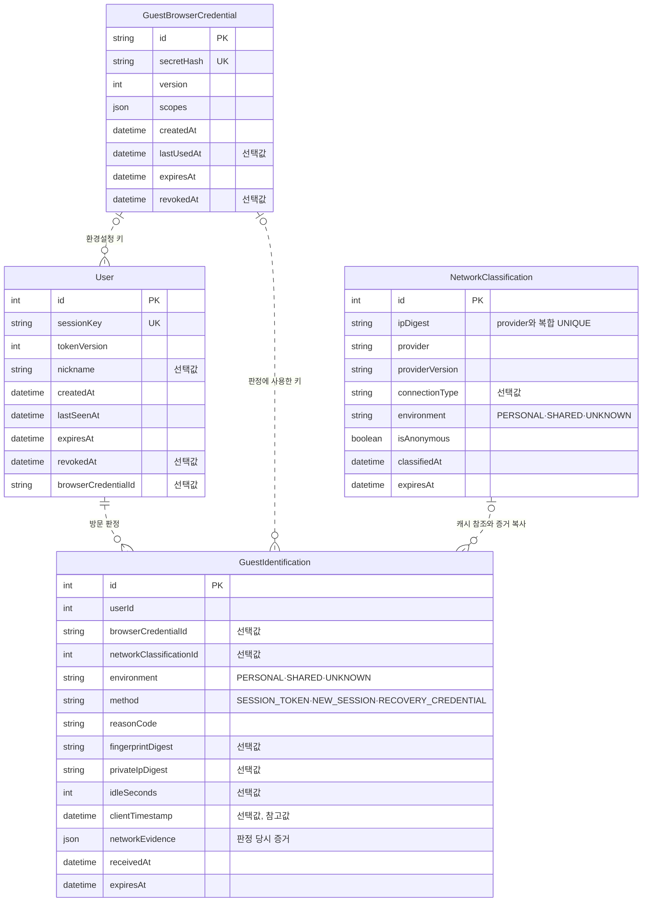

# 1. 비회원 관리 테이블

로그인하지 않은 방문자도 게시물과 댓글을 작성할 수 있습니다. 먼저 사람과 방문을 구분하고 콘텐츠 관리 권한을 따로 살펴봐요. 환경설정 복구·접속 환경 분류·회원 연결은 해당 요구가 있을 때 읽는 확장입니다.

- [출발 구조](#출발-구조)
- [사람과 방문의 구분](#사람과-방문의-구분)
- [방문 식별자의 선택](#방문-식별자의-선택)
- [방문 유효기간과 콘텐츠 권한](#방문-유효기간과-콘텐츠-권한)
- [환경설정의 복구](#환경설정의-복구)
- [접속 환경의 분류와 기록](#접속-환경의-분류와-기록)
- [회원가입 이후의 연결](#회원가입-이후의-연결)
- [정리](#정리)

## 출발 구조

교육 과제에서는 User의 ID로 작성자 관계를 표현할 수 있어요. 다음 그림은 과제에서 출발하는 최소 구조예요. 로그인이나 세션 기능을 구현했다는 뜻은 아닙니다.

운영 환경에서는 방문이 끊기거나 접속 환경이 바뀔 수 있어요. 아래 질문은 이런 실패가 어떤 혼동을 만드는지 살펴봐요. 필요한 보장만 구조에 추가합니다.

## 사람과 방문의 구분

1. [기본] 같은 사람인지 모를 때 무엇을 구분해야 할까요?

한 사람이 글을 쓰고 브라우저를 닫았다고 가정해 봐요. 신원 확인 수단이 없다면 다음 방문자가 같은 사람인지 확정할 수 없어요. 공용 브라우저라면 다른 사람이 같은 쿠키를 이어 쓸 수도 있습니다.

이 설계는 사람의 영구 ID를 추정하지 않아요. 요구를 현재 이어지는 방문을 구분하는 것으로 제한합니다. **User 한 행은 실제 사람이 아니라 독립 방문 한 건을 나타냅니다.**

User.id는 데이터베이스 행의 PK예요. sessionKey는 이어지는 방문을 찾는 UNIQUE 키예요. 이 값만으로 방문을 인증하지 않습니다. IP·별명·지문이 같다는 이유로 다른 User 행을 병합하지 않아요. 같은 쿠키를 공유하는 사람은 이 구조만으로 구별할 수 없습니다.

아래 그림은 행 ID와 방문 키의 역할을 보여줘요. 어느 값도 사람의 신원을 증명하지 않습니다.

## 방문 식별자의 선택

2. [기본] 같은 IP를 공유하거나 접속 IP가 바뀌면 방문도 같아질까요?

PC방이나 통신사 접속망에서는 여러 방문자가 공인 IP를 공유할 수 있어요. 한 방문자의 IP는 셀룰러 데이터에서 Wi-Fi로 바뀔 수도 있어요. IP로 방문을 묶으면 두 사람이 하나로 합쳐지거나, 한 방문이 두 방문처럼 보일 수 있습니다.

원인은 IP가 사람이나 방문을 가리키지 않기 때문이에요. IP는 접속망에서 관측한 주소예요. 따라서 IP를 User의 PK나 UNIQUE 값으로 두지 않습니다. 접속 환경을 분류할 요구가 있으면 그 관측값은 방문 키와 다른 곳에 저장해요.

셀룰러 전용 사람 식별 테이블도 추가하지 않습니다. `connectionType`은 접속 환경 정보이고 `sessionKey`는 방문을 이어 보는 값이에요. 환경이 바뀌어도 기존 방문이나 콘텐츠 관리 권한을 추정해 다시 연결하지 않아요.

## 방문 유효기간과 콘텐츠 권한

방문 식별과 관리 권한은 다릅니다. 실제 권한 검증 절차는 다루지 않아요.

3. [기본] 방문을 식별하면 그 방문이 쓴 글도 수정할 수 있을까요?

방문을 식별하는 값만으로 특정 글을 수정하게 하면 안 돼요. 방문 유효성은 세션 정보로 다루고, 특정 게시물이나 댓글의 관리 권한은 해당 콘텐츠의 관리 키로 따로 구분합니다. 관리 키의 전달·검증 절차는 이 ERD의 범위가 아니에요.

`tokenVersion`은 서명 토큰과 대조하는 방문 유효성 버전이에요. 관리 키와 다른 역할입니다. 상세 인증 절차는 이 문서의 범위가 아니에요.

4. [기본] 방문이 끝난 시각을 어떻게 다룰까요?

브라우저가 닫혀도 서버가 그 순간을 알 수는 없어요. 한 시각만 저장하면 방문 시작, 최근 활동, 만료, 철회를 구분하기 어렵습니다. 예를 들어 만료된 방문을 삭제하면 그 방문이 쓴 게시물과 댓글의 작성자 참조도 끊길 수 있어요.

그래서 User는 서로 다른 사건을 별도 시각으로 표현해요. `createdAt`은 방문 시작, `lastSeenAt`은 마지막 성공 활동, `expiresAt`은 절대 만료, `revokedAt`은 선택적 철회를 나타냅니다. 서비스는 유휴 만료를 판단할 때 `lastSeenAt`을 참고합니다. 실제 시간 정책이나 세션 처리를 구현했다는 뜻은 아닙니다.

만료와 행 삭제는 같은 사건이 아니에요. 작성 콘텐츠가 방문을 참조할 수 있으므로 삭제 가능 여부는 남은 참조를 확인해야 합니다. 일반 원칙은 [관계 무결성과 삭제](post-management.md#관계-무결성과-삭제)를 참고해요.

## 환경설정의 복구

환경설정을 복구할 요구가 없다면 이 절의 구조를 추가하지 않아요.

5. [확장] 환경설정 복구 키가 글의 수정 권한도 줘야 할까요?

방문이 새로 시작되면 이전 방문의 환경설정을 잃을 수 있어요. 반대로 공용 브라우저에서 설정을 이어 쓰면 다른 사람이 이전 설정을 볼 수도 있습니다. 환경설정을 찾는 수단을 과거 글의 수정 권한으로도 쓰면, 잘못 연결된 방문에 콘텐츠 권한까지 넘어갑니다.

환경설정을 이어 쓸 요구가 있을 때만 `GuestBrowserCredential`을 추가할 수 있어요. 이 키는 여러 독립 방문이 선택적으로 참조하는 N:1 논리 관계예요. 키의 ID는 검색에 사용하고, 비밀 원문 대신 `secretHash`를 저장합니다. `scopes`는 기본적으로 `PREFERENCES` 범위를 나타내요.

이 키는 사람의 신원이나 게시물·댓글 관리 권한을 나타내지 않아요. `version`은 키 검증 버전입니다. 유효 기간과 철회, 환경설정 전용 범위는 서비스가 검사해야 합니다. 환경설정 복구 요구가 없다면 이 테이블은 필요하지 않아요.

## 접속 환경의 분류와 기록

접속 환경에 따라 복구를 제한할 때만 분류를 검토해요. 필요한 관측값과 보존 목적을 먼저 정하고, 현재 캐시와 과거 판정 기록을 구분해요.

6. [확장] 접속 정보는 어디까지 저장할까요?

분류 공급자가 응답하지 않거나 일부 관측값을 얻지 못할 수 있어요. 관측값을 모두 필수로 저장하면 방문 기록까지 만들지 못할 수 있습니다. 반대로 원본 IP·지문·비밀을 오래 보관하면 유출과 장기 추적의 부담이 커집니다.

먼저 각 값이 어떤 판정에 필요한지 정해야 해요. 필요하지 않은 관측값은 저장하지 않습니다. 필요한 IP와 지문은 목적별 HMAC(비밀 키를 함께 쓰는 해시) 값으로 표현합니다. 이 값은 원문을 보관하지 않으며 사람을 식별하거나 방문을 복구하는 키도 아니에요.

아래 표는 스키마에서 확인할 저장 조건이에요.

| 고려할 점 | 스키마에서 확인할 내용 |
| --- | --- |
| 선택 관측값 | `connectionType`, 지문·사설 IP digest, 유휴 시간, 클라이언트 시각은 선택값인지 확인 |
| 시각의 역할 | 서버 수신·분류 시각과 클라이언트 참고 시각을 구분 |
| 보존 범위 | 판정 기록과 분류 캐시의 만료 시각을 구분 |
| 역참조 | 콘텐츠나 판정 기록이 남아 있을 때 방문·키·캐시를 삭제할 수 있는지 확인 |

`expiresAt`이 있다고 행이 자동으로 삭제되지는 않아요. 작성 콘텐츠와 다른 기록이 참조하는 동안 삭제할 수 있는지도 별도로 판단해야 합니다. 공통 삭제 기준은 [관계 무결성과 삭제](post-management.md#관계-무결성과-삭제)를 참고해요.

이 구조는 선택 관측값의 부재를 허용하고 기록의 보존 시점을 표현합니다. 실제 수집·삭제 정책이나 개인정보 보호 수준을 자동으로 보장하지는 않아요.

7. [확장] 공용 접속 환경에서 설정 복구를 제한해야 할까요?

공용 브라우저에서 이전 설정을 복구하면 다른 사람이 그 설정을 볼 수 있어요. 접속 환경에 따라 복구를 제한해야 하는 요구인지 먼저 정해요. 공인 IP 공유는 같은 기기를 여러 사람이 쓰는 상황과도 다릅니다.

환경에 따라 브라우저 키의 연결을 제한할 요구가 있다면 `PERSONAL`, `SHARED`, `UNKNOWN` 같은 분류를 둘 수 있어요. 분류를 알 수 없는 경우도 표현해야 합니다. `PERSONAL`은 개인 환경의 후보이지 신원 확인 결과가 아니에요.

공급자의 분류 결과를 재사용하려면 현재 값을 캐시할 수 있어요. `NetworkClassification`은 접속 IP의 목적별 HMAC 값과 공급자를 `(ipDigest, provider)` 복합 UNIQUE로 구분합니다. `providerVersion`은 공급자·정책·HMAC 키 식별값을 나타내요. `isAnonymous`는 공급자가 제공한 익명 접속 신호예요. 분류와 만료 시각은 갱신 가능한 현재 값입니다.

이 캐시는 방문 식별자가 아니에요. 캐시 유효성과 보존 기간은 서비스가 확인해야 합니다. 아래 그림은 캐시가 보관하는 환경 정보예요.

8. [확장] 갱신된 캐시에서 과거 판정도 알 수 있을까요?

어제 한 방문을 `SHARED`로 분류했다고 가정해 봐요. 오늘 공급자가 같은 IP를 `UNKNOWN`으로 분류해 캐시를 갱신할 수 있어요. 현재 캐시만 읽으면 어제 방문에 어떤 환경을 적용했는지 알 수 없습니다.

현재 분류와 당시 판정은 다른 사실이에요. `NetworkClassification`은 갱신할 수 있지만 `GuestIdentification`은 방문에 실제 적용한 환경·방법·사유를 보존합니다. 판정 때 사용한 캐시 값은 `networkEvidence`에 복사해요. 캐시 참조는 출처를 찾는 논리 관계이고, JSON은 당시 근거를 보관하는 복사본입니다. 캐시가 바뀌어도 과거 복사본은 바뀌지 않아요.

`GuestIdentification`은 User를 필수 N:1로 참조합니다. 브라우저 키와 분류 캐시는 선택적 N:1 논리 참조예요. 판정 기록의 불변성, 환경과 키의 일치, 보존 만료는 서비스가 검사해야 합니다. HMAC digest는 인증이나 방문 자동 복구에 사용하지 않아요.

아래 그림은 현재 캐시 참조와 판정 당시 복사본을 구분해요. 관계선은 물리 FK가 아닙니다.

## 회원가입 이후의 연결

9. [확장] 회원가입 뒤 기존 글을 자동으로 연결할까요?

가족이 함께 쓰는 브라우저에서 한 사람이 비회원으로 글을 쓴 뒤, 다른 사람이 그 브라우저로 회원가입할 수 있어요. 브라우저 쿠키나 같은 IP만 보고 글을 회원 계정에 연결하면 다른 사람의 글이 넘어갈 수 있습니다.

회원 신원, 기존 방문, 과거 글의 소유권은 별개의 대상이에요. 어떤 글을 연결할지와 그 권한을 확인하는 방법을 먼저 정해야 합니다. 이 문서는 그 연결 정책이나 인증 절차를 정하지 않아요.

현재 스키마에는 회원 테이블이나 회원 연결 컬럼이 없습니다. 요구가 정해지지 않은 회원 연결 구조를 미리 추가하지 않아요. 기존 방문의 작성 관계를 자동으로 회원에게 넘기는 설계도 아닙니다.

## 정리

- **사람과 방문은 다릅니다.** User는 독립 방문 행이에요. IP·별명·지문이 같아도 같은 사람이라고 확정하지 않습니다.
- **방문 식별과 콘텐츠 권한은 다릅니다.** 세션 키, 환경설정 키, 콘텐츠 관리 키는 서로 다른 역할이에요.
- **캐시와 판정 기록은 다릅니다.** NetworkClassification은 현재 분류를 갱신하고 GuestIdentification은 당시 판정과 근거를 보존합니다.
- **만료와 삭제는 다릅니다.** 만료된 행도 작성 관계나 판정 기록이 참조할 수 있어요.
- **환경 분류는 신원 확인이 아닙니다.** 같은 쿠키를 공유하는 사람도 이 구조만으로 구별할 수 없습니다.

### 최종 테이블 구조

다음 그림은 이 문서에서 설명한 네 테이블의 전체 컬럼과 논리 관계를 보여줘요. 앞의 부분 그림에서 생략한 컬럼도 포함합니다. 모든 관계선은 물리 FK가 아닙니다.

키와 인덱스는 다음과 같아요.

| 테이블 | PK·UNIQUE | 인덱스 |
| --- | --- | --- |
| User | `id`, `sessionKey` | `browserCredentialId` |
| GuestBrowserCredential | `id`, `secretHash` | 없음 |
| NetworkClassification | `id`, (`ipDigest`, `provider`) | `expiresAt` |
| GuestIdentification | `id` | (`userId`, `receivedAt`), `browserCredentialId`, `networkClassificationId`, (`fingerprintDigest`, `receivedAt`), `expiresAt` |

컬럼 설명과 저장·참조 흐름은 [User](../erd.md#users), [GuestBrowserCredential](../erd.md#guest_browser_credentials), [NetworkClassification](../erd.md#network_classifications), [GuestIdentification](../erd.md#guest_identifications)에서 확인해요. 콘텐츠의 작성 관계와 권한은 [게시물 관리](post-management.md#작성-관계와-관리-권한)에서 이어서 설명합니다.
