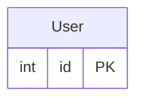
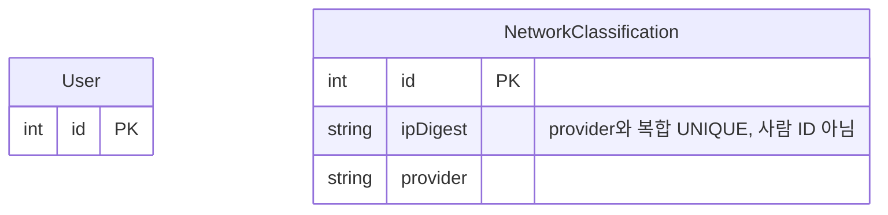
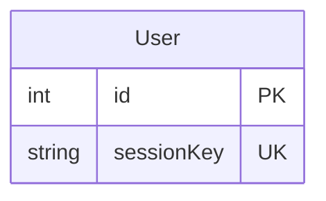
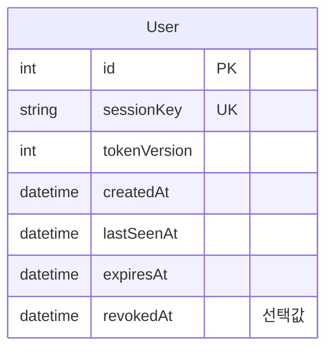
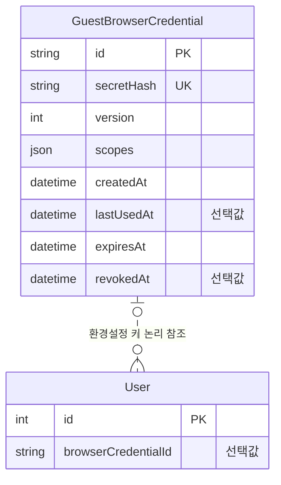
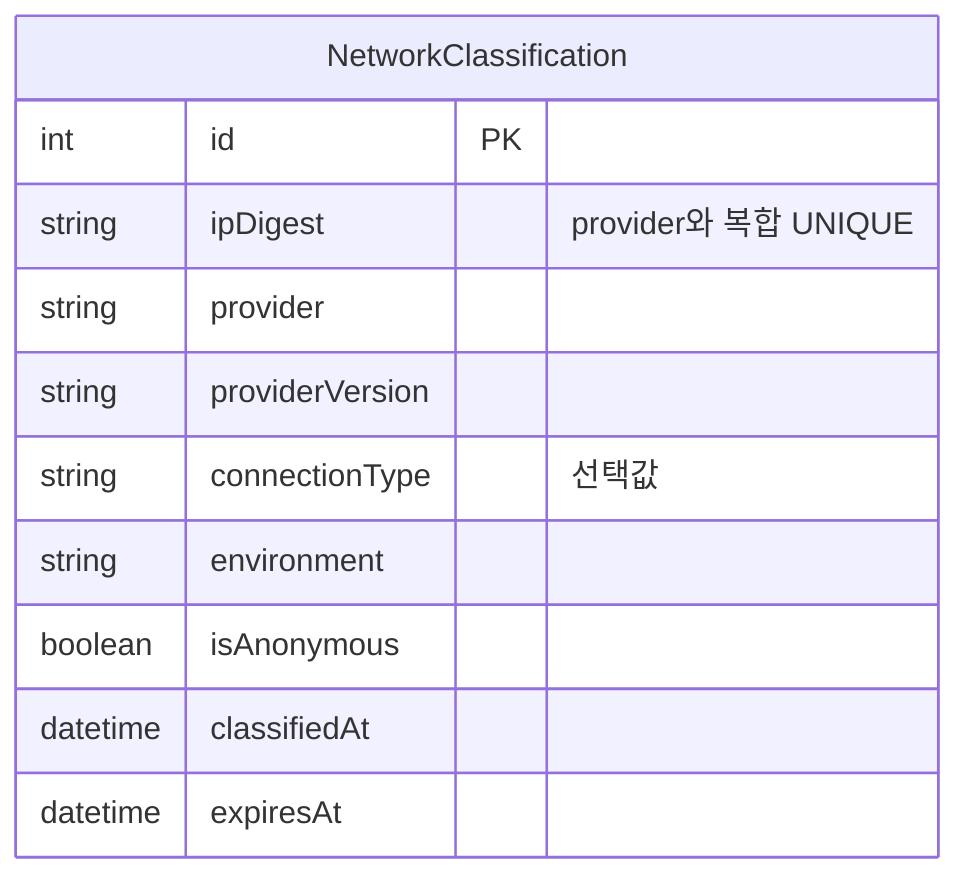
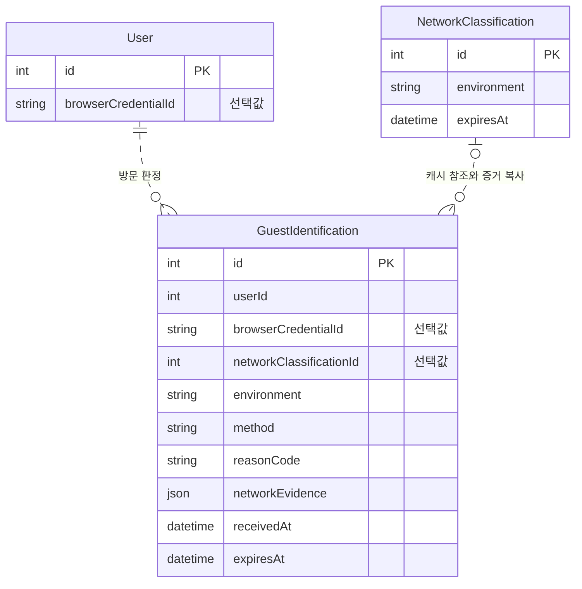
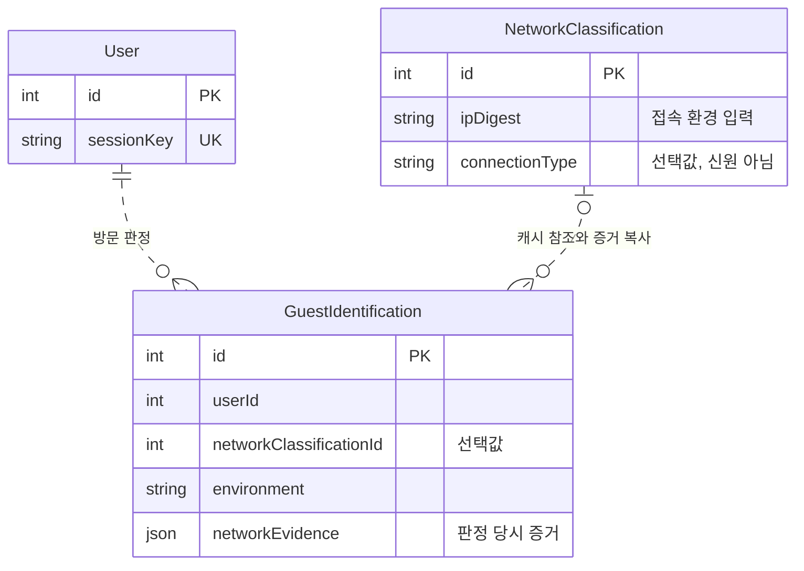
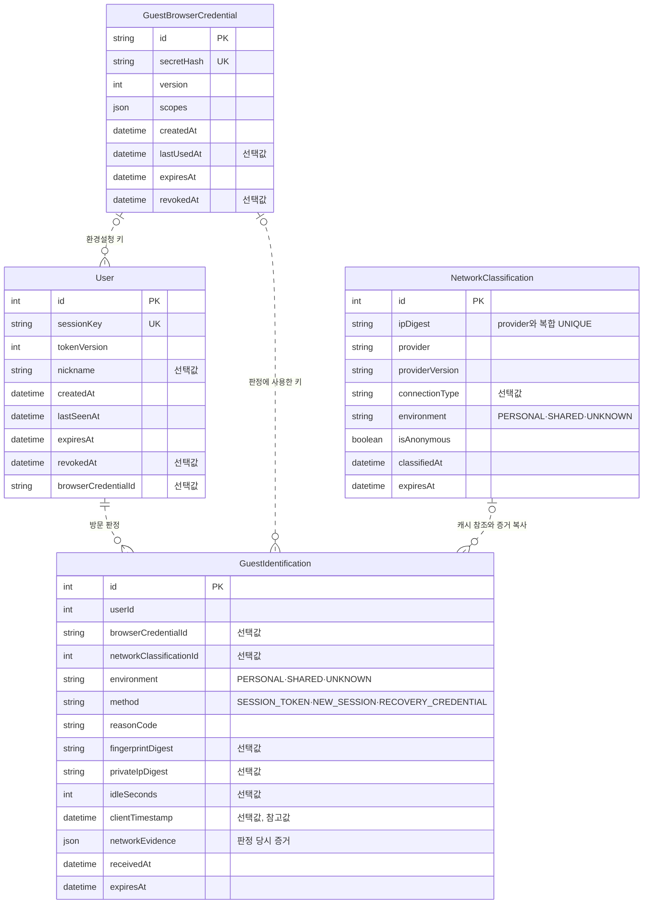

# 1. 비회원 관리 테이블

로그인하지 않은 방문자가 게시물과 댓글을 남기는 상황을 생각해 봐요. 무엇을 기준으로 방문을 구분하고, 어디까지 같은 사람이라고 판단할 수 있을까요? 이 문서는 식별과 권한을 나누고 접속 환경·판정 기록을 모델링할 때 고려할 점을 설명해요.

- [출발 구조](#출발-구조)
- [방문 식별과 권한](#방문-식별과-권한)
- [접속 환경과 판정](#접속-환경과-판정)
- [접속 정보의 보존](#접속-정보의-보존)
- [회원가입 확장 범위](#회원가입-확장-범위)
- [정리](#정리)

## 출발 구조

과제에서는 User의 ID만으로 작성자 관계를 시작할 수 있어요. 아래 그림은 그 최소 구조입니다. 로그인이나 세션을 구현했다는 뜻은 아니에요.

## 방문 식별과 권한

1. [실무 기본] 로그인하지 않은 사람들의 데이터를 어떻게 구분해야 할까요?

먼저 접속 IP를 기준으로 묶는 방법을 떠올릴 수 있어요. 하지만 같은 공인 IP를 여러 사람이 쓸 수도 있고, 한 사람의 IP가 바뀔 수도 있어요. **IP는 접속망의 주소이지 사람의 고유 ID가 아닙니다.**

그래서 IP를 User의 PK나 UNIQUE 식별자로 삼지 않아요. 접속 환경을 구분할 요구가 있다면 NetworkClassification에 별도로 저장해요. 이 테이블을 도입하더라도 방문을 구분하는 기준은 여전히 필요해요.

**설계 포인트:** 사람을 식별할 값과 환경을 관측할 값을 같은 키로 취급하지 않아요. 아래 그림은 환경 분류에 필요한 컬럼만 보여줘요.

2. [실무 기본] 같은 사람이라고 확신할 수 없다면 무엇을 식별해야 할까요?

로그인이나 신원 확인이 없다면 같은 사람의 영구 ID를 보장하기 어려워요. 대신 같은 방문을 유지하는 범위로 요구를 좁힐 수 있어요. **이 설계의 User는 실제 사람이 아니라 독립 방문 한 건입니다.**

User.id는 DB의 행을 구분하고, sessionKey는 이어지는 방문을 구분해요. IP·별명·지문이 같다는 이유로 서로 다른 User를 병합하지 않아요. 같은 쿠키를 쓰는 공용 브라우저의 사람들은 이 구조만으로 구별할 수 없다는 한계도 있어요.

식별자를 안다는 사실과 수정 권한이 있다는 사실도 달라요. 방문의 유효성은 세션 정보로, 특정 게시물·댓글의 관리 권한은 해당 콘텐츠의 관리 키로 구분해요. 인증 수단의 전달 방식은 ERD가 정하는 대상이 아니에요.

**설계 포인트:** 방문 식별과 콘텐츠 관리 권한을 별개의 데이터로 표현해요.

3. [실무 기본] 방문의 유효 기간을 어떻게 표현할까요?

브라우저가 닫혔다고 서버가 정확한 종료 시각을 알 수는 없어요. 그래서 createdAt·lastSeenAt·expiresAt·revokedAt으로 발급·활동·만료·철회를 구분해요. 만료된 방문도 과거 콘텐츠의 작성자로 참조될 수 있으므로, 만료와 행 삭제는 같은 일이 아니에요.

**설계 포인트:** 방문의 수명과 작성 관계를 분리해요. 아래 그림은 이를 위해 필요한 시각 컬럼을 보여줘요.

4. [심화] 환경설정을 이어 쓰는 키가 작성 권한도 넘겨야 할까요?

새 방문에서도 환경설정을 이어 쓰고 싶다면 GuestBrowserCredential을 별도로 둘 수 있어요. User가 이 키를 선택적으로 참조하는 N:1 관계예요. 환경설정 연결이 과거 게시물·댓글의 관리 권한까지 넘긴다는 뜻은 아니에요.

키를 찾는 ID와 소유를 확인하는 비밀도 구분해야 해요. DB에는 비밀 원문 대신 검증에 필요한 값과 권한 범위를 저장해요. 환경설정 연결 요구가 없다면 이 구조를 추가할 필요도 없어요.

**설계 포인트:** 환경설정 연결과 콘텐츠 관리 권한을 같은 키로 표현하지 않아요. 아래 그림은 방문과 환경설정 키의 역할을 나눈 구조예요.

## 접속 환경과 판정

5. [심화] PC방처럼 공용으로 쓰는 공인 IP라면요?

PC방의 서로 다른 PC가 같은 공인 IP를 쓸 수 있어요. IP를 방문 키로 쓰면 서로 다른 방문자의 데이터가 섞일 수 있어요. 공인 IP를 공유하는 접속망과 여러 사람이 쓰는 기기도 서로 다른 조건이에요.

접속 환경에 따라 환경설정 연결을 제한할 요구가 있다면, PERSONAL·SHARED·UNKNOWN 같은 분류를 둘 수 있어요. 분류를 알 수 없는 경우도 표현해야 해요. PERSONAL도 신원 인증 결과가 아니라 환경의 후보일 뿐입니다.

분류 결과를 매번 새로 얻기 어렵다면 NetworkClassification을 캐시로 사용할 수 있어요. 이때 무엇을 기준으로 같은 캐시를 찾을지, 언제까지 유효할지를 정해야 해요. 이 설계는 (ipDigest, provider) 복합 UNIQUE와 분류·만료 시각으로 구분해요.

**설계 포인트:** 환경 분류가 필요한 요구에 한해 캐시를 추가하고, 캐시의 식별 키를 사람의 식별 키로 재사용하지 않아요.

6. [심화] 바뀌는 캐시와 당시 판단을 같은 행에 둘까요?

캐시는 새 결과로 갱신할 수 있어요. 그런데 과거 방문에 어떤 판단을 적용했는지도 알아야 한다면, 현재 캐시만 읽어서는 당시 상황을 설명할 수 없어요. 그래서 GuestIdentification에 적용 환경·처리 방법·사유와 당시 근거를 따로 남겨요.

**갱신 가능한 현재 값과 보존할 과거 기록은 역할이 다릅니다.** 캐시 참조는 출처를 찾는 관계이고, networkEvidence는 당시 근거를 보관하는 복사본이에요. 캐시가 바뀌었다고 과거 판정도 바꾸지는 않아요.

**설계 포인트:** 캐시 참조와 당시 근거의 복사본을 함께 두되 역할을 나눠요. 아래 그림은 방문·캐시·판정 기록의 관계를 보여줘요.

7. [심화] 셀룰러 데이터로 접속하다 Wi-Fi로 바뀌면요?

통신사 접속망에서도 여러 가입자가 공인 IP를 공유할 수 있어요. 같은 휴대전화가 셀룰러 데이터와 Wi-Fi를 오가면 접속 IP가 바뀌기도 해요. IP의 일치나 변경만으로 같은 사람인지 판단할 수는 없어요.

따라서 셀룰러 전용 사람 식별 테이블을 추가하기보다, 기존 방문과 접속 환경 관측을 분리해요. connectionType은 환경 정보이고 sessionKey는 방문을 구분하는 값이에요. 한 값이 다른 값의 역할을 대신하지 않아요.

**설계 포인트:** 환경이 바뀌어도 콘텐츠의 최초 작성 방문과 관리 권한을 추정해서 재연결하지 않아요.

## 접속 정보의 보존

8. [심화] 접속 정보는 어디까지 저장해도 될까요?

접속 정보를 많이 저장할수록 유출이나 장기 추적의 부담도 커져요. 판단에 필요한 만큼만 저장하는 원칙을 데이터 최소화(data minimization)라고 해요. 설계 단계에서는 각 관측값이 어떤 판단에 필요한지, 없어도 방문을 만들 수 있는지부터 확인해요.

원본 IP·지문·비밀을 그대로 저장하지 않는 것도 고려할 점이에요.

| 고려할 점 | ERD에서 확인할 내용 |
| --- | --- |
| 선택 관측값 | 미수집·실패를 표현할 수 있도록 NULL 허용 여부 구분 |
| 시각의 역할 | 서버가 판단에 쓰는 시각과 클라이언트 참고 시각 구분 |
| 보존 범위 | 판정 기록의 만료 시각과 정리 대상 구분 |
| 역참조 | 작성 콘텐츠나 판정이 남아 있을 때 방문·키·캐시를 지울 수 있는지 확인 |

만료 시각 컬럼만 있다고 데이터가 자동으로 지워지지는 않아요. 삭제 가능 여부는 [관계 무결성과 삭제](post-management.md#관계-무결성과-삭제)에서 함께 살펴봐요.

**설계 포인트:** 판단에 쓰는 관측값만 저장하고, IP·지문은 원문 대신 목적별 HMAC 값으로 남겨요.

## 회원가입 확장 범위

9. [실무 기본] 나중에 회원가입을 도입하면 기존 글도 자동으로 연결할까요?

비회원이 나중에 가입하더라도 이전 글이 자동으로 그 회원의 소유가 되는 것은 아니에요. 같은 IP나 공용 기기에 남은 쿠키만으로 연결하면 다른 사람의 데이터를 넘길 수 있어요.

확장을 고려할 때는 회원 신원과 기존 방문을 별개의 대상으로 두어요. 어떤 데이터를 연결할지, 연결 권한은 무엇으로 확인할지, 과거 작성 기록을 그대로 보존할지도 먼저 정해야 해요.

**설계 포인트:** 아직 확정하지 않은 회원 요구를 위해 테이블부터 추가하지 않아요. 현재 스키마에는 회원 테이블이나 회원 연결 컬럼을 두지 않았어요.

## 정리

- **사람과 방문의 구분:** User는 독립 방문이며 IP·별명이 같아도 같은 사람이라고 확정하지 않아요.
- **식별과 권한의 분리:** 방문 키·환경설정 키·콘텐츠 관리 키는 서로 다른 역할이에요.
- **캐시와 이력의 분리:** NetworkClassification은 현재 분류, GuestIdentification은 당시 판정이에요.
- **수명과 삭제의 분리:** 만료된 행도 작성 관계나 이력의 참조로 남을 수 있어요.
- **한계:** 같은 쿠키를 쓰는 공용 브라우저의 사람들은 이 구조만으로 구별할 수 없어요.

### 최종 테이블 구조

다음 그림은 이 문서에서 다룬 테이블의 전체 컬럼과 논리 관계예요. 질문별 그림에서 생략한 컬럼도 모두 포함했어요.

키와 인덱스는 다음과 같아요.

| 테이블 | PK·UNIQUE | 인덱스 |
| --- | --- | --- |
| User | id, sessionKey | browserCredentialId |
| GuestBrowserCredential | id, secretHash | - |
| NetworkClassification | id, (ipDigest, provider) | expiresAt |
| GuestIdentification | id | (userId, receivedAt), browserCredentialId, networkClassificationId, (fingerprintDigest, receivedAt), expiresAt |

컬럼 설명과 데이터 흐름은 [User](../erd.md#users)·[GuestBrowserCredential](../erd.md#guest_browser_credentials)·[NetworkClassification](../erd.md#network_classifications)·[GuestIdentification](../erd.md#guest_identifications)에서 확인해요. 콘텐츠의 작성·수정 관계는 [게시물 관리](post-management.md#게시물-변경-설계)에서 이어서 설명해요.
