# 2. 게시물 관리 테이블

게시물은 제목과 본문으로 시작해요. 먼저 작성 관계·권한·조회·수정·삭제를 설계해요. 전체 수정 이력과 첨부는 추가 요구가 있을 때 확장해요.

기본 절의 그림은 현재 내용을 한 행에 둔 학습용 출발점이에요. 최종 스키마의 Post와 PostSnapshot 구조를 변경한다는 뜻은 아니에요. 이 문서는 설계 선택과 한계를 설명하며 구현이나 운영 보장을 뜻하지 않아요.

- [출발 구조](#출발-구조)
- [작성 관계와 관리 권한](#작성-관계와-관리-권한)
- [참조 관계와 검증 책임](#참조-관계와-검증-책임)
- [목록·상세 조회와 인덱스](#목록상세-조회와-인덱스)
- [변경의 일관성](#변경의-일관성)
- [삭제와 관계 보존](#삭제와-관계-보존)
- [수정 이력과 현재 내용](#수정-이력과-현재-내용)
- [본문과 첨부](#본문과-첨부)
- [공통 저장·관계 설계 기준](#공통-저장관계-설계-기준)
- [참고: 저장 타입과 제약](#저장-타입과-제약)
- [참고: 관계 무결성과 삭제](#관계-무결성과-삭제)
- [정리](#정리)

## 출발 구조

현재 제목과 본문만 필요하면 Post 한 행에 두 값을 저장할 수 있어요. 다음 그림은 가장 작은 출발 구조예요. 수정 이력이나 별도 증거가 필요하지 않다면 구조를 더 나누지 않아도 돼요.

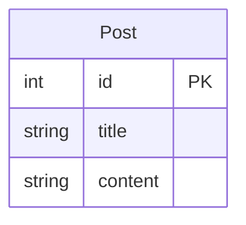

## 작성 관계와 관리 권한

1. [기본] 새 방문으로 돌아온 작성자는 글을 어떻게 관리할까요?

비회원의 다음 방문은 새 User 행으로 표현될 수 있어요. 새 방문을 기존 게시물의 authorId에 덮어쓰면 최초 작성 방문이라는 기록이 바뀌어요.

Post.authorId는 최초 작성 방문을 가리켜요. Post.managementKeyHash는 관리 키의 해시를 저장하고 원문은 저장하지 않아요. 키나 방문 ID가 있다는 사실만으로 관리 권한이 생기지는 않아요.

관리 키 해시는 생성 중에는 NULL일 수 있어요. 게시물 생성을 완료할 때는 값이 있어야 해요. 서비스가 완료 조건을 확인해야 해요.

**설계 포인트:** 최초 작성 방문과 관리 권한은 서로 다른 사실이에요. 수정 방문의 기록은 [수정 이력과 현재 내용](#수정-이력과-현재-내용)에서 설명해요. 방문과 권한의 자세한 경계는 [비회원 관리](guest-management.md#방문-식별과-권한)를 참고해요.

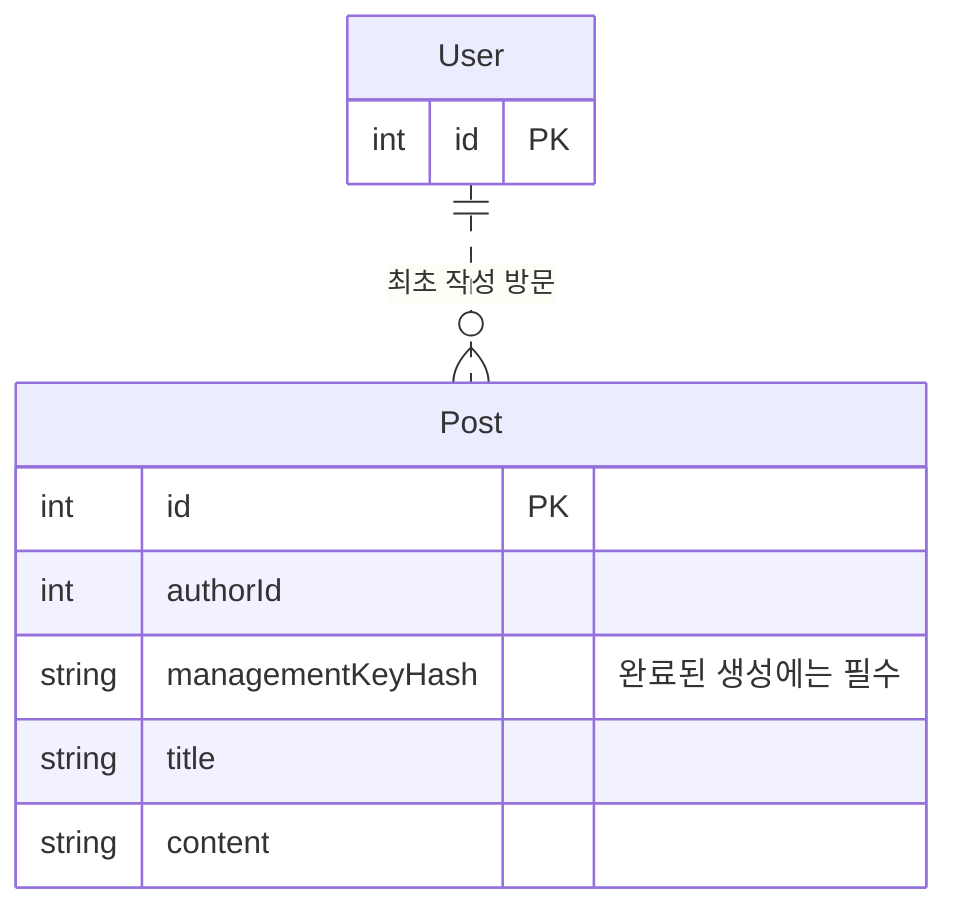

## 참조 관계와 검증 책임

2. [기본] 작성 방문의 ID가 있으면 게시물의 연결도 올바를까요?

요청에 존재하지 않는 방문 ID가 들어올 수 있어요. 다른 방문의 ID로 바꾸면 최초 작성 기록도 달라져요.

`Post.authorId`는 생성할 때 최초 작성 방문으로 정해요. 생성 뒤 다른 방문으로 바꾸지 않는 설계입니다. 서비스는 참조 대상의 존재와 올바른 작성 관계를 확인해야 해요. ID가 존재한다는 사실은 수정 권한을 뜻하지 않아요.

3. [기본] FK를 없애면 방문과 게시물 사이의 관계도 없어질까요?

관계선은 개념적 연결을 나타내고 물리 외래 키(FK)는 DB가 참조 행의 존재를 강제해요. 이를 참조 무결성(referential integrity)이라고 해요. 요구에 맞는다면 FK는 참조 오류를 DB가 막는 기본 선택이 될 수 있어요.

FK를 두지 않는 선택에는 쓰기 경합이나 도구 제약 같은 이유가 있을 수 있어요. 그렇다고 참조 검사가 불필요해지는 것은 아니에요. 서비스 오류나 직접 입력은 참조 대상이 없는 고아 행(orphan row)을 만들 수 있어요.

이 스키마는 `relationMode = "prisma"`로 논리 관계를 표현하고 물리 FK를 두지 않아요. PK·UNIQUE·NOT NULL과 명시적 참조 인덱스는 선언해요. 관계 선언만으로 모든 입력의 참조가 검사된다고 가정하지 않아요.

| 책임 | 설계에서 구분할 내용 |
| --- | --- |
| DB 제약 | 선언된 PK·UNIQUE·NOT NULL과 트랜잭션 |
| 서비스 | 참조 존재·소유자·상태·권한·생성 완결성·삭제 정책 |

**설계 포인트:** FK가 없는 관계의 존재·소유자·삭제 정책은 서비스가 검사해요. 자동 Cascade·SetNull은 사용하지 않아요.

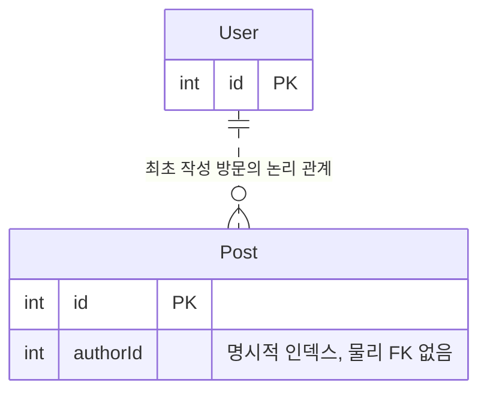

## 목록·상세 조회와 인덱스

4. [기본] 게시물 목록과 상세는 같은 데이터를 읽을까요?

목록은 제목과 생성 시각만 필요할 수 있어요. 상세는 본문까지 필요할 수 있어요. 먼저 필터·정렬·읽을 컬럼을 정해요.

| 조회 요구 | 최소 구조에서 고려할 값 |
| --- | --- |
| 상태별 시간순 목록 | status·createdAt·id |
| 현재 본문 상세 | 게시물 ID·title·content |

게시물을 숨기거나 삭제했다면 서비스는 현재 상태와 권한을 확인해 노출 여부를 정해요. 관계나 인덱스는 그 판단을 실행하지 않아요.

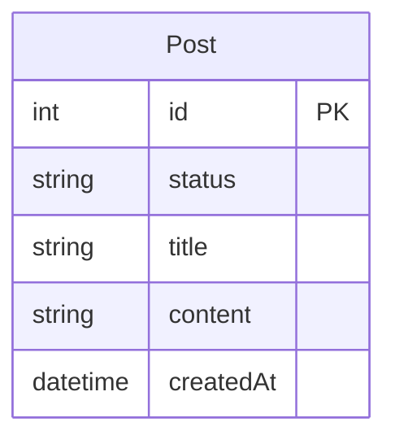

5. [기본] 어떤 조회를 할지 정하지 않고 인덱스부터 추가해도 될까요?

같은 테이블도 목록·상세·관계 확인마다 읽는 행과 순서가 달라요. 먼저 조회 조건과 정렬을 정한 뒤 인덱스를 선택해요. 논리 관계를 찾는 데 쓰는 참조 인덱스도 별도로 확인해요.

시간순 목록에는 createdAt이 같은 행이 있을 수 있어요. id를 보조 정렬 기준으로 쓰면 순서가 결정돼요. 마지막 행의 createdAt과 id를 다음 페이지 기준으로 삼는 방식을 키셋 페이지네이션(keyset pagination)이라고 해요.

B-tree는 키를 정렬된 트리 구조로 찾는 인덱스예요. 인덱스가 모든 검색을 빠르게 하지는 않아요. B-tree 인덱스만으로 본문의 임의 부분 검색을 처리한다고 가정하지 않아요. 목록에서 본문과 증거를 모두 읽을지, 상세 화면에서만 읽을지도 정해요.

**설계 포인트:** 조회 조건, 정렬 기준, 읽을 컬럼을 정한 뒤 필요한 인덱스를 선택해요.

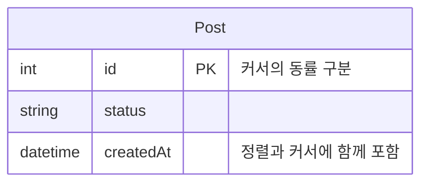

## 변경의 일관성

6. [기본] 두 요청이 같은 글을 동시에 수정하면요?

두 요청이 같은 버전을 읽으면 나중 저장이 먼저 저장한 내용을 덮을 수 있어요. 이를 갱신 손실(lost update)이라고 해요. 저장 시 읽은 버전과 현재 버전을 비교하는 낙관적 동시성 제어(optimistic concurrency control)를 고려할 수 있어요.

`Post.version`은 변경 충돌을 구분하는 값이에요. 서비스는 읽은 버전과 저장 시점의 버전을 비교해야 해요. 버전 비교는 오래된 요청의 덮어쓰기를 다루지만 여러 행의 부분 저장을 막지는 않아요.

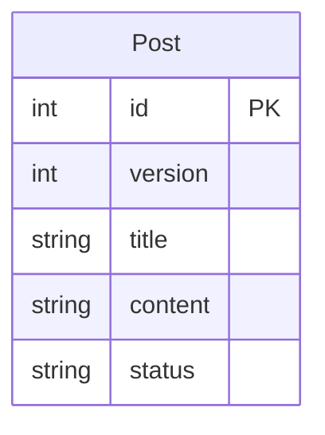

7. [기본] 함께 바꿔야 하는 값 중 일부만 저장되면요?

본문은 바뀌었는데 변경 버전은 그대로 남으면 다음 요청이 오래된 버전을 구분하지 못할 수 있어요. 함께 반영해야 하는 변경의 범위를 먼저 정해요.

원자성(atomicity)은 묶은 변경을 모두 반영하거나 모두 취소하는 성질이에요. 서비스는 해당 변경을 한 트랜잭션(transaction)으로 묶어야 해요. MySQL에서는 InnoDB처럼 트랜잭션을 지원하는 엔진이 필요해요. 엔진이 어떤 변경을 묶을지 자동으로 정하지는 않아요.

버전 비교는 동시 충돌을 다루고 트랜잭션은 부분 저장을 다뤄요. 후속 작업을 별도로 실행할 필요가 있는지는 [별도 후속 작업의 도입 조건](request-failure-management.md#별도-후속-작업의-도입-조건)에서 판단해요.

## 삭제와 관계 보존

8. [기본] 게시물을 삭제하면 댓글과 다른 기록도 함께 지워야 할까요?

댓글이 있는 게시물을 물리 삭제하면 `Comment.postId`가 가리키는 소속이 끊길 수 있어요. 게시물의 노출을 중단하는 일과 행을 없애는 일은 다릅니다.

이 설계는 일반 삭제를 `DELETED` 상태로 기록해요. 이를 소프트 삭제(soft delete)라고 해요. 서비스는 상태에 따라 노출을 판단하고, 남은 관계를 확인한 뒤 물리 삭제 가능 여부를 정해요.

댓글의 대화 맥락이나 신고 증거를 보존할 요구는 각각 따로 판단해요. 상태를 남기는 선택은 저장량을 늘리고 별도 보존·정리 기준을 요구해요. 이력과 독립 증거를 도입한 경우의 삭제는 [공통 관계 기준](#관계-무결성과-삭제)에서 이어서 설명해요.

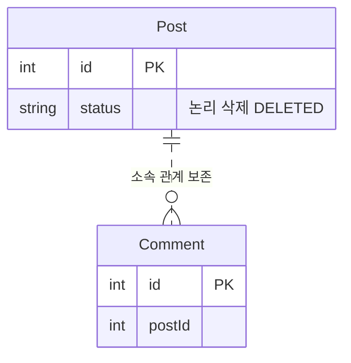

## 수정 이력과 현재 내용

전체 수정 이력이 필요할 때만 읽어요. 현재 값만 필요하면 기본 구조에서 멈출 수 있어요.

9. [확장] 수정 전 내용을 다시 확인할 필요가 있을까요?

작성자가 글을 고치면 한 행을 갱신하는 구조에서는 이전 본문이 사라져요. 이전 내용을 다시 확인해야 하는 요구가 있는지 먼저 정해요. 현재 값만 필요하면 이력 테이블은 필요하지 않아요. 신고 순간만 보존하면 된다면 신고 문서의 독립 증거가 별도 선택지예요. **모든 게시판에 전체 수정 이력이 필요한 것은 아니에요.**

권한자가 과거 개정과 이미지를 확인해야 한다면 이전 값을 덮어쓸 수 없어요. 이 설계는 각 수정 시점의 제목과 본문을 새 스냅샷(snapshot) 행으로 남겨요. 개정마다 새 행을 추가하는 구조를 이력 테이블(history table)이라고 해요. 신고가 관찰한 개정도 식별할 수 있지만, 신고 증거의 독립 복사는 신고 문서가 설명해요.

**Post는 게시물 메타데이터를 저장하고 PostSnapshot은 시점별 제목과 본문을 저장해요.** 기존 스냅샷은 바꾸거나 지우지 않고 새 개정을 추가하는 설계예요. 본문은 GitHub 확장 마크다운인 GFM(GitHub Flavored Markdown)으로 정했어요.

**설계 포인트:** 이력을 보존해야 할 때만 제목과 본문을 별도 행으로 나눠요.

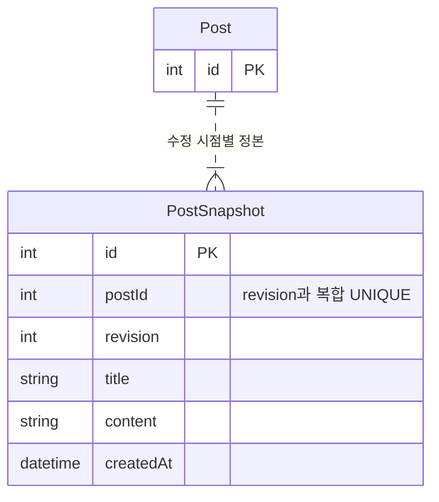

10. [확장] 여러 수정 기록 중 지금 보여줄 내용은 어떻게 정할까요?

스냅샷은 여러 개지만 현재 보여줄 정본은 하나예요. 매번 생성 시각이나 가장 큰 ID로 최신 값을 추측하면 정렬 기준과 현재 값이 어긋날 수 있어요. Post.currentSnapshotId가 현재 정본을 직접 가리키도록 설계해요.

**정본은 제목·본문의 기준이 되는 개정이에요.** 첨부 설명과 배치 순서도 정본의 본문에 있어요. 완료된 게시물에는 스냅샷이 최소 한 개 있어야 해요. 현재 포인터는 같은 게시물의 최신 개정을 가리켜야 해요.

처음 만들 때는 Post 행을 만든 뒤 스냅샷을 추가할 수 있어요. 이 중간 상태에서 currentSnapshotId는 NULL일 수 있어요. 저장을 완료한 뒤에도 NULL을 허용한다는 뜻은 아니에요. 컬럼의 NULL 허용은 DB 형식이고, 완료 시점의 최소 스냅샷과 포인터 조건은 서비스가 검사해야 해요.

**설계 포인트:** 이력 소유자, 개정 번호, 현재 포인터, 완료 조건을 함께 정해요.

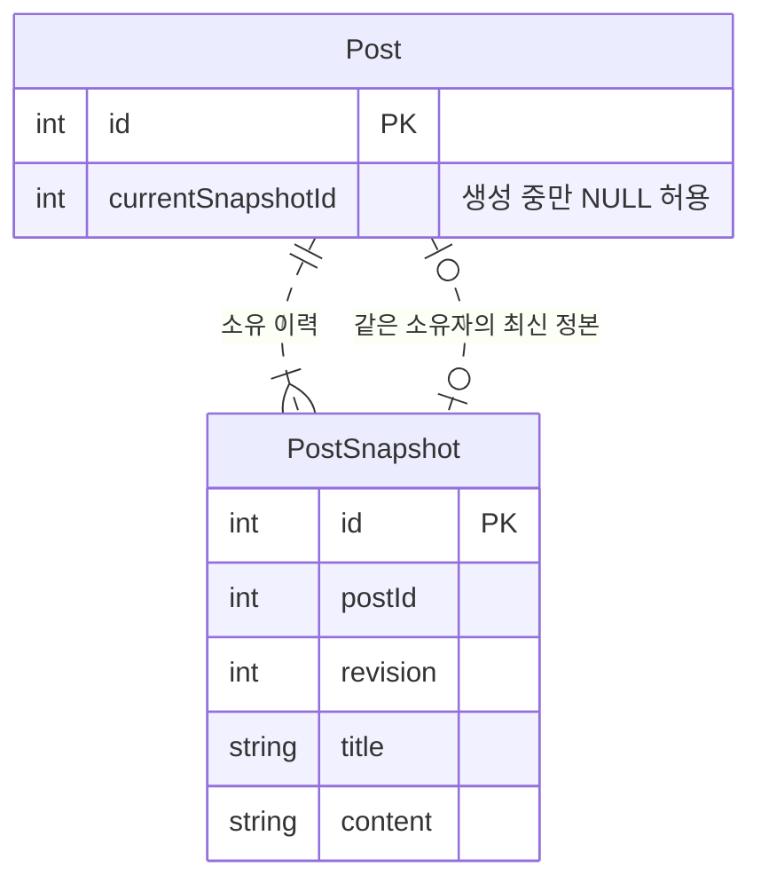

11. [확장] 새 개정과 현재 포인터 중 하나만 저장되면요?

새 스냅샷만 남고 `currentSnapshotId` 갱신이 실패하면 현재 내용으로 선택되지 않아요. 이력을 도입하면 함께 저장할 행도 늘어납니다.

스냅샷·첨부 사용 관계·포인터·버전을 함께 바꾼다면 서비스는 이를 한 DB 트랜잭션에 저장해야 해요. 완료된 게시물에는 관리 키 해시와 최소 한 스냅샷이 있어야 해요. 현재 포인터는 같은 게시물의 최신 개정을 가리켜야 해요.

| 상황 | 기준 값 | 구분하는 변화 |
| --- | --- | --- |
| 메타데이터 변경 | Post.version | 상태 등 게시물 메타데이터의 동시 변경 |
| 본문 개정 | PostSnapshot.revision | 게시물별 불변 제목·본문 개정 |

상태만 바뀌면 새 본문 개정 없이 version만 증가할 수 있어요. revision은 본문 개정 번호예요. 두 값을 하나의 버전으로 대신하지 않아요.

PostSnapshot.editorKey는 실제 작성·수정 방문의 논리 키를 기록해요. 이 값은 FK가 아니에요. 최초 작성 방문·수정 방문·관리 권한을 한 값으로 대신하지 않아요.

DB 저장 뒤 별도 후속 작업도 놓치지 않아야 한다면 Outbox 도입을 고려할 수 있어요. 이 저장소가 선택한 구조에서는 서비스가 콘텐츠 변경과 OutboxEvent를 같은 DB 트랜잭션에 저장해야 해요. 필요성과 한계는 [변경과 작업 기록의 원자 저장](request-failure-management.md#변경과-작업-기록의-원자-저장)에서 설명해요.

## 본문과 첨부

첨부가 필요하면 먼저 [파일 정보와 바이트의 저장](file-management.md#파일-정보와-바이트의-저장)과 [업로드와 검증](file-management.md#업로드와-검증)을 읽어요. 이 절은 수정 이력을 선택한 경우의 개정별 사용과 표시 결과를 설명해요.

12. [확장] 본문에 파일 주소를 넣으면 첨부 관계도 표현된 걸까요?

본문에 주소를 적어도 DB가 첨부의 존재·소유자·준비 상태를 확인하지는 않아요. 원문은 파일을 가리키는 정보와 설명·배치 순서를 보존해요. PostSnapshotAttachment는 해당 개정이 쓰는 첨부 집합을 보존해요. 두 표현이 가리키는 파일은 같아야 하며 서비스가 일치 여부를 검사해야 해요.

관계 테이블에 설명과 순서까지 복사하면 서로 다른 정본이 생길 수 있어요. 이 설계에서 연결 테이블은 중복 없는 집합만 저장해요. 설명과 순서는 원문만 담당해요.

**설계 포인트:** 원문은 설명·순서, 연결 테이블은 사용 집합, 렌더는 정책별 표시 결과를 맡아요. 다음 그림은 이 세 역할을 비교해요.

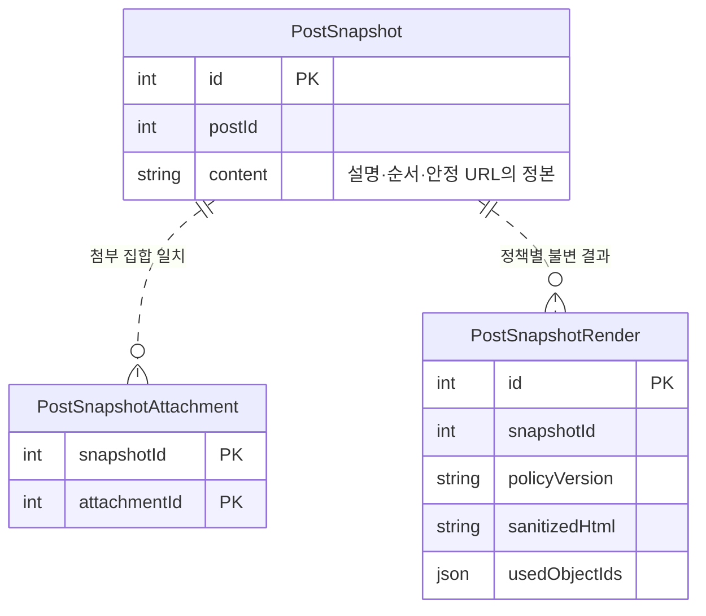

13. [확장] 첨부를 교체해도 과거 개정의 파일을 확인하려면요?

현재 본문에서 파일을 빼도 과거 개정이나 신고는 당시 파일을 필요로 할 수 있어요. Post에 현재 첨부 ID만 저장하면 과거 개정의 사용 관계를 알 수 없어요.

한 개정은 여러 첨부를 쓸 수 있어요. 같은 게시물의 여러 개정이 한 첨부를 다시 쓸 수도 있어요. 이 다대다(N:M) 관계를 조인 테이블(join table)인 PostSnapshotAttachment로 표현해요. 복합 PK는 같은 개정의 같은 첨부를 중복 연결하지 않아요.

**설계 포인트:** 파일 메타데이터와 개정별 사용 관계를 나눠요.

firstPostId는 연결 전에는 NULL일 수 있어요. 처음 연결할 때 firstPostId와 linkedAt을 함께 확정해요. 최초 게시물 연결과 원본 포인터는 확정 뒤 바꾸지 않는 설계예요. 같은 게시물의 여러 개정에서만 첨부를 다시 쓸 수 있어요.

업로드 완료는 사용 준비와 다르며, READY에는 검증된 원본과 필수 파생본이 준비돼야 해요. 서비스가 이 조건과 보존 상태를 검사해요. 연결된 첨부는 만료 시각보다 보존 참조를 우선해요. 파일 바이트와 보존 기준은 [파일 관리](file-management.md)를 참고해요.

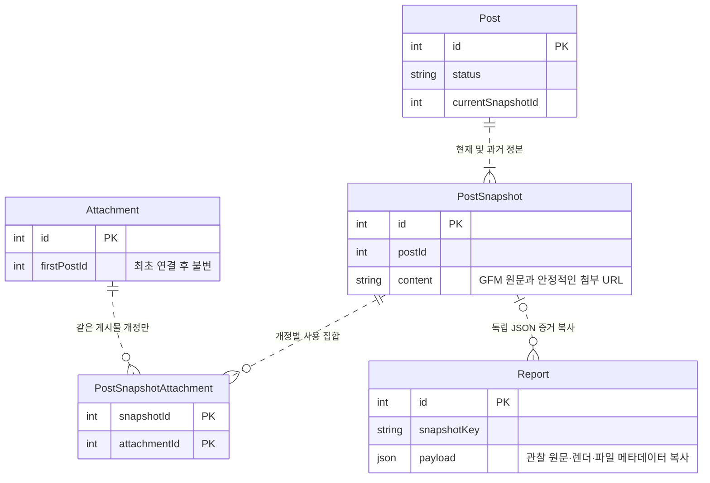

14. [확장] 원문과 렌더 결과를 왜 나눌까요?

같은 원문도 파서·정제·URL 처리 정책에 따라 다른 HTML 결과를 만들 수 있어요. 원문과 별개로 당시 표시 결과까지 보존해야 하는 요구인지 확인해요. 필요하면 PostSnapshotRender에 개정·정책 버전별 결과를 저장해요.

`(snapshotId, policyVersion)`은 개정과 정책 버전별 결과를 구분해요. 결과는 수정하지 않는 설계예요. usedObjectIds는 렌더가 참조하는 관리 객체 ID를 기록해요. 목록과 HTML의 일치는 서비스가 검사해야 해요. retainUntil은 렌더 결과의 최소 보존 종료 시각이에요. 서비스는 렌더와 참조 객체의 보존을 함께 검사해요. 외부 이미지 URL을 기록해도 외부 바이트를 보존하는 것은 아니에요. 신고 당시 파일 보존은 [신고 관리](report-management.md#파일-증거와-보존)를 참고해요.

**설계 포인트:** 원문이 정본이고 렌더는 정책별 결과예요. 정책이 바뀌면 이전 결과를 덮어쓰지 않고 다른 버전의 결과를 추가해요.

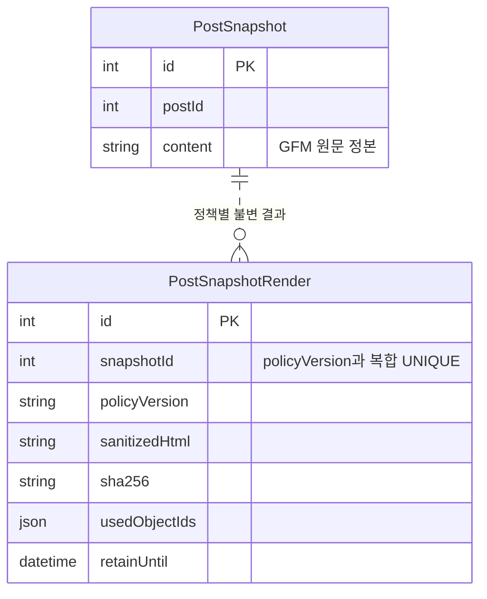

15. [확장] 이력·첨부·신고가 추가되면 조회는 어떻게 달라질까요?

목록은 제목과 생성 시각만 필요할 수 있어요. 상세는 본문·첨부·표시 결과도 필요할 수 있어요. currentSnapshotId는 목록이 읽을 제목의 정본을 선택해요.

| 조회 요구 | 고려할 데이터·인덱스 |
| --- | --- |
| 상태별 시간순 목록 | Post.status·createdAt·id, (status, createdAt, id) |
| 현재 내용 | currentSnapshot 관계와 선택한 스냅샷 |
| 개인 숨김·신고 집계 | Report의 reporterKey·targetKey·status |
| 첨부 표시 | 개정별 사용 관계와 선택 렌더 |

게시물을 숨겨도 댓글이나 파일을 다른 경로에서 보여줄지 정책을 정해야 해요. ERD는 상태와 참조 데이터를 표현할 뿐, 노출 규칙을 실행하지 않아요.

**설계 포인트:** 목록과 상세의 읽기 범위를 나누면 필요한 정본 참조와 인덱스도 분명해져요.

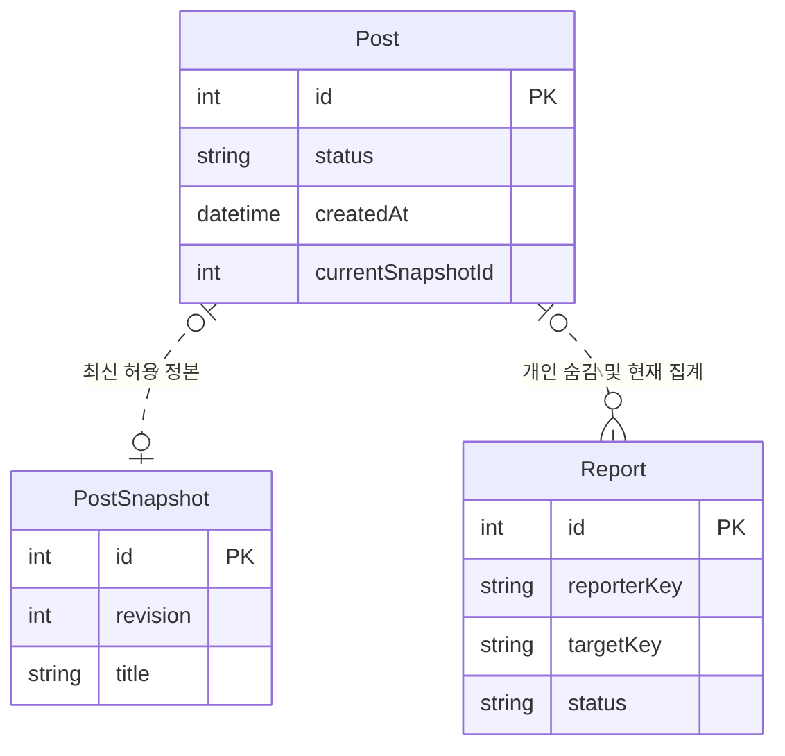

## 공통 저장·관계 설계 기준

앞의 기본 사례를 다른 테이블에 적용할 때 참고해요. 저장 타입·비교 기준·NULL 허용 시점과 관계별 검증 책임을 한 곳에서 관리해요.

### 저장 타입과 제약

16. [참고] 문자열 비교 규칙이 다르면 같은 키를 비교할 수 있을까요?

문자열 비교 규칙(collation)은 대소문자와 문자 표현을 비교하는 방식을 정해요. 대소문자만 다른 두 값을 같은 키로 볼지 정해야 UNIQUE가 막는 중복도 분명해져요.

컬럼마다 비교 기준이 다르면 같은 논리 키를 다르게 판단할 수 있어요. JSON 값과 일반 컬럼을 비교할 때도 기준을 맞춰야 해요. 이 설계는 논리 키를 소문자 ASCII 정본으로 구분해요.

**설계 포인트:** 문자셋은 저장 가능한 문자를 정하고 collation은 비교 방식을 정해요. 키의 정본 형태와 중복 기준을 함께 선택해요.

17. [참고] JSON이나 날짜 타입만 선언하면 데이터의 의미도 정해질까요?

**저장 타입만으로 데이터의 의미가 정해지지는 않아요.** JSON은 증거나 가공 결과를 담지만 내부 항목을 ERD 관계로 표현하지 않아요. 자주 검색하는 값은 별도 컬럼으로 둘지 검토해요.

DATETIME(3)은 시간대를 저장하지 않아요. 서버와 DB가 같은 UTC 기준으로 값을 기록하고 해석해야 해요.

| 데이터 | 이 설계의 표현과 고려사항 |
| --- | --- |
| 행 ID·참조 | Int, 참조 인덱스와 소유 관계 확인 |
| UUID | CHAR(36), 사람이 아닌 논리 식별자 |
| 제목·본문 | 제목 VARCHAR(200), 본문 LONGTEXT로 역할 구분 |
| 시각 | DATETIME(3), 저장·해석의 시간 기준 통일 |
| 증거·가공 결과 | JSON, 검색할 값과 불변성의 범위 구분 |
| 파일 크기 | BIGINT, 필요한 수치 범위 고려 |

**설계 포인트:** 길이, 정밀도, NULL 허용 시점, 비교 규칙을 데이터 역할에 맞춰 정해요.

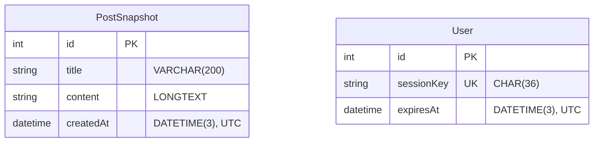

18. [참고] 스키마 검사가 통과하면 설계한 보장도 모두 적용된 걸까요?

Prisma 스키마 검사는 스키마의 타입과 관계 선언을 확인해요. 검사를 통과해도 실제 DB에 테이블이 생성되거나 서비스 검사가 구현되지는 않아요.

DB는 선언된 PK·UNIQUE·NOT NULL을 강제할 수 있어요. 현재 스냅샷의 소유자와 최신 여부, 생성 완결성, 관리 권한, 삭제 정책은 관계선만으로 보장되지 않아요. 서비스가 각 조건을 검사해야 해요.

**설계 포인트:** 조건마다 DB 제약과 서비스 검사의 책임을 구분해요. 이 문서는 DB 적용이나 API 구현 완료를 주장하지 않아요.

### 관계 무결성과 삭제

19. [참고] ID가 존재하기만 하면 올바른 관계라고 볼 수 있을까요?

참조 행이 존재해도 관계가 올바르다는 뜻은 아니에요. currentSnapshotId가 다른 게시물의 스냅샷을 가리킬 수 있어요. 부모 댓글도 다른 게시물에 속할 수 있어요. 존재와 소유자 일치를 각각 검사해야 해요.

| 관계 | 함께 고려할 조건 |
| --- | --- |
| currentSnapshot | 같은 콘텐츠의 스냅샷인가, 최신 개정인가 |
| Comment.parentId | 같은 postId인가, 자기 자신이나 순환 참조는 아닌가 |
| PostSnapshotAttachment | 개정 소유 게시물과 첨부의 최초 연결 게시물이 같은가 |
| Attachment.originalObjectId | 같은 첨부의 원본 객체인가 |
| 작업 결과·렌더·신고 보존 객체 | 해당 입력·개정·증거가 사용하는 객체인가 |
| 브라우저 키·판정 참조 | 해당 방문의 연결인가, 유효한 판단 근거인가 |

완료된 게시물에는 최소 한 스냅샷이 필요해요. 컬럼이 NULL을 허용해도 생성 중에만 비울 수 있고 완료 시에는 채워야 할 수 있어요. 서비스는 이 시점 조건을 검사해야 해요.

**설계 포인트:** 존재·소유자·상태·완결성은 별도 조건이에요. DB가 강제하지 않는 항목은 서비스가 검사해요.

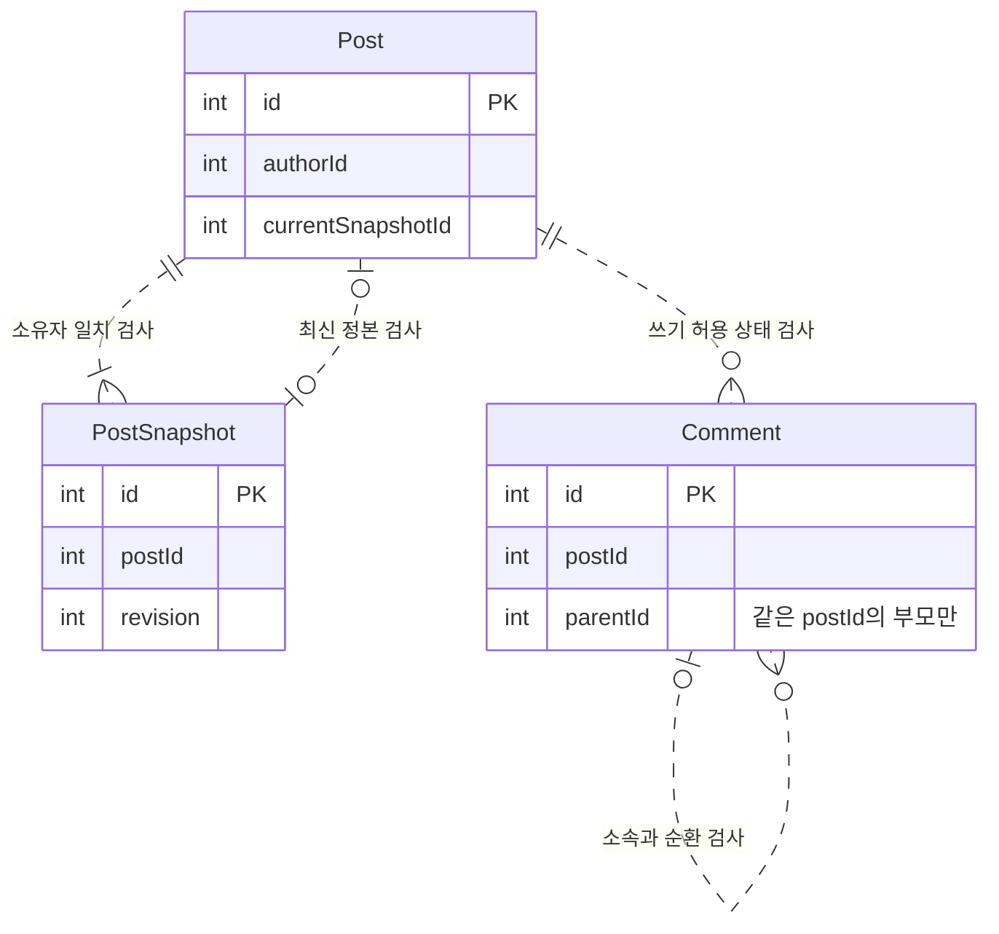

20. [참고] 이력과 독립 신고 증거를 도입하면 삭제 판단은 어떻게 달라질까요?

게시물 행을 물리 삭제하면 Comment.postId와 PostSnapshot.postId가 가리키는 소속 참조가 끊길 수 있어요. Report.payload는 독립 복사이므로 원본 Post 행이 없어도 읽을 수 있어요. 파일 바이트까지 필요하면 별도 보존 참조를 확인해야 해요. 이 범위는 [신고 관리](report-management.md#파일-증거와-보존)에서 설명해요.

이 설계는 일반 삭제를 DELETED 상태로 기록해요. 이를 소프트 삭제(soft delete)라고 해요. 상태를 바꿔도 메타데이터·스냅샷·독립 신고 증거는 자동으로 지워지지 않아요.

게시물 노출 중단, 댓글 대화 보존, 신고 증거 보존은 서로 다른 요구예요. 게시물을 숨긴다는 이유만으로 댓글이나 증거까지 지울 수는 없어요. 상태 전환은 저장량을 늘리고 별도 보존·정리 기준을 요구해요.

**설계 포인트:** 노출 상태 변경과 행 삭제를 구분해요. 댓글 대화는 [댓글 관리](comment-management.md), 참조와 삭제 책임은 [관계 무결성과 삭제](#관계-무결성과-삭제)에서 다뤄요.

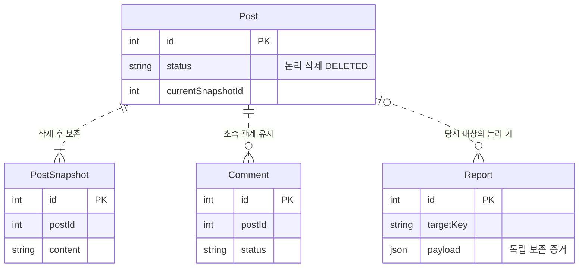

21. [참고] 존재 확인 직후 다른 요청이 부모를 삭제하면요?

서비스가 부모의 존재를 확인한 직후 다른 요청이 부모를 지울 수 있어요. 처음 확인할 때 행이 있었다는 사실만으로 자식 저장 시점까지 관계가 유지되지는 않아요.

참조를 추가하는 작업과 부모를 삭제하는 작업은 같은 대상을 보호해야 해요. 설계에 따라 잠금이나 버전 비교가 필요할 수 있어요. 여러 행을 보호하면 범위와 순서를 일관되게 정해야 해요. 순서가 다르면 교착 상태(deadlock)가 생길 수 있어요.

**설계 포인트:** 한 번의 존재 확인은 동시 삭제를 막지 않아요. 물리 FK가 없는 설계에서는 서비스가 경합까지 고려해야 해요.

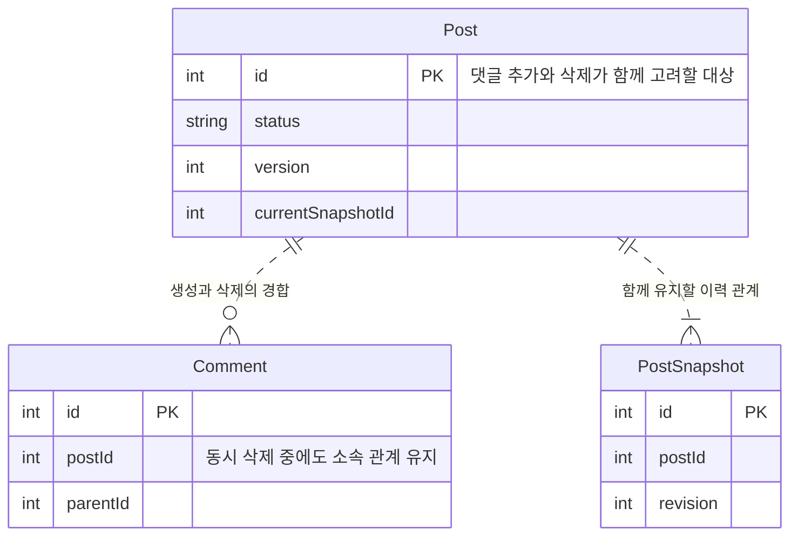

22. [참고] 신고에 남긴 당시 ID도 원본이 계속 존재해야 할까요?

현재 관계는 현재 존재하는 행을 가리켜요. 역사적 식별 정보는 당시 대상을 설명하므로 원본 행이 사라져도 남을 수 있어요. 신고 증거는 원본 삭제와 독립해 보존해야 할 수 있어요.

Report의 대상·작성자·관찰 정본 키는 당시 사실을 식별해요. PostSnapshot.editorKey도 실제 편집 방문의 논리 키예요. EventReceipt는 외부 이벤트를 기록할 수도 있으므로 항상 로컬 OutboxEvent의 행을 참조하지는 않아요.

**설계 포인트:** 논리 참조와 독립 증거를 구분해요. 원본 행이 없어져도 유지할 식별 정보에는 물리 FK를 요구하지 않아요.

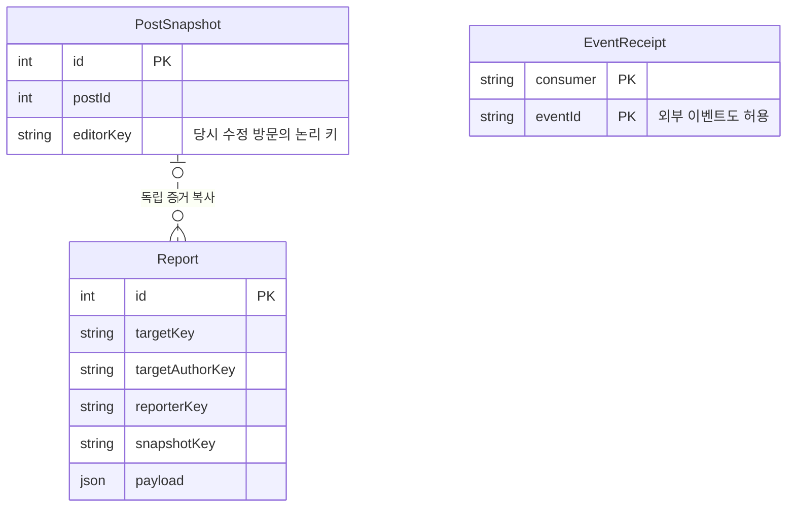

23. [참고] 세션이나 캐시가 만료되면 참조된 행도 지워도 될까요?

방문 자격이 만료돼도 그 방문이 작성한 게시물은 남을 수 있어요. 캐시의 유효 기간이 끝나도 판정 기록이 캐시를 참조할 수 있어요. 유효 기간과 행 보존 기간은 다를 수 있어요.

| 대상 | 삭제를 생각할 때 확인할 관계 |
| --- | --- |
| User | 최초 작성 콘텐츠·업로드·판정 |
| 브라우저 키·분류 캐시 | 방문·판정의 역참조 |
| 게시물·댓글 | 스냅샷·현재 포인터·답글 |
| 파일·가공 결과 | 개정·렌더·작업 결과·신고 보존 참조 |
| 독립 증거 | 원본 존재가 아니라 자체 보존 목적 |

이 설계는 일반 콘텐츠 삭제를 상태 전환으로 다뤄요. 보존할 관계가 남아 있으면 서비스는 물리 삭제를 허용하지 않아야 해요. 정리 목적으로 과거 작성자를 다른 방문에 연결하거나 증거를 바꾸지 않아요.

**설계 포인트:** 부모 삭제 때 자식을 삭제·차단·보존할지는 관계마다 정해요. 만료 시각이나 FK 유무만으로 일괄 결정하지 않아요.

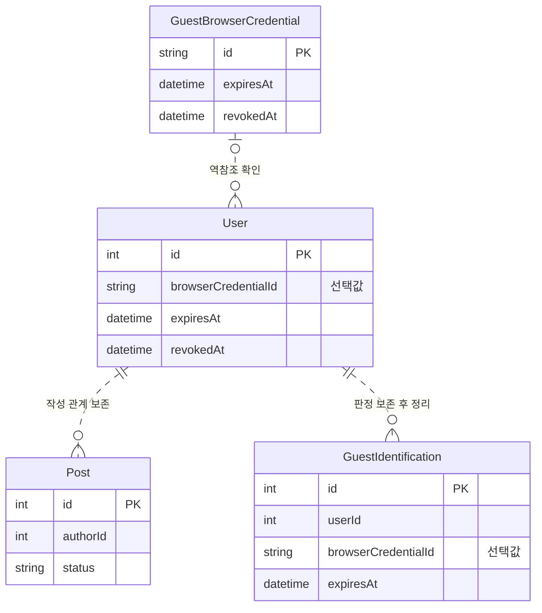

24. [참고] 운영 도구나 대량 입력이 서비스의 검사를 우회하면요?

물리 FK가 없으면 서비스 밖의 도구도 잘못된 참조를 저장할 수 있어요. 대량 입력과 정리 도구가 같은 관계 규칙을 적용하는지 고려해야 해요.

대상이 없는 참조뿐 아니라 존재하는 행 사이의 잘못된 연결도 확인해야 해요. 예를 들어 다른 게시물의 스냅샷을 현재 정본으로 가리키거나 부모 댓글의 게시물이 다를 수 있어요. 반면 독립 증거는 원본 행이 없다는 이유만으로 잘못된 데이터가 되지 않아요.

**설계 포인트:** 서비스 밖 쓰기가 만들 수 있는 오류와 점검 책임을 정해요. DB가 분리되면 한 DB의 잠금만으로 다른 DB와의 관계를 보장할 수 없어요.

## 정리

- **요구에서 출발:** 현재 값만 필요하면 한 행으로 시작해요. 이력·첨부·후속 작업은 요구가 있을 때 추가해요.
- **정본과 이력:** Post는 메타데이터, PostSnapshot은 불변 개정, currentSnapshotId는 현재 정본을 가리켜요.
- **변경의 일관성:** version 비교는 충돌을 다뤄요. 트랜잭션은 함께 저장할 변경을 다뤄요.
- **관계와 조회:** 첨부 사용 집합과 조회 조건에 맞는 인덱스를 설계해요.
- **삭제의 의미:** 상태 변경, 물리 삭제, 독립 증거 보존은 서로 달라요.
- **한계:** 논리 관계와 스키마 선언은 서비스의 권한·완결성·동시성 검사를 대신하지 않아요.

### 최종 테이블 구조

다음 그림은 이 문서가 다룬 핵심 테이블의 컬럼과 논리 관계를 모아요. 질문별 그림에서 생략한 컬럼도 포함해요. 모든 선은 물리 FK가 아니에요. 신고 증거는 원본 행에 연결된 선이 아니라 별도 문서에서 설명하는 독립 복사예요.

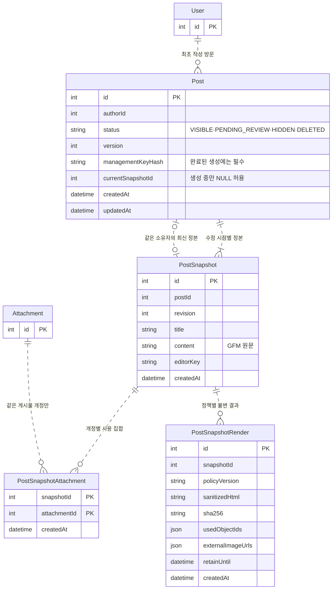

키와 인덱스는 다음과 같아요.

| 테이블 | PK·UNIQUE | 인덱스 |
| --- | --- | --- |
| Post | id, (id, currentSnapshotId) | authorId, (status, createdAt, id) |
| PostSnapshot | id, (postId, revision), (postId, id) | - |
| PostSnapshotAttachment | (snapshotId, attachmentId) | attachmentId |
| PostSnapshotRender | id, (snapshotId, policyVersion) | (retainUntil, id) |

컬럼 설명과 데이터 흐름은 [Post](../erd.md#posts)·[PostSnapshot](../erd.md#post_snapshots)·[PostSnapshotAttachment](../erd.md#post_snapshot_attachments)·[PostSnapshotRender](../erd.md#post_snapshot_renders)에서 확인해요. 댓글 관계는 [댓글 관리](comment-management.md), 증거 복사는 [신고 관리](report-management.md), 파일의 저장과 보존은 [파일 관리](file-management.md)를 참고해요.
