# 2. 게시물 관리 테이블

회의 기록을 게시물로 저장한다고 생각해 봐요. 지금의 제목과 본문만 있으면 충분할까요? 수정 전 내용·동시 수정·첨부·신고까지 필요해질 때 어떤 데이터를 나눠야 하는지 살펴봐요. 공통 조회·저장·관계의 고려사항도 이 문서에 모았어요.

- [출발 구조](#출발-구조)
- [게시물 변경 설계](#게시물-변경-설계)
- [본문과 첨부](#본문과-첨부)
- [조회와 인덱스 설계](#조회와-인덱스-설계)
- [게시물 조회](#게시물-조회)
- [저장 타입과 제약](#저장-타입과-제약)
- [관계 무결성과 삭제](#관계-무결성과-삭제)
- [정리](#정리)

## 출발 구조

가장 단순하게는 Post 한 행에 제목과 본문을 넣을 수 있어요. 다음 그림은 출발 구조이며 최종 스키마는 아니에요. 필요한 보장이 없다면 여기서 끝낼 수도 있어요.

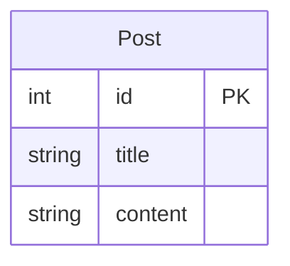

## 게시물 변경 설계

1. [실무 기본] 수정 전 내용을 다시 확인할 필요가 있을까요?

현재 내용만 필요하다면 같은 행을 갱신하는 구조로 끝낼 수 있어요. 신고 순간의 증거만 필요하다면 신고할 때 복사하는 방법도 있어요. **모든 게시판에 전체 수정 이력이 필요한 것은 아닙니다.**

이 설계는 권한자가 과거 개정과 이미지를 확인하고, 신고자가 관찰한 개정도 찾을 수 있게 해요. 그래서 특정 수정 시점의 기록인 스냅샷(snapshot)을 저장해요. 개정마다 새 행을 쌓는 구조를 이력 테이블(history table)이라고 불러요.

**Post는 게시물의 메타데이터, PostSnapshot은 시점별 내용입니다.** 기존 스냅샷을 덮어쓰지 않고 새 개정을 추가해요. 본문 형식은 GitHub의 확장 마크다운인 GFM(GitHub Flavored Markdown)으로 정했어요.

**설계 포인트:** 수정 이력이 필요한 요구부터 확인한 뒤 제목·본문을 별도 테이블로 분리해요.

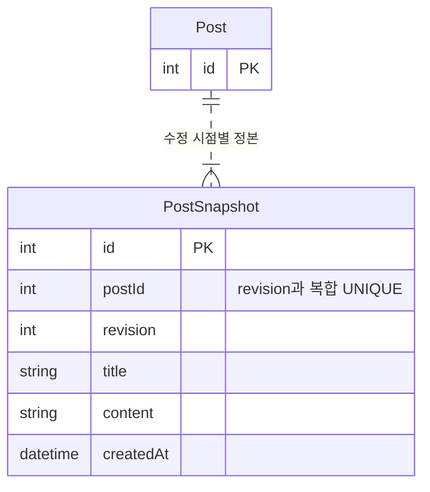

2. [실무 기본] 여러 수정 기록 중 지금 보여줄 내용은 어떻게 정할까요?

수정 이력은 1:N이지만 현재 보여줄 내용은 한 개예요. currentSnapshotId로 그 한 행을 선택할 수 있어요. 생성 시각이나 MAX(id)로 최신 내용을 추측하지 않는 설계예요.

**정본은 제목·본문과 첨부 사용의 기준이 되는 데이터입니다.** 완료된 게시물에는 최소 한 개의 정본이 필요하고, 현재 포인터는 같은 게시물의 최신 개정을 가리켜야 해요.

처음 게시물을 만들 때는 Post와 스냅샷을 순서대로 저장하므로 포인터가 잠시 NULL일 수 있어요. 하지만 저장을 마친 게시물까지 NULL이어도 된다는 뜻은 아니에요. 컬럼의 NULL 허용과 저장 완료 조건을 나눠 생각해야 해요.

**설계 포인트:** 이력의 소유자·개정 번호·현재 포인터와 최소 개수 조건을 함께 정해요.

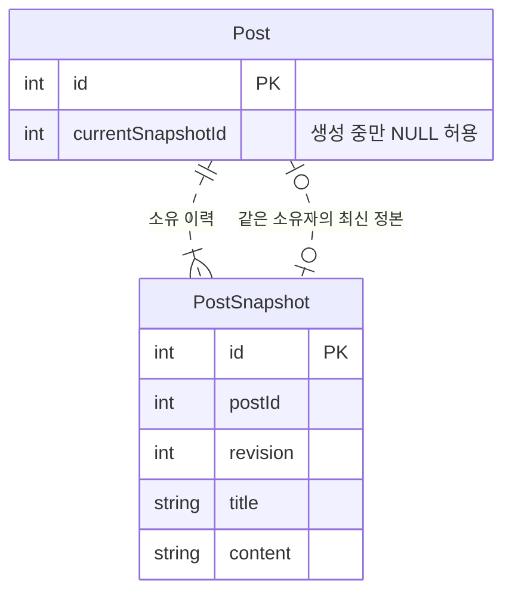

3. [실무 기본] 새 방문으로 돌아온 작성자는 글을 어떻게 관리할까요?

User는 독립 방문이므로 다음 방문에서는 다른 User가 생길 수 있어요. 그렇다고 최초 authorId를 새 방문으로 바꾸면 작성 기록의 의미가 달라져요.

이 설계는 최초 작성 방문과 해당 콘텐츠의 관리 권한을 구분해요. 관리 키를 확인할 값은 Post에, 실제 작성·수정 방문은 PostSnapshot.editorKey에 남겨요. 키의 ID나 작성자 관계가 있다는 사실만으로 권한을 인정하지는 않아요.

**설계 포인트:** 최초 작성자·실제 수정자·관리 권한은 서로 다른 사실이에요. 같은 컬럼 하나로 대신 표현하지 않아요. 방문의 의미는 [비회원 관리](guest-management.md#방문-식별과-권한)에서 설명해요.

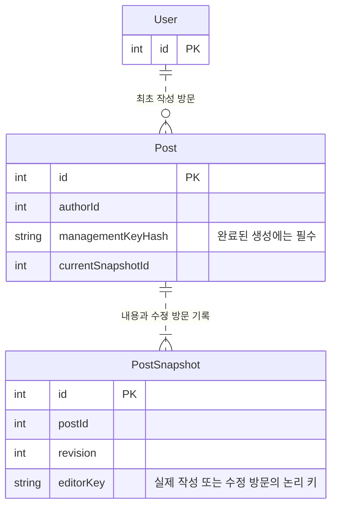

4. [실무 기본] 두 요청이 같은 글을 수정하거나 저장 중 서버가 종료되면요?

두 요청이 같은 내용을 읽고 차례로 저장하면 앞선 수정이 사라질 수 있어요. 이를 갱신 손실(lost update)이라고 해요. 어떤 버전을 기준으로 수정했는지 비교하는 낙관적 동시성 제어(optimistic concurrency control)를 고려할 수 있어요.

Post.version은 게시물 메타데이터의 변경을 구분하고, PostSnapshot.revision은 내용 개정을 구분해요. 상태만 바뀌면 새 본문 개정이 없어도 메타데이터 버전은 달라질 수 있어요. 두 번호의 역할을 섞지 않는 것이 중요해요.

**원자성(atomicity)은 묶인 변경이 모두 반영되거나 모두 취소되는 보장입니다.** 새 정본·첨부 연결·현재 포인터·버전이 일부만 남으면 완성된 게시물을 읽기 어려워져요. 함께 일관돼야 하는 데이터를 같은 트랜잭션의 범위로 정해야 해요.

후속 작업이 필요한 요구라면 변경과 OutboxEvent도 함께 고려해요. Outbox를 추가하는 이유와 한계는 [요청 실패 관리](request-failure-management.md#후속-작업의-저장)에서 이어서 설명해요.

**설계 포인트:** 버전은 수정 충돌을, 트랜잭션은 저장 묶음의 일관성을 다뤄요.

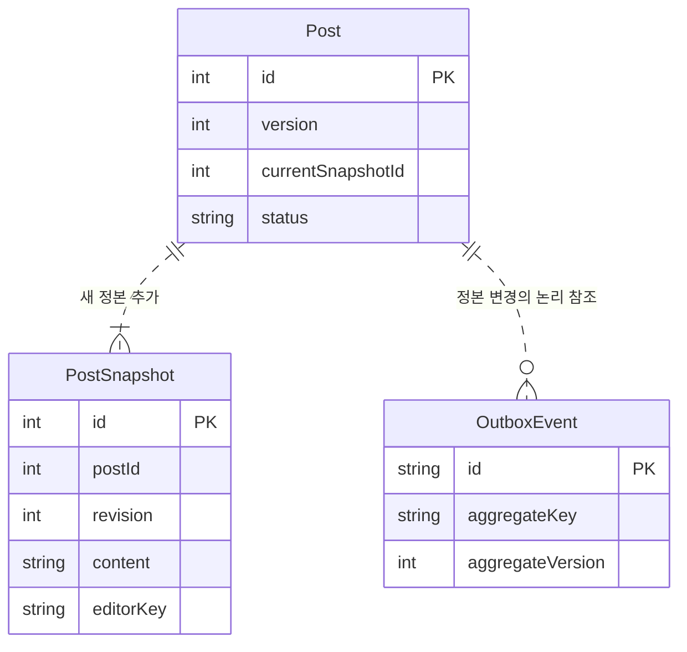

5. [실무 기본] 신고된 게시물을 삭제하면 스냅샷과 댓글도 함께 지워야 할까요?

물리 DELETE로 지우면 답글의 연결이나 신고 근거를 잃을 수 있어요. 이 설계는 일반 삭제를 DELETED 상태로 표현하고 메타데이터·스냅샷·신고 증거를 보존해요. 상태 값으로 삭제를 나타내는 방식을 소프트 삭제(soft delete)라고 해요.

게시물 삭제·댓글의 대화 구조·신고 증거는 서로 다른 요구예요. 한쪽을 삭제했다는 이유로 다른 데이터를 모두 지우는 것이 적절한지 먼저 확인해야 해요. 상태만 남기는 방법에도 저장량 증가와 별도 정리 정책이라는 비용이 있어요.

**설계 포인트:** 화면에서 보이지 않게 하는 일과 행을 없애는 일을 구분해요. 댓글은 [댓글 관리](comment-management.md), 물리 삭제는 [관계 무결성과 삭제](#관계-무결성과-삭제)에서 다뤄요.

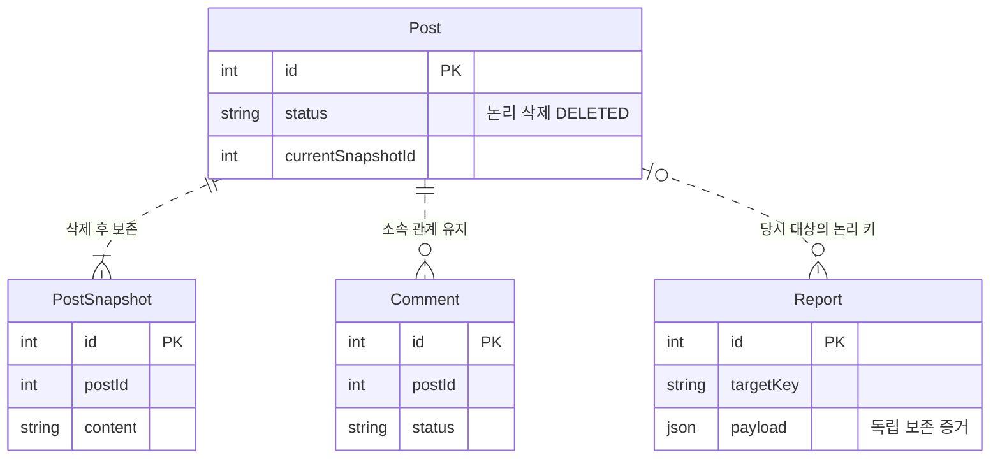

6. [심화] 첨부를 교체해도 과거 개정의 파일을 확인하려면요?

현재 본문에서 첨부를 뺐어도 과거 개정이나 신고에서 그 파일이 필요할 수 있어요. Post에 현재 첨부 ID만 두면 어느 개정이 어떤 파일을 사용했는지 잃게 돼요.

한 개정이 여러 첨부를 쓰고, 한 첨부도 같은 게시물의 여러 개정에서 다시 쓰일 수 있어요. 이런 다대다(N:M) 관계는 두 ID를 담은 조인 테이블(join table)로 풀 수 있어요. PostSnapshotAttachment는 개정별 사용 집합을 나타내요.

**설계 포인트:** 파일 자체의 메타데이터와 어느 개정이 파일을 쓰는지를 나눠요. 저장 키를 다른 바이트에 재사용하면 과거 관계의 의미도 바뀌므로 파일의 불변성과 보존을 함께 고려해요.

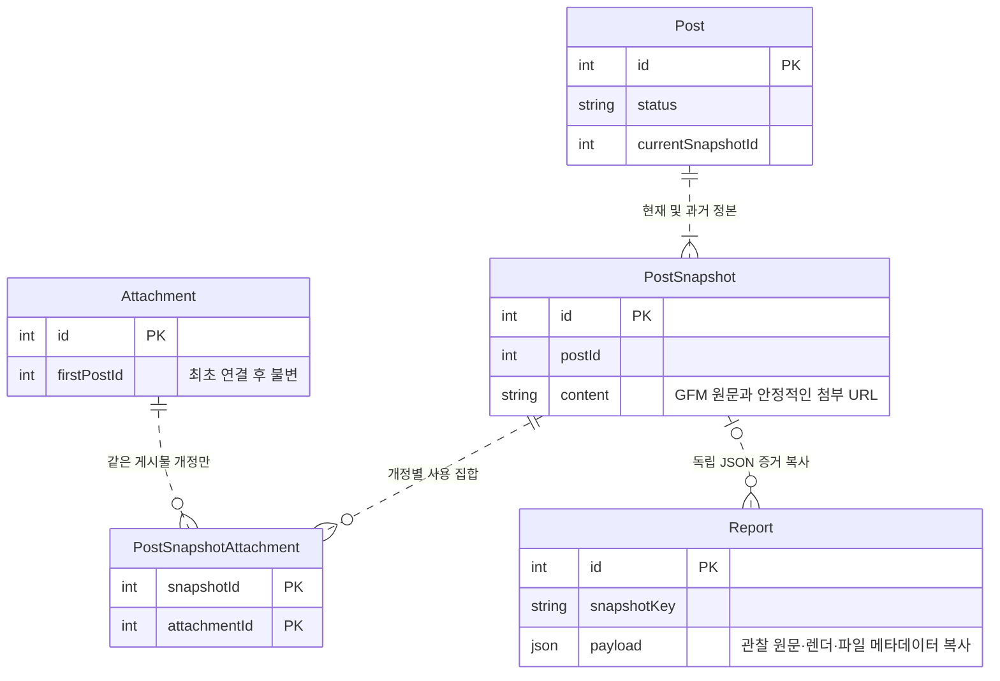

## 본문과 첨부

7. [심화] 본문에 파일 주소를 넣으면 첨부 관계도 표현된 걸까요?

본문에 주소가 있어도 DB가 첨부의 존재·소유자·사용 상태를 자동으로 알지는 못해요. 이 설계는 본문에 파일을 가리키는 정보를 두고, 개정별 첨부 집합은 PostSnapshotAttachment로 표현해요. 두 표현이 서로 다른 파일을 가리키지 않아야 해요.

본문에는 설명과 배치 순서가 이미 있어요. 관계 테이블에도 같은 순서를 복제하면 어느 쪽이 정본인지 애매해질 수 있어요. 그래서 사용 관계는 중복 없는 집합으로 두고 설명·순서는 원문이 담당해요.

**설계 포인트:** 원문·첨부 집합·가공된 표시 결과의 역할을 나눠 중복 정본을 피해야 해요.

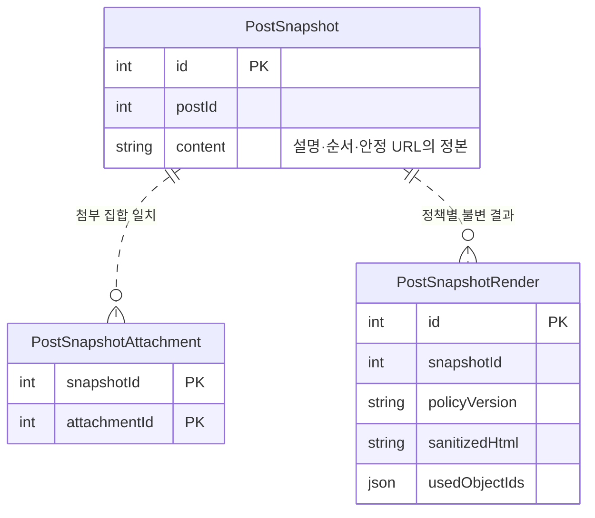

8. [심화] 원문과 렌더 결과를 왜 나눌까요?

같은 원문도 가공 정책이 달라지면 다른 표시 결과가 나올 수 있어요. 원문을 보존해야 하는지, 가공된 결과까지 관찰 기록으로 남겨야 하는지를 먼저 정해요. 그런 요구가 있다면 PostSnapshotRender를 별도로 둘 수 있어요.

이 설계는 (snapshotId, policyVersion) 조합으로 개정별·정책별 결과를 구분해요. 사용한 객체의 목록과 결과를 함께 보관하면 어떤 파일로 표시했는지도 추적할 수 있어요. 원문·렌더·파일 보존의 차이는 [신고 관리](report-management.md#파일-증거와-보존)에서 이어서 살펴봐요.

**설계 포인트:** 원문은 정본이고 렌더는 정책별 결과예요. 정책이 바뀌면 기존 결과를 덮어쓰지 않고 새 행을 추가해요.

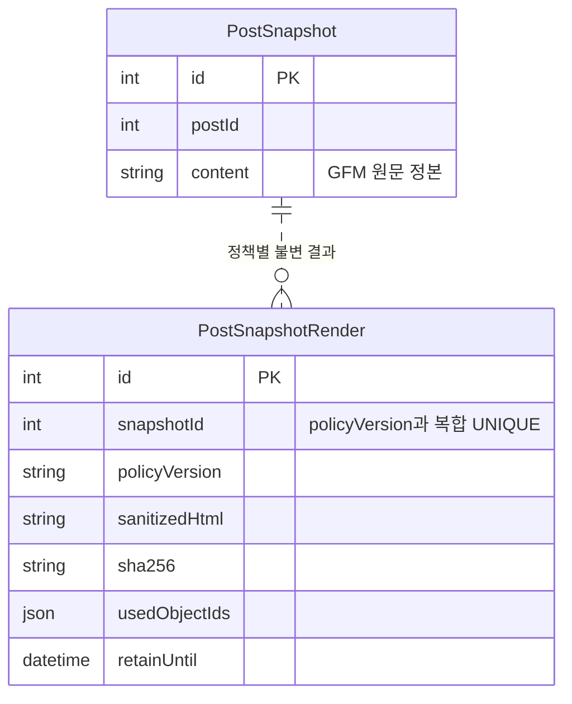

## 조회와 인덱스 설계

9. [실무 기본] 어떤 조회를 할지 정하지 않고 인덱스부터 추가해도 될까요?

인덱스는 저장하는 컬럼의 목록만 보고 정하지 않아요. 어떤 조건으로 범위를 좁히고 어떤 순서로 읽을지 먼저 정해야 해요. 관계 탐색에 쓸 참조 인덱스도 함께 고려해요.

시간순 목록에서는 같은 시각의 행이 여럿 있을 수 있어요. createdAt과 id를 함께 정렬 기준으로 두면 동률을 구분할 수 있어요. 마지막으로 읽은 값을 이어 읽는 키셋 페이지네이션(keyset pagination)을 생각할 때도 이 조합이 기준이 돼요.

인덱스가 있다고 모든 검색이 빨라지는 것은 아니에요. B-tree 인덱스만으로 임의 본문 부분 검색을 지원한다고 가정하지 않아요. 목록에 전체 본문·증거까지 필요한지, 상세 조회와 읽는 범위를 나눌지도 고려해요.

**설계 포인트:** 조회 조건·정렬·읽는 컬럼을 먼저 정하고 그 요구에 맞는 인덱스를 설계해요.

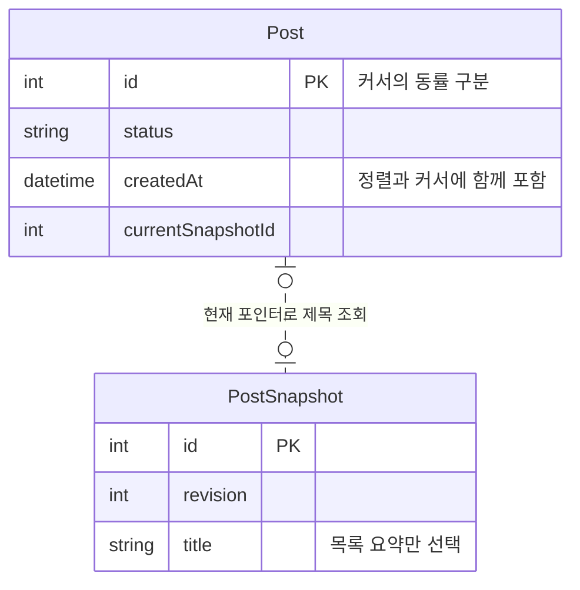

## 게시물 조회

10. [실무 기본] 게시물 목록과 상세는 같은 데이터를 읽을까요?

목록에는 제목과 생성 시각 같은 요약이 필요하고, 상세에는 본문·첨부·표시 결과가 필요할 수 있어요. 현재 포인터가 있으면 목록에서도 선택한 정본의 제목을 읽을 수 있어요.

| 조회 요구 | 고려할 데이터·인덱스 |
| --- | --- |
| 상태별 시간순 목록 | Post.status·createdAt·id, (status, createdAt, id) |
| 현재 내용 | currentSnapshot 관계와 선택한 스냅샷 |
| 개인 숨김·신고 집계 | Report의 reporterKey·targetKey·status |
| 첨부 표시 | 개정별 사용 관계와 선택 렌더 |

숨긴 게시물의 댓글이나 파일을 다른 경로로 보여줄지까지 생각해야 해요. ERD는 판단에 필요한 데이터를 표현하지만 실제 노출 조건을 실행하지는 않아요.

**설계 포인트:** 목록과 상세의 읽기 요구가 테이블 분리·현재 포인터·인덱스에 어떤 영향을 주는지 살펴봐요.

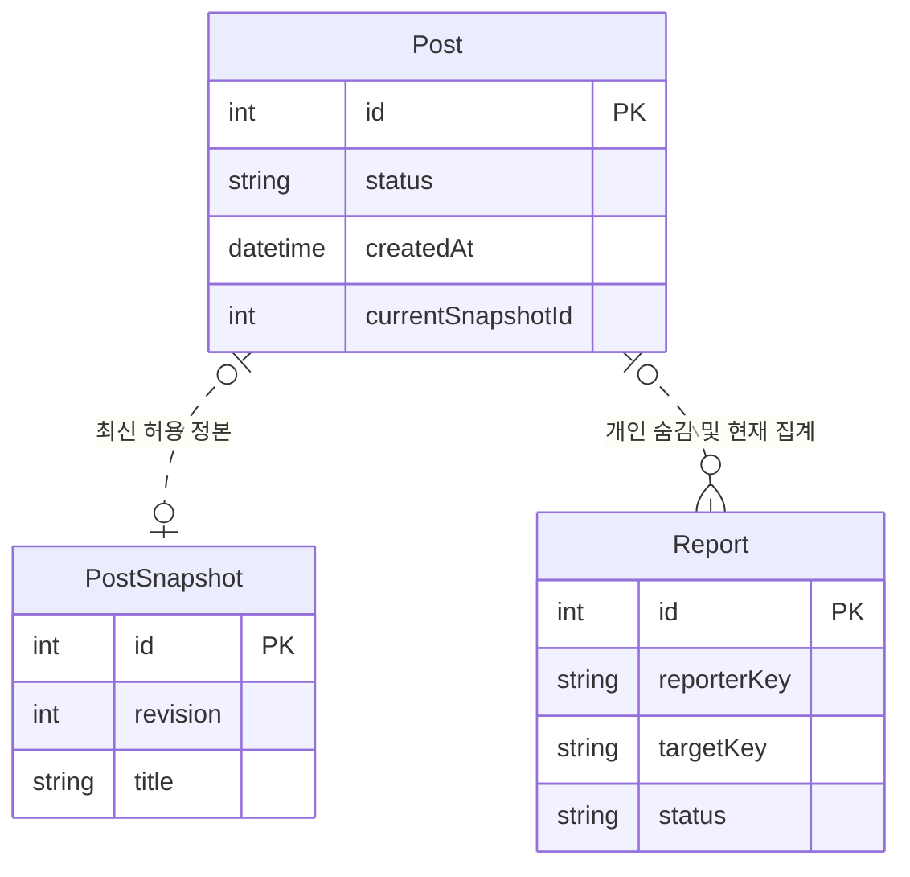

## 저장 타입과 제약

11. [실무 기본] 스냅샷만 저장되고 현재 포인터를 바꾸지 못하면요?

테이블을 나눴다고 데이터가 자동으로 함께 저장되는 것은 아니에요. 변경이 일부만 남았을 때 어떤 관계가 불완전해지는지 먼저 생각해야 해요. 스냅샷·포인터·첨부 관계의 저장은 질문 4의 원자성을 필요로 해요.

MySQL에서 이 보장을 사용할 수 있도록 InnoDB 같은 트랜잭션 지원 엔진도 고려해야 해요. 하지만 엔진 선택이 서비스의 변경 묶음이나 완료 조건을 대신 정하지는 않아요.

**설계 포인트:** 테이블의 분리와 트랜잭션의 경계를 함께 생각해요. 엔진 설정은 ERD의 관계선이나 컬럼이 아니라 실제 테이블을 만드는 설정이에요.

12. [실무 기본] 문자열 비교 규칙이 다르면 같은 키를 비교할 수 있을까요?

문자열 비교 규칙인 collation은 대소문자나 문자 표현을 어떻게 비교할지 정해요. 대소문자만 다른 두 값을 같은 키로 볼지부터 정해야 UNIQUE의 의미도 분명해져요.

테이블·컬럼·연결에서 비교 기준이 달라지면 같은 논리 키를 다르게 해석할 수 있어요. JSON에서 꺼낸 문자열과 일반 컬럼을 비교할 때도 같은 문제를 고려해야 해요. 이 설계의 논리 키는 소문자 ASCII 정본으로 구분해요.

**설계 포인트:** 문자셋은 무엇을 저장할 수 있는지, collation은 어떻게 비교할지를 결정해요. 문자열 키의 정본 형태와 중복 판단을 함께 정해야 해요.

13. [실무 기본] JSON이나 날짜 타입만 선언하면 데이터의 의미도 정해질까요?

**저장 타입과 비즈니스 의미는 다릅니다.** JSON 컬럼은 유연한 증거·가공 결과를 담을 수 있지만, 내부 구조까지 ERD의 관계선으로 표현하지는 못해요. 반복해서 검색할 값은 별도 컬럼이 필요한지도 고려해야 해요.

날짜 타입도 기준 시각을 정해 주지는 않아요. DATETIME(3)은 시간대를 함께 저장하지 않으므로 서버와 DB가 같은 UTC 기준으로 기록·해석하는 것이 중요해요.

| 데이터 | 이 설계의 표현과 고려사항 |
| --- | --- |
| 행 ID·참조 | Int, 참조 인덱스와 소유 관계 확인 |
| UUID | CHAR(36), 사람이 아닌 논리 식별자 |
| 제목·본문 | 제목 VARCHAR(200), 본문 LONGTEXT로 역할 구분 |
| 시각 | DATETIME(3), 저장·해석의 시간 기준 통일 |
| 증거·가공 결과 | JSON, 검색할 값과 불변성의 범위 구분 |
| 파일 크기 | BIGINT, 필요한 수치 범위 고려 |

**설계 포인트:** 길이·정밀도·NULL 허용·비교 규칙을 실제 데이터의 역할에 맞춰 선택해요.

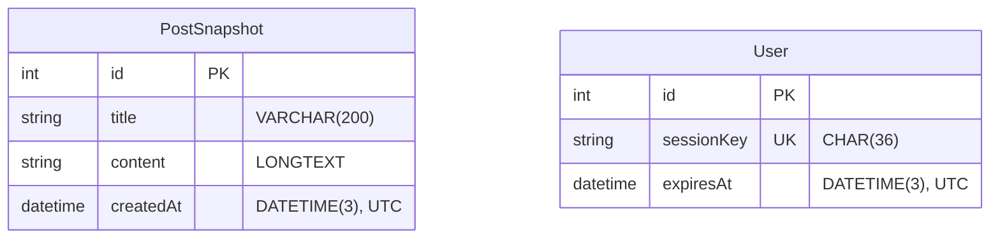

14. [실무 기본] 스키마 검사가 통과하면 설계한 보장도 모두 적용된 걸까요?

Prisma 스키마 검사는 타입과 관계 선언을 확인해요. 실제 DB에 테이블을 만들거나 서비스의 검사 로직까지 구현하는 것은 아니에요.

PK·UNIQUE·NOT NULL로 표현할 수 있는 조건과 서비스가 확인해야 하는 조건을 나눠야 해요. 현재 스냅샷의 소유자·최대 개정·관리 권한·삭제 정책은 관계선 하나만으로 모두 보장되지 않아요.

**설계 포인트:** 각 보장을 어떤 제약이나 계층이 맡는지 설명할 수 있어야 해요. 이 저장소는 ERD 설계 자료이며 DB 적용이나 API 구현의 완료를 뜻하지 않아요.

## 관계 무결성과 삭제

15. [실무 기본] FK를 없애면 방문과 게시물 사이의 관계도 없어질까요?

관계와 물리 FK는 같은 말이 아니에요. 물리 FK는 참조 무결성(referential integrity), 즉 참조 행이 실제로 존재한다는 조건을 DB가 검사하게 해요. 과제나 작은 서비스라면 FK가 안전한 기본값일 수 있어요.

FK를 빼는 경우에는 쓰기 경합, 스키마 변경 도구, DB 분리 같은 이유가 있을 수 있어요. 하지만 검사 비용이 사라지는 것은 아니에요. 서비스 버그나 직접 입력이 고아 행(orphan row)을 남길 위험도 커져요.

이 저장소는 relationMode = "prisma"로 논리 관계를 표현하고 물리 FK는 두지 않아요. PK·UNIQUE·NOT NULL·명시적 참조 인덱스는 유지해요. Prisma 관계 선언이나 관계선 자체가 모든 쓰기의 참조를 검사한다고 가정하지 않아요.

| 책임 | 설계에서 구분할 내용 |
| --- | --- |
| DB 제약 | 선언된 PK·UNIQUE·NOT NULL과 트랜잭션 |
| 서비스 | 참조 존재·소유자·상태·권한·생성 완결성·삭제 정책 |

**설계 포인트:** FK를 없애는 선택에는 대가가 있어요. 자동 Cascade·SetNull을 쓰지 않는다면 연결과 삭제를 누가 책임질지도 정해야 해요.

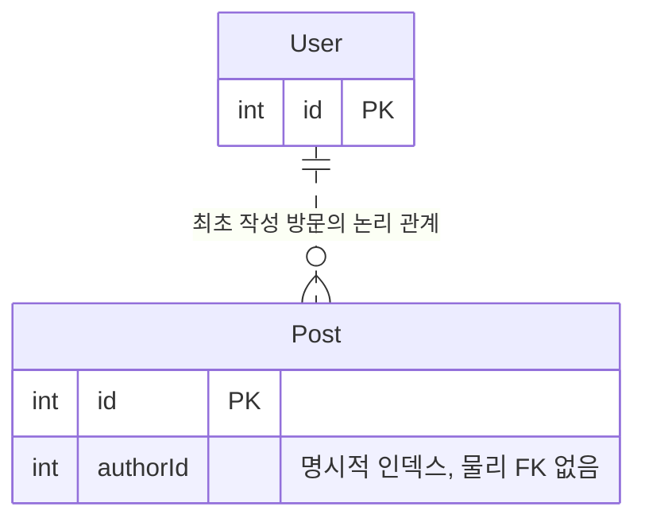

16. [실무 기본] ID가 존재하기만 하면 올바른 관계라고 볼 수 있을까요?

존재하는 스냅샷이어도 다른 게시물의 정본일 수 있어요. 존재하는 부모 댓글이어도 다른 게시물에 속할 수 있고요. 존재 확인과 소유 관계 확인은 별개의 조건이에요.

| 관계 | 함께 고려할 조건 |
| --- | --- |
| currentSnapshot | 같은 콘텐츠의 스냅샷인가, 최신 개정인가 |
| Comment.parentId | 같은 postId인가, 자기 자신이나 순환 참조는 아닌가 |
| PostSnapshotAttachment | 개정 소유 게시물과 첨부의 최초 연결 게시물이 같은가 |
| Attachment.originalObjectId | 같은 첨부의 원본 객체인가 |
| 작업 결과·렌더·신고 보존 객체 | 해당 입력·개정·증거가 사용하는 객체인가 |
| 브라우저 키·판정 참조 | 해당 방문의 연결인가, 유효한 판단 근거인가 |

완료된 콘텐츠의 최소 스냅샷처럼 개수 조건도 생각해야 해요. 컬럼을 NULL 허용으로 선언할 때는 언제 비어 있을 수 있고 언제 반드시 채워져야 하는지 구분해야 해요.

**설계 포인트:** 참조의 존재·소유자·상태·완결성을 따로 적어 보면 관계선이 보장하지 않는 조건을 찾을 수 있어요.

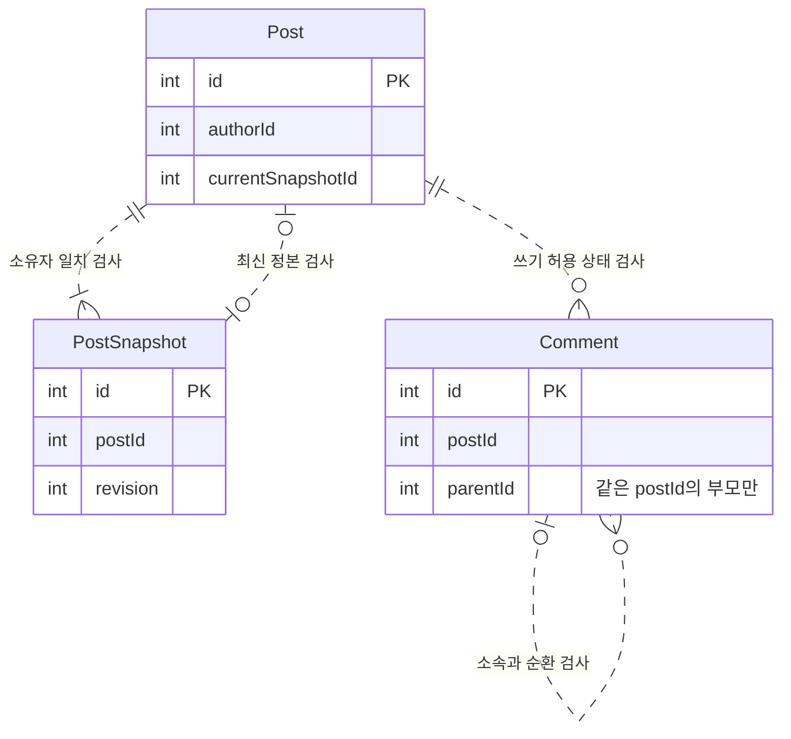

17. [심화] 존재 확인 직후 다른 요청이 부모를 삭제하면요?

존재를 확인한 순간에는 부모가 있었어도 자식을 저장하기 전에 삭제될 수 있어요. 정적인 ERD가 맞는 것과 동시 변경 중 관계가 유지되는 것은 다른 문제예요.

참조를 추가하는 경로와 부모를 지우는 경로가 같은 대상을 보호해야 해요. 잠금이나 버전 비교를 고려할 수 있고, 여러 대상을 보호한다면 일관된 범위와 순서가 필요해요. 잠금 순서가 다르면 서로 기다리는 교착 상태(deadlock)가 생길 수 있어요.

**설계 포인트:** 참조 존재를 한 번 확인하는 것만으로 동시 삭제까지 안전해지는 것은 아니에요. DB 제약 없이 관계를 유지한다면 서비스의 동시성 책임도 커져요.

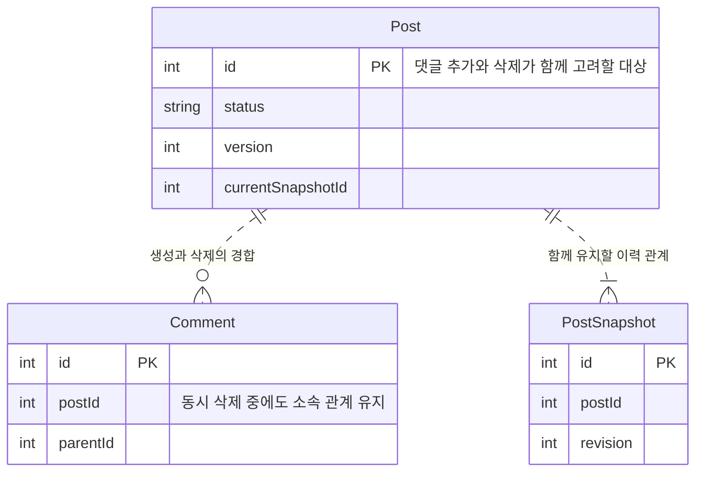

18. [실무 기본] 신고에 남긴 당시 ID도 원본이 계속 존재해야 할까요?

현재 관계와 과거 증거의 식별 정보는 역할이 달라요. 살아 있는 관계는 연결 대상이 있어야 하지만, 신고 증거는 당시 대상을 기억하기 위해 원본이 없어져도 남아야 할 수 있어요.

Report의 대상·작성자·관찰 정본 키와 스냅샷의 editorKey는 이런 역사적 식별 정보예요. EventReceipt도 외부 이벤트를 식별할 수 있으므로 항상 로컬 OutboxEvent를 요구하는 관계는 아니에요.

**설계 포인트:** 모든 ID를 무조건 FK나 살아 있는 관계로 취급하지 않아요. 참조인지 증거 복사인지부터 구분해야 삭제 정책도 정할 수 있어요.

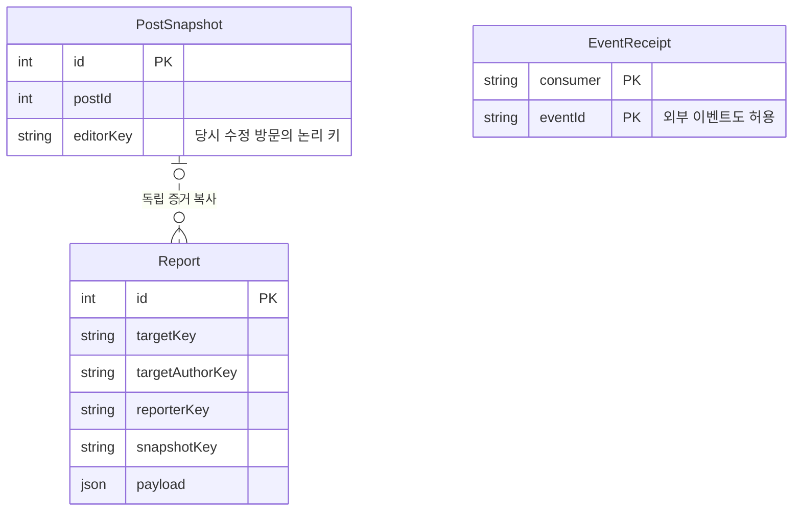

19. [실무 기본] 세션이나 캐시가 만료되면 참조된 행도 지워도 될까요?

방문이 만료돼도 작성한 게시물·댓글은 남을 수 있어요. 캐시가 만료돼도 당시 판정이 그 행을 참조할 수 있고요. 따라서 유효 기간과 행의 보존 기간은 같은 기준이 아닐 수 있어요.

| 대상 | 삭제를 생각할 때 확인할 관계 |
| --- | --- |
| User | 최초 작성 콘텐츠·업로드·판정 |
| 브라우저 키·분류 캐시 | 방문·판정의 역참조 |
| 게시물·댓글 | 스냅샷·현재 포인터·답글 |
| 파일·가공 결과 | 개정·렌더·작업 결과·신고 보존 참조 |
| 독립 증거 | 원본 존재가 아니라 자체 보존 목적 |

이 설계는 일반 콘텐츠 삭제를 상태 전환으로 다뤄요. 보존할 관계가 남아 있다면 물리 삭제를 거부해요. 정리를 위해 과거 작성자를 다른 방문에 재연결하거나 증거를 바꾸지는 않아요.

**설계 포인트:** 부모가 지워질 때 자식을 삭제·차단·보존할지 관계마다 정해야 해요. 만료 컬럼이나 FK의 유무만으로 일괄 결정하지 않아요.

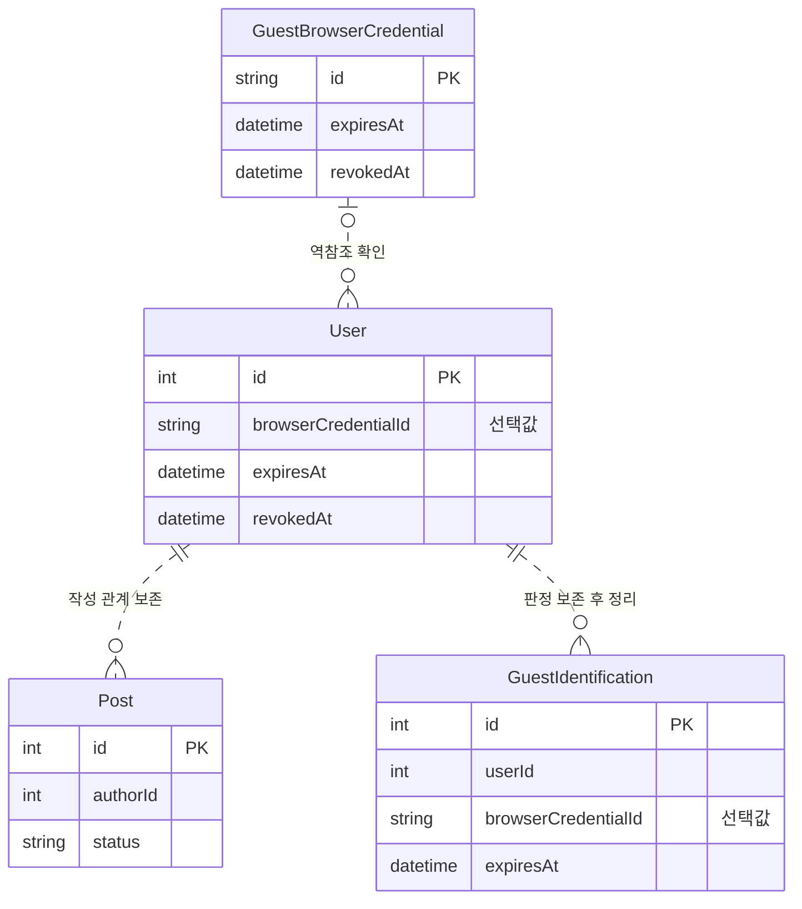

20. [심화] 운영 도구나 대량 입력이 서비스의 검사를 우회하면요?

물리 FK 없는 구조에서는 서비스 밖에서 넣은 데이터도 잘못된 참조를 만들 수 있어요. 정리 도구나 대량 입력까지 같은 무결성 기준을 적용할 수 있는지 고려해야 해요.

고아 참조만 찾는 것으로 충분하지 않을 수 있어요. 스냅샷 소유자 불일치, 다른 게시물의 부모 댓글, 비어 있는 현재 포인터처럼 존재하는 행 사이의 잘못된 연결도 있어요. 반면 원본이 없다는 이유로 역사적 증거를 오류로 취급해서는 안 돼요.

**설계 포인트:** 선택한 제약의 범위 밖에서 어떤 데이터 오류가 생길 수 있는지 설명해요. DB를 여러 곳으로 나누면 같은 DB의 잠금만으로 관계를 보장할 수 없다는 한계도 있어요.

## 정리

- **요구에서 출발:** 수정 이력·첨부·후속 작업이 필요할 때 해당 구조를 추가해요.
- **정본과 이력:** 메타데이터·시점별 내용·현재 포인터의 역할을 나눠요.
- **관계와 조회:** 개정별 사용 관계와 조회 조건에 맞는 인덱스를 설계해요.
- **변경의 일관성:** 버전·트랜잭션·소유자 검사는 서로 다른 보장을 맡아요.
- **삭제의 의미:** 상태 전환·물리 삭제·증거 보존을 구분해요.
- **한계:** ERD와 스키마 선언만으로 서비스의 권한·동시성·실제 성능이 보장되지는 않아요.

### 최종 테이블 구조

다음 그림은 이 문서에서 다룬 테이블의 전체 컬럼과 논리 관계예요. 질문별 그림에서 생략한 컬럼도 모두 포함했고, 다른 문서의 테이블은 참조 키만 표시했어요.

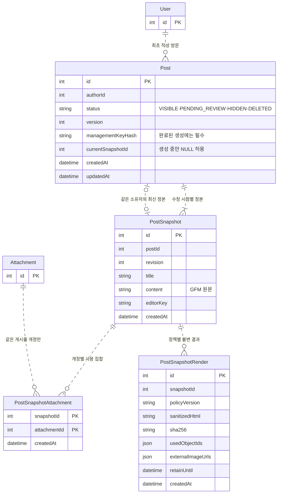

키와 인덱스는 다음과 같아요.

| 테이블 | PK·UNIQUE | 인덱스 |
| --- | --- | --- |
| Post | id, (id, currentSnapshotId) | authorId, (status, createdAt, id) |
| PostSnapshot | id, (postId, revision), (postId, id) | - |
| PostSnapshotAttachment | (snapshotId, attachmentId) | attachmentId |
| PostSnapshotRender | id, (snapshotId, policyVersion) | (retainUntil, id) |

컬럼 설명과 데이터 흐름은 [Post](../erd.md#posts)·[PostSnapshot](../erd.md#post_snapshots)·[PostSnapshotAttachment](../erd.md#post_snapshot_attachments)·[PostSnapshotRender](../erd.md#post_snapshot_renders)에서 확인해요. 댓글 관계는 [댓글 관리](comment-management.md), 증거 복사는 [신고 관리](report-management.md), 파일의 저장과 보존은 [파일 관리](file-management.md)를 참고해요.
