# 4. 신고 관리 테이블

신고는 게시물이나 댓글을 대상으로 접수합니다. 대상 식별·독립 증거·숨김·검수·중복 기준을 먼저 설계해요. 전체 수정 이력이 있어야만 신고 기능을 만들 수 있는 것은 아니에요. 관찰 개정과 파일 보존은 추가 요구가 있을 때 살펴봐요.

신고 기능은 교육 과제의 선택 요구입니다. 이 문서는 설계 선택을 설명하며 서비스 구현을 뜻하지 않아요.

- [출발 구조](#출발-구조)
- [신고 대상의 식별](#신고-대상의-식별)
- [신고 증거의 보존과 저장 방식](#신고-증거의-보존과-저장-방식)
- [숨김과 검수의 구분](#숨김과-검수의-구분)
- [재전송과 반복 신고](#재전송과-반복-신고)
- [검수 목록과 검색 정보](#검수-목록과-검색-정보)
- [관찰 개정과 파일 증거](#관찰-개정과-파일-증거)
- [확장: 관찰 개정의 식별](#관찰-개정의-식별)
- [확장: 파일 증거와 보존](#파일-증거와-보존)
- [정리](#정리)

## 출발 구조

신고 번호와 대상 번호만 저장하면 무엇이 빠질까요? 게시물 12와 댓글 12가 모두 있을 수 있어요. 숫자만으로는 어느 대상을 신고했는지 알 수 없어요. 대상이 바뀌거나 사라지면 신고 당시 내용도 알 수 없습니다.

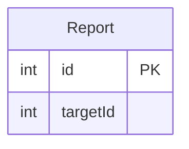

## 신고 대상의 식별

1. [기본] 게시물과 댓글의 ID가 같으면 어느 대상을 신고한 걸까요?

게시물 12와 댓글 12는 서로 다른 행이에요. `targetId`만 저장하면 신고 대상의 종류를 알 수 없어요. 신고 대상은 종류와 번호를 함께 식별해야 합니다.

여러 테이블 중 하나를 가리키는 구조를 다형 연관(polymorphic association)이라고 해요. `targetType`과 `targetId`를 함께 저장하면 종류별 대상을 구분할 수 있어요. 하지만 대상 테이블이 하나로 정해지지 않으므로 이 두 값으로 물리 외래 키(FK)를 만들 수는 없어요.

대상 종류마다 참조 컬럼을 두거나 신고 테이블을 나누는 방법도 있어요. 이 설계는 공통 `Report`에서 신고와 검수 정보를 관리해요. 서비스는 신고 접수 시 대상의 존재와 종류가 일치하는지 검사해야 합니다. 이 관계는 논리 참조이며 DB가 대상 행을 보장하지 않아요.

아래 그림은 종류와 번호를 함께 저장하는 이유를 보여줘요. 선은 물리 FK가 아니라 신고 대상의 논리 참조입니다.

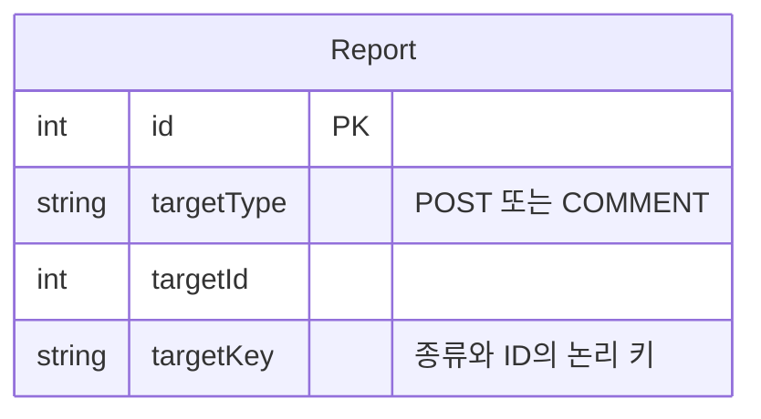

## 신고 증거의 보존과 저장 방식

2. [기본] 작성자가 내용을 바꾸거나 삭제하면 무엇을 보고 검수할까요?

신고 접수 뒤 작성자가 게시물 내용을 바꿀 수 있어요. 검수자가 현재 게시물만 읽으면 신고자가 본 내용과 다를 수 있습니다. 원본을 삭제하면 현재 행을 읽지 못할 수도 있어요.

신고 순간의 내용만 보존하려면 전체 수정 이력 없이도 그 내용을 독립 증거로 복사하는 방법을 검토할 수 있어요. 이 저장소가 선택한 최종 구조는 신고자가 관찰한 정본의 내용을 `Report.payload`에 복사해요. 원본을 계속 읽는 대신 신고 기록에 증거를 남깁니다. 원본과 사본은 같은 행이 아니며, 원본 변경에 맞춰 사본을 고치지 않아요.

정규화(normalization)는 같은 사실을 여러 곳에서 갱신해 값이 어긋나는 문제를 줄이는 설계 원칙이에요. 신고 증거는 목적이 달라요. 과거 관찰을 남기려면 의도적으로 증거를 복사하는 비정규화(denormalization)가 필요할 수 있어요. 이 복사는 원본의 보존을 대신하지 않고, 원본 보존은 게시물 설계의 책임입니다.

다음 그림은 내용 복사의 최소 출발점이에요. 이력을 선택한 최종 스키마의 관찰 개정과 키는 [관찰 개정과 파일 증거](#관찰-개정과-파일-증거)에서 설명해요. 관계선은 증거 복사를 뜻하며 물리 FK가 아니에요.

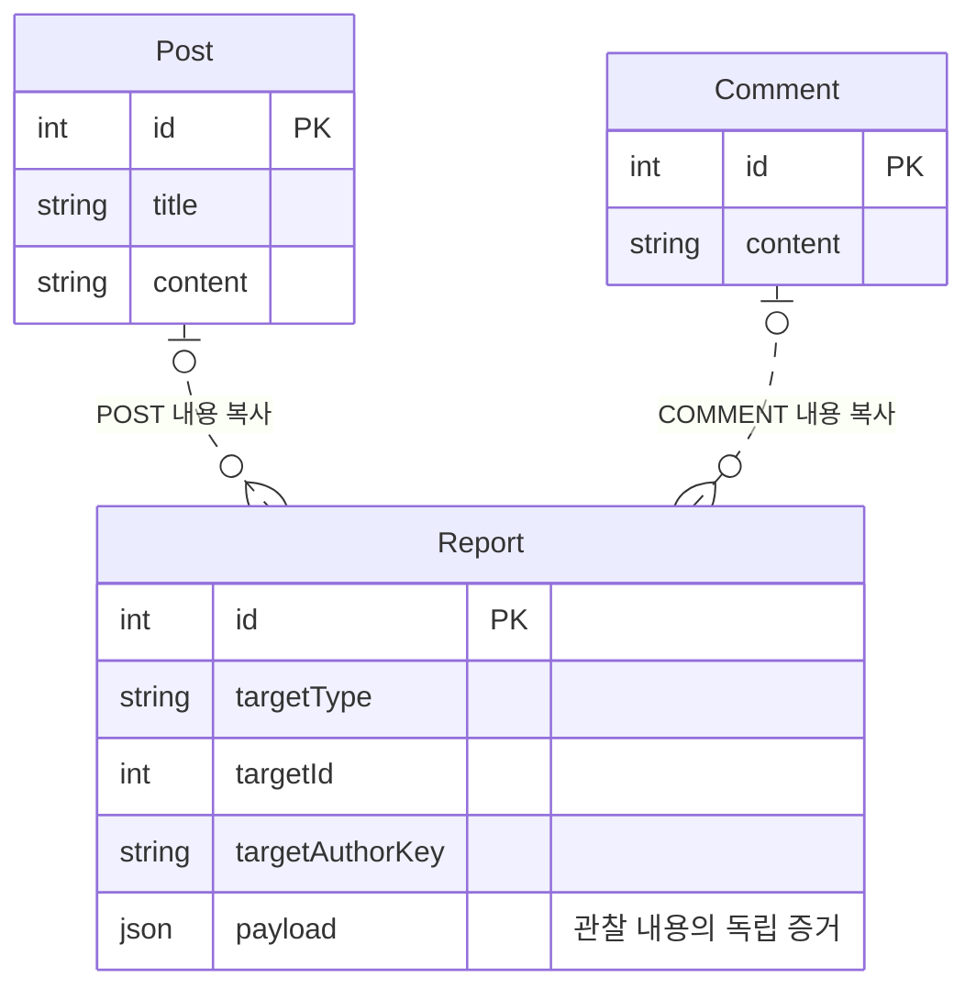

3. [기본] 모든 증거 항목을 같은 컬럼으로 만들어야 할까요?

게시물에는 제목과 본문이 있지만 댓글에는 제목이 없어요. 모든 종류의 값을 컬럼으로 두면 사용하지 않는 선택 컬럼이 늘고, 어떤 값이 필요한지 분명하지 않을 수 있습니다.

종류별 증거 테이블은 고정 컬럼과 DB 제약을 표현하기 쉬워요. 공통 `Report`와 JSON 증거는 종류별 내용을 담기 편해요. 대신 JSON 내부의 구조와 검색 컬럼 간 일치는 ERD만으로 모두 강제할 수 없습니다.

이 설계는 공통 신고 정보는 `Report` 컬럼에 두고, 종류에 따라 달라지는 증거는 `payload`에 복사해요. 검색에 쓸 값은 별도 컬럼으로 둡니다. JSON의 세부 필드 계약이나 API 명세는 이 문서의 범위가 아니에요.

다음 그림은 종류별로 다른 증거를 공통 Report에 담는 선택을 보여줘요. JSON 내부의 세부 필드 계약은 다루지 않아요.

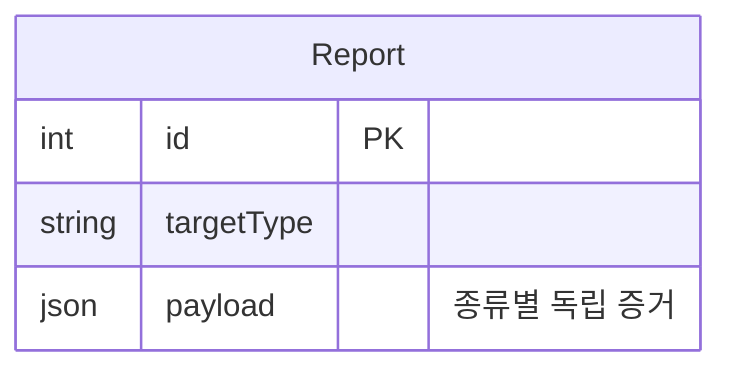

## 숨김과 검수의 구분

4. [기본] 신고한 사람에게만 숨길지 모두에게 숨길지는 어떻게 나눌까요?

신고자 한 명에게 숨기려면 어느 방문이 어떤 대상을 신고했는지 구분해야 해요. 모든 방문자에게 숨기려면 대상별 신고를 집계하고 콘텐츠의 노출 상태를 판단해야 합니다.

같은 방문이 한 콘텐츠를 여러 번 신고하면 신고 행이 여러 개가 될 수 있어요. 이력을 선택한 최종 구조에서는 다른 개정의 신고도 별도 행으로 남을 수 있어요. 이 설계에서 콘텐츠별 신고 집계는 `targetKey`와 서로 다른 `reporterKey`를 기준으로 생각해요. 방문 수는 실제 사람 수를 증명하지 않습니다.

`Report.status`는 신고의 검수 상태예요. `Post.status`와 `Comment.status`는 콘텐츠의 노출 상태예요. 신고가 접수됐다는 사실만으로 콘텐츠가 숨겨지거나 검수가 끝났다고 볼 수 없어요. 콘텐츠 상태의 변경은 콘텐츠 설계와 서비스 판단의 책임입니다.

아래 그림은 신고 상태와 콘텐츠 상태가 별도라는 점을 보여줘요. 각 선은 집계 또는 소속을 나타내는 논리 관계입니다.

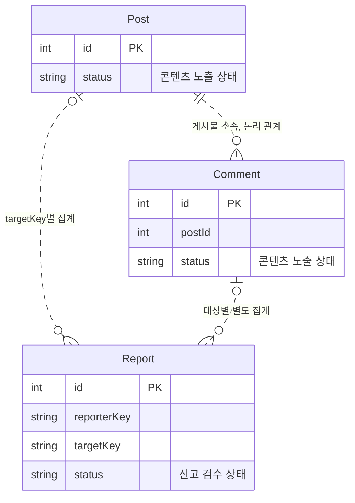

5. [기본] 검수 결과를 기록하면서 신고 증거도 바꿔도 될까요?

검수자가 증거를 결과로 덮어쓰면 신고 당시 자료와 검수 판단을 구분할 수 없어요. `payload`는 신고 당시 증거를 보존해요. `review`는 그 증거와 별도로 검수 결과를 저장합니다.

신고가 접수되면 `status`는 `PENDING`이고 `review`와 `reviewedAt`은 NULL이에요. 검수가 끝나면 상태는 `CONFIRMED` 또는 `REJECTED`가 되고 결과와 시각을 저장하는 구조입니다. 이 상태별 조합은 문서가 설명하는 설계 규칙이며, 스키마의 NULL 허용만으로 조합 전체가 강제되지는 않아요.

두 검수자가 동시에 같은 신고를 바꾸면 한 판단이 다른 판단을 덮을 수 있어요. `version`은 변경 충돌을 구분하는 값이에요. 서비스는 버전을 확인하고 허용된 상태 전이를 검사해야 합니다. 검수자의 신원은 비회원 작성 방문 키와 같은 값으로 취급하지 않아요.

서비스는 신고 상태·검수 결과·검수 시각을 함께 저장해야 해요. 다음 그림은 신고 증거와 검수 결과를 나눈 구조예요. 후속 작업을 도입한 최종 구조의 변경·작업 기록 원자성은 [변경과 작업 기록의 원자 저장](request-failure-management.md#변경과-작업-기록의-원자-저장)에서 설명해요.

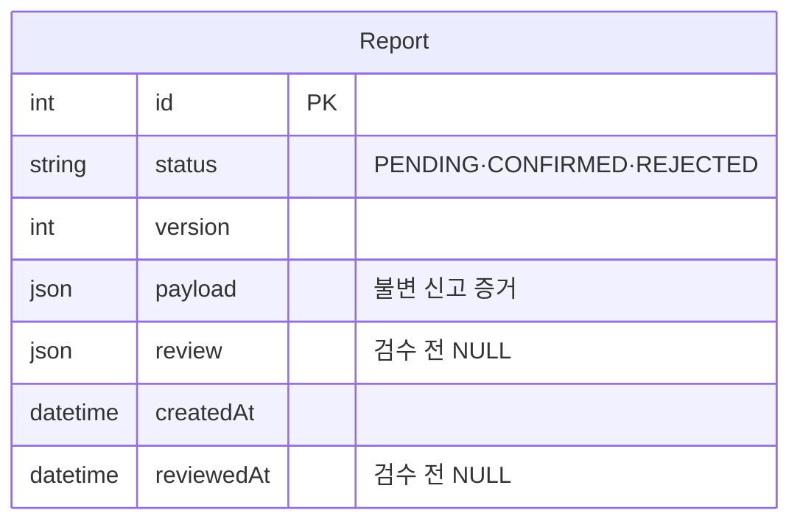

## 재전송과 반복 신고

6. [기본] 응답이 끊겨 다시 보내는 신고와 반복 신고는 같은 문제일까요?

신고 저장 뒤 응답이 끊기면 클라이언트가 같은 요청을 다시 보낼 수 있어요. 같은 방문자가 같은 게시물을 반복해서 신고할 수도 있습니다. 두 상황은 같은 신고가 아닙니다.

| 구분할 상황 | 기준 | 스키마의 제약 | 남는 한계 |
| --- | --- | --- | --- |
| 같은 요청의 재시도 | `eventId` | `eventId` UNIQUE | 같은 키에 다른 내용이 오면 서비스가 충돌로 판단해야 함 |
| 이력을 선택한 최종 구조의 같은 방문·대상·개정 신고 | `(reporterKey, targetKey, snapshotKey)` | 복합 UNIQUE | 다른 개정은 다른 신고로 구분함 |

`Report.eventId`는 같은 요청의 재전송을 구분하는 멱등 키(idempotency key)예요. 요청 키와 반복 신고의 기준은 따로 정해야 해요. 이 설계는 관찰 개정도 중복 기준에 포함해요. 개정 식별은 [관찰 개정과 파일 증거](#관찰-개정과-파일-증거)에서 설명해요.

별도 후속 작업은 신고 접수의 필수 구조가 아니에요. 필요할 때 [저장 이후의 후속 작업과 실패](request-failure-management.md)를 읽어요.

다음 그림은 요청 키와 신고 대상의 역할을 구분해요. 관찰 개정을 쓰는 복합 UNIQUE 조건은 위 표의 최종 구조에 해당해요.

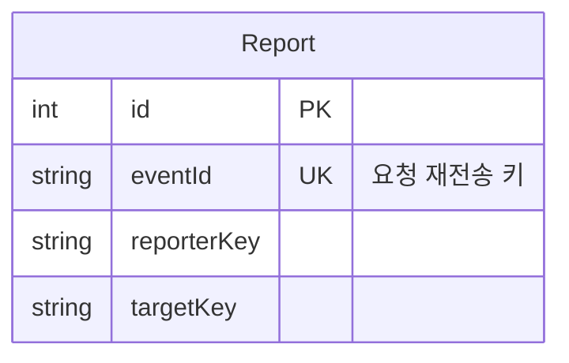

## 검수 목록과 검색 정보

조회 조건과 읽을 정보를 먼저 정하고, 필요한 검색 컬럼과 인덱스를 선택해요.

7. [기본] 신고 목록과 증거 상세를 같은 데이터로 읽을까요?

검수 목록은 대상, 상태, 접수 시각을 보여줄 수 있어요. 큰 증거 내용까지 목록마다 읽으면 필요하지 않은 데이터도 반복해서 읽게 됩니다. 먼저 어떤 조건으로 찾고 어떤 순서로 정렬할지 정해야 해요.

| 조회 요구 | 고려할 인덱스 |
| --- | --- |
| 상태별 시간순 검수 목록 | `(status, createdAt, id)` |
| 최초 작성 방문별 신고 목록 | `(targetAuthorKey, createdAt, id)` |
| 대상별 상태 집계 | `(targetKey, status)` 또는 `(targetType, targetId, status)` |

`payload`를 독립 증거로 저장하면 원본 콘텐츠를 읽지 않고 신고 내용을 확인하는 설계를 할 수 있어요. 관리자 접근 권한은 이 구조가 대신하지 않습니다. 공통 조회 원칙과 페이지 순서는 [조회와 인덱스 설계](post-management.md#조회와-인덱스-설계)를 참고해요.

아래 그림은 목록 요약 정보와 상세 증거가 한 신고에 함께 저장되는 점을 보여줘요. 컬럼을 읽는 권한 정책은 서비스가 정해야 합니다.

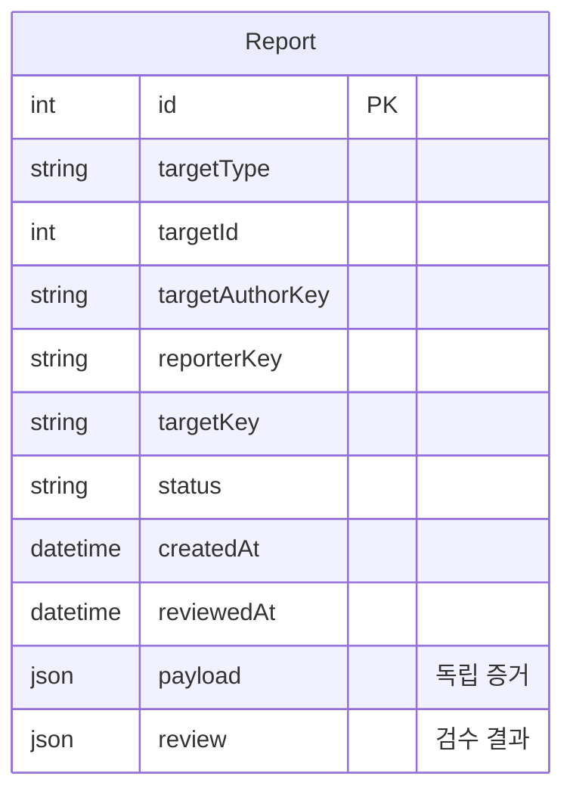

8. [기본] 증거에 이미 있는 대상 정보를 별도 컬럼으로도 둘까요?

대상 정보가 증거 안에만 있으면 목록을 만들 때 큰 JSON을 읽어야 할 수 있어요. 검색과 집계에 필요한 값은 별도 컬럼에 둘 수 있습니다. 큰 증거를 매번 읽지 않고 조건에 맞는 신고를 찾기 위한 선택이에요.

증거에서 꺼내 별도 컬럼으로 저장한 값을 투영(projection)이라고 해요. `targetType`, `targetId`, `targetAuthorKey`, `targetKey`는 검색과 집계를 돕습니다. `payload`는 관찰 당시 증거를 보존해요. 이력을 선택한 최종 구조에서는 관찰 개정의 `snapshotKey`도 별도 컬럼에 둬요.

같은 대상을 두 곳에 저장하면 값이 서로 달라질 수 있어요. DB의 인덱스와 UNIQUE 제약은 각 컬럼의 키 조건을 보장하지만 `payload` 내부 값과의 일치는 모두 표현하지 못합니다. 서비스는 증거와 검색 컬럼의 일치를 확인해야 해요.

아래 그림은 검색용 컬럼과 증거 JSON이 다른 목적을 가진다는 점을 나타냅니다.

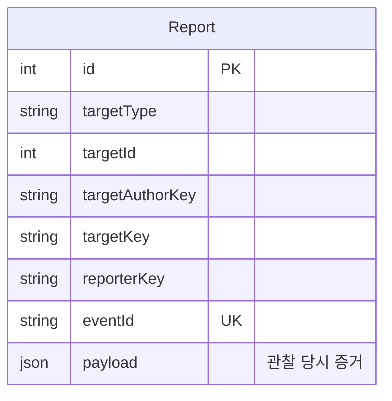

## 관찰 개정과 파일 증거

개정 식별은 [수정 이력과 현재 내용](post-management.md#수정-이력과-현재-내용)을 읽은 뒤 살펴봐요. 파일 증거는 [파일 정보와 바이트의 저장](file-management.md#파일-정보와-바이트의-저장)을 먼저 읽어요.

### 관찰 개정의 식별

9. [확장] 신고 직전에 글이 바뀌면 어떤 개정을 남길까요?

신고자가 게시물 개정 4를 읽은 직후 작성자가 개정 5를 저장했다고 해볼게요. 신고 접수 시점에 최신 내용만 복사하면 개정 5가 증거로 남아요. 그러나 신고자가 관찰한 내용은 개정 4예요.

신고 기록은 콘텐츠와 관찰 정본을 따로 식별해야 해요. `targetKey`는 같은 콘텐츠를 모으는 키예요. `snapshotKey`는 관찰한 정본을 구분해요. `reporterKey`는 신고한 방문을 나타내고, `targetAuthorKey`는 최초 작성 방문을 나타냅니다.

키가 있다는 사실만으로 방문자가 실제 내용을 읽었거나 신고 권한이 있다고 증명하지는 않아요. 서비스는 신고 접수 시 허용할 정본과 방문 정보를 검사해야 합니다. 스키마는 식별 정보를 저장하지만 관찰 사실을 확인하지 않아요.

아래 그림은 신고가 개정 4의 증거를 담고, 현재 정본은 개정 5가 되는 경우를 구분해요. JSON 필드의 내부 계약은 이 문서에서 정의하지 않습니다.

저장을 완료한 Post에는 최소 한 개의 PostSnapshot이 필요합니다. 서비스가 이 조건을 확인하고 저장을 완료해요. 증거 복사선의 선택 분기는 신고 종류를 구분하며 원본 행의 계속된 존재를 요구하지 않아요.

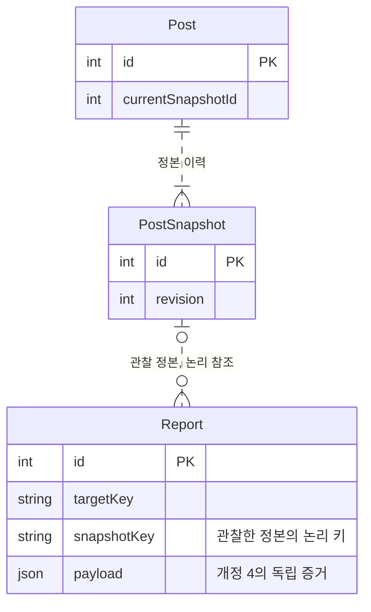

### 파일 증거와 보존

10. [확장] 원문은 남아 있지만 당시 표시 결과나 파일이 달라지면요?

게시물 원문이 같아도 렌더 정책이 달라지면 화면 결과가 달라질 수 있어요. 첨부 파일의 이름이나 메타데이터가 바뀌거나 실제 객체가 삭제될 수도 있습니다. 어떤 자료를 증거로 남길지 구분해야 해요.

| 남길 자료 | 저장 방식 | 보장하지 않는 내용 |
| --- | --- | --- |
| 관찰한 정본·렌더·파일 메타데이터 | `Report.payload`에 독립 JSON 증거로 복사 | 원본의 이후 보존 |
| 관리 중인 원본·파생 파일 바이트 | `ReportStoredObject`로 객체 보존 참조 | 바이트나 메타데이터 사본 생성 |
| 외부 이미지 URL | 관찰 당시 주소를 증거에 기록 | 외부 서버의 파일 바이트 보존 |

정책별 렌더 결과가 필요하면 `PostSnapshotRender`로 개정과 정책 버전을 구분할 수 있어요. 신고에는 관찰한 렌더 결과를 증거로 복사합니다. 렌더 HTML과 파일 바이트는 서로 다른 자료예요.

`ReportStoredObject`는 바이트 복사본이 아니에요. 신고 증거가 사용하는 관리 객체를 가리키는 보존 참조입니다. `(reportId, objectId)` 복합 기본 키는 같은 참조의 중복을 막고, `objectId` 인덱스는 객체를 참조하는 신고를 찾는 데 씁니다. 서비스는 증거 JSON과 객체 집합이 일치하는지 확인하고, 보존 정책이 끝나기 전에는 참조 객체를 삭제하지 않아야 해요.

검수가 끝나도 증거 보존 목적이 끝났다고 단정할 수 없어요. 보존 기간과 삭제 시점은 정책으로 정해야 합니다. 외부 URL을 저장해도 외부 소유자의 파일이 그대로 남는다는 보장은 없어요. 파일 바이트와 저장소 메타데이터의 공통 설계는 [파일 관리](file-management.md)를 참고해요.

아래 그림은 JSON 증거 복사와 관리 객체 보존 참조를 구분해요. 모든 선은 논리 관계입니다.

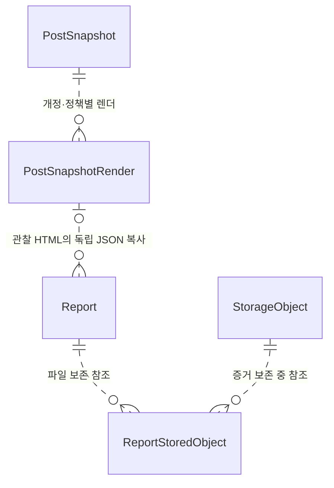

## 정리

- **대상 식별:** `targetType`과 `targetId`로 종류별 대상을 구분해요. 대상 행과의 관계는 물리 FK가 아니며 서비스가 신고 접수 시 존재와 일치를 확인해야 합니다.
- **독립 증거:** `payload`는 신고자가 관찰한 정본을 복사해요. 원본 변경이나 삭제 뒤에도 신고 증거를 읽기 위한 구조입니다. 보존된 증거를 읽을 때는 원본 행의 계속된 존재를 요구하지 않아요.
- **역사적 식별:** 키는 대상·정본·방문을 구분하지만 실제 관찰이나 권한을 증명하지 않아요.
- **중복 기준:** `eventId`는 같은 요청을, 복합 UNIQUE는 같은 방문·대상·개정 신고를 구분해요.
- **상태 책임:** 신고 검수 상태와 콘텐츠 노출 상태는 별도 책임이에요. 방문 수는 실제 사람 수가 아닙니다.
- **보존 한계:** 파일 메타데이터 복사는 바이트 보존을 대신하지 않아요. 외부 URL은 외부 파일의 보존을 보장하지 않습니다.

### 최종 테이블 구조

다음 그림은 `Report`와 `ReportStoredObject`의 전체 컬럼과 키를 보여줘요. 다른 문서의 테이블은 참조 키만 표시합니다. 원본 대상과 방문 키는 논리 식별 정보이므로 원본 콘텐츠 테이블과 선을 연결하지 않아요.

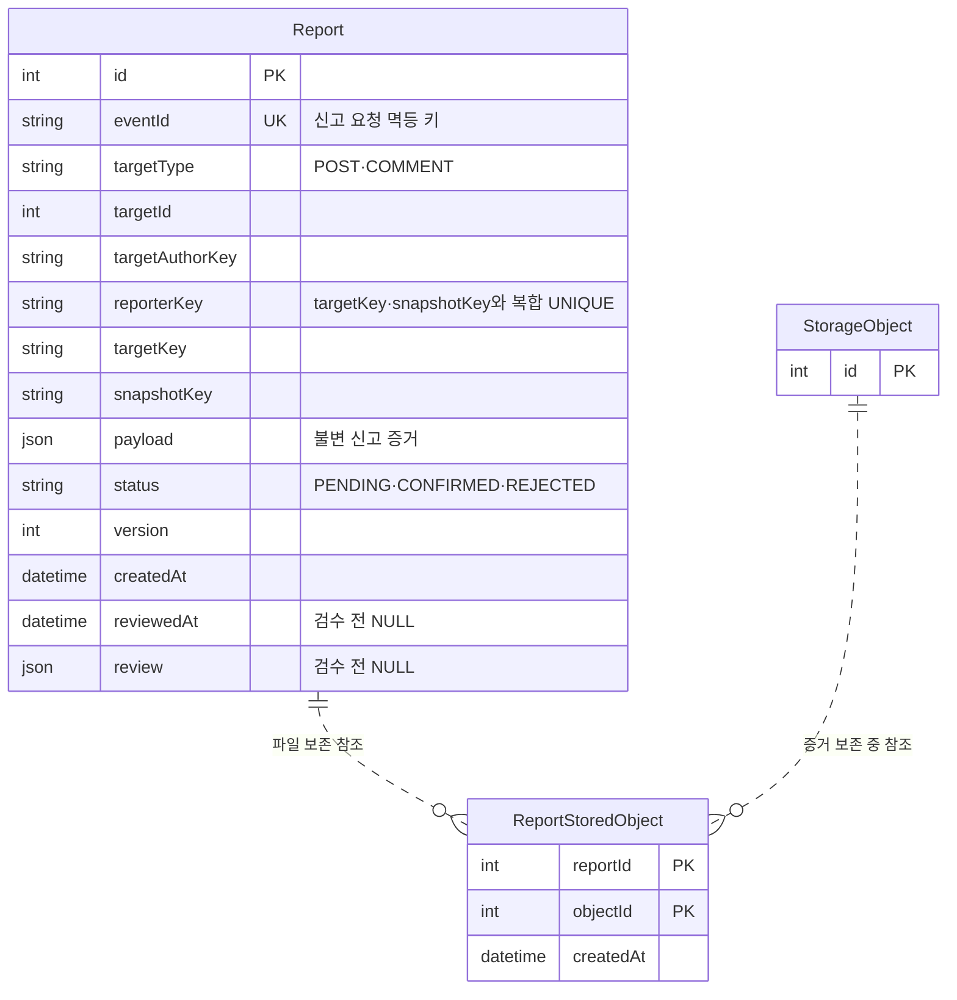

키와 인덱스는 다음과 같아요.

| 테이블 | PK·UNIQUE | 인덱스 |
| --- | --- | --- |
| `Report` | `id`, `eventId`, `(reporterKey, targetKey, snapshotKey)` | `(targetKey, status)`, `(targetType, targetId, status)`, `(status, createdAt, id)`, `(targetAuthorKey, createdAt, id)` |
| `ReportStoredObject` | `(reportId, objectId)` | `(objectId)` |

전체 컬럼과 데이터 흐름은 [Report](../erd.md#reports)와 [ReportStoredObject](../erd.md#report_stored_objects)에서 확인해요. 참조와 역사적 식별 정보의 차이는 [관계 무결성과 삭제](post-management.md#관계-무결성과-삭제)를 참고해요.
