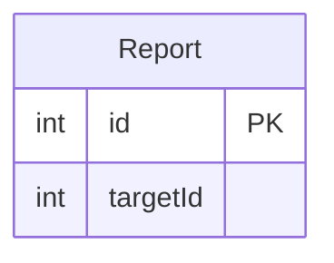
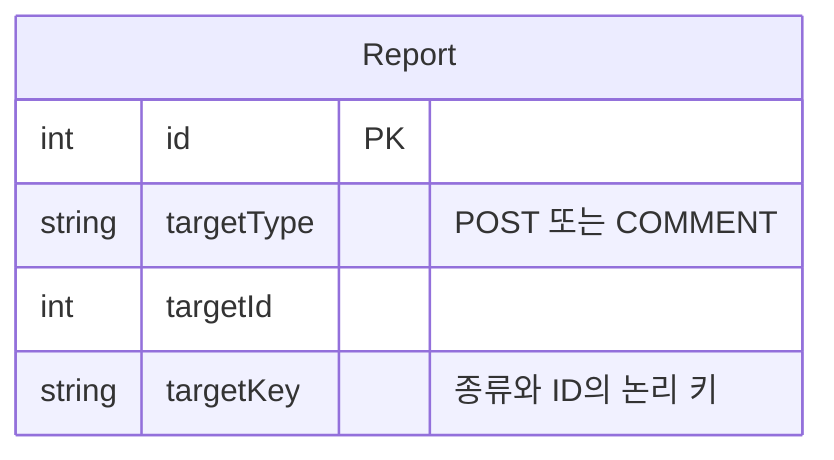
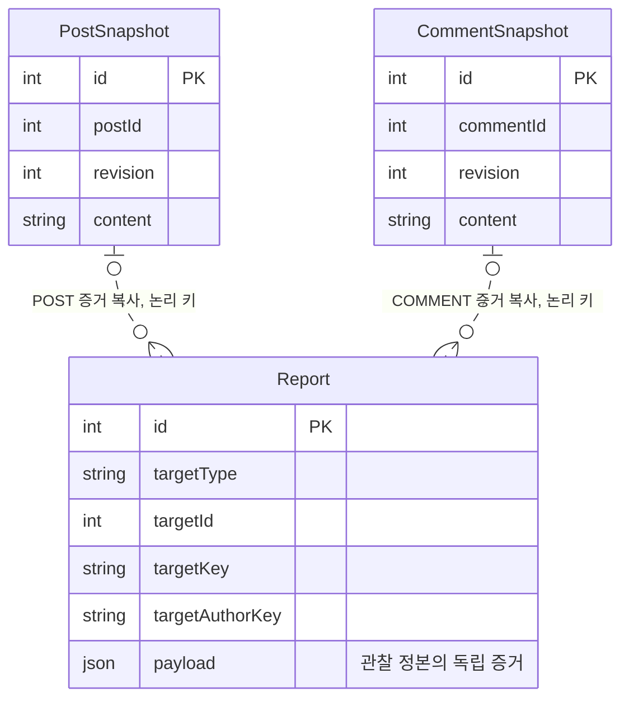
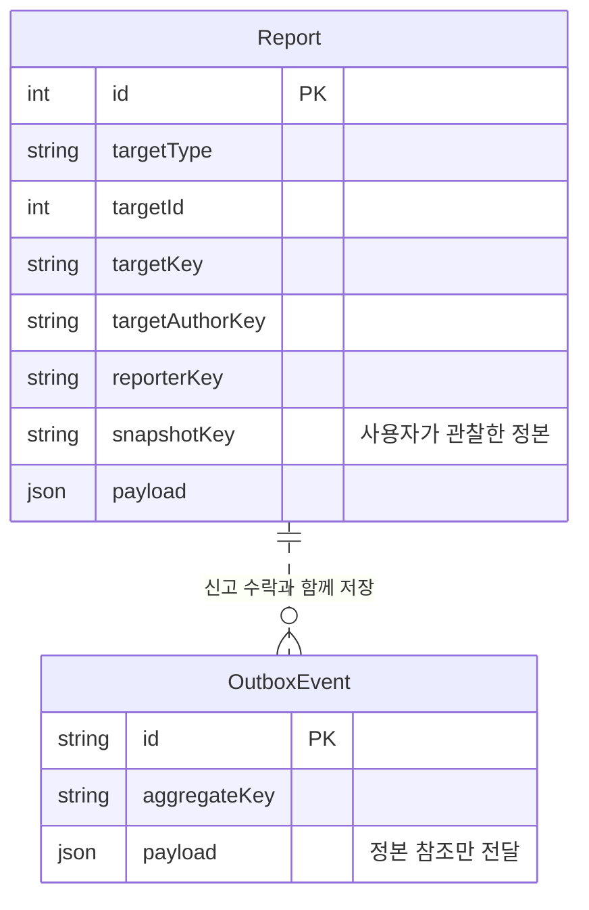
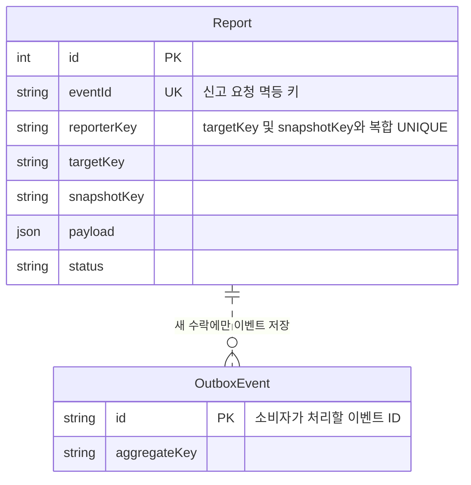
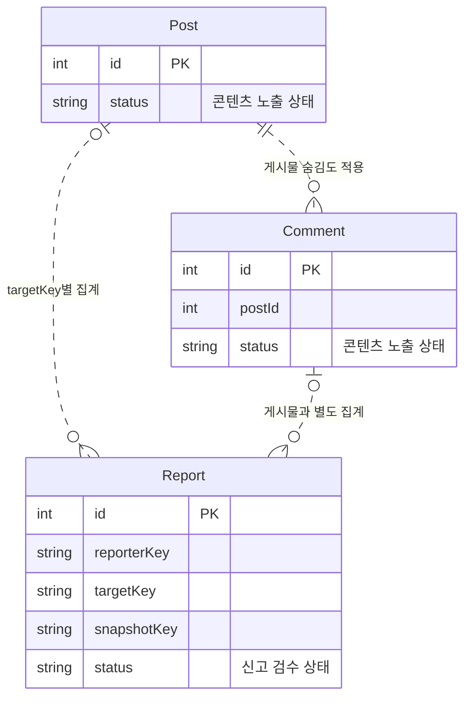
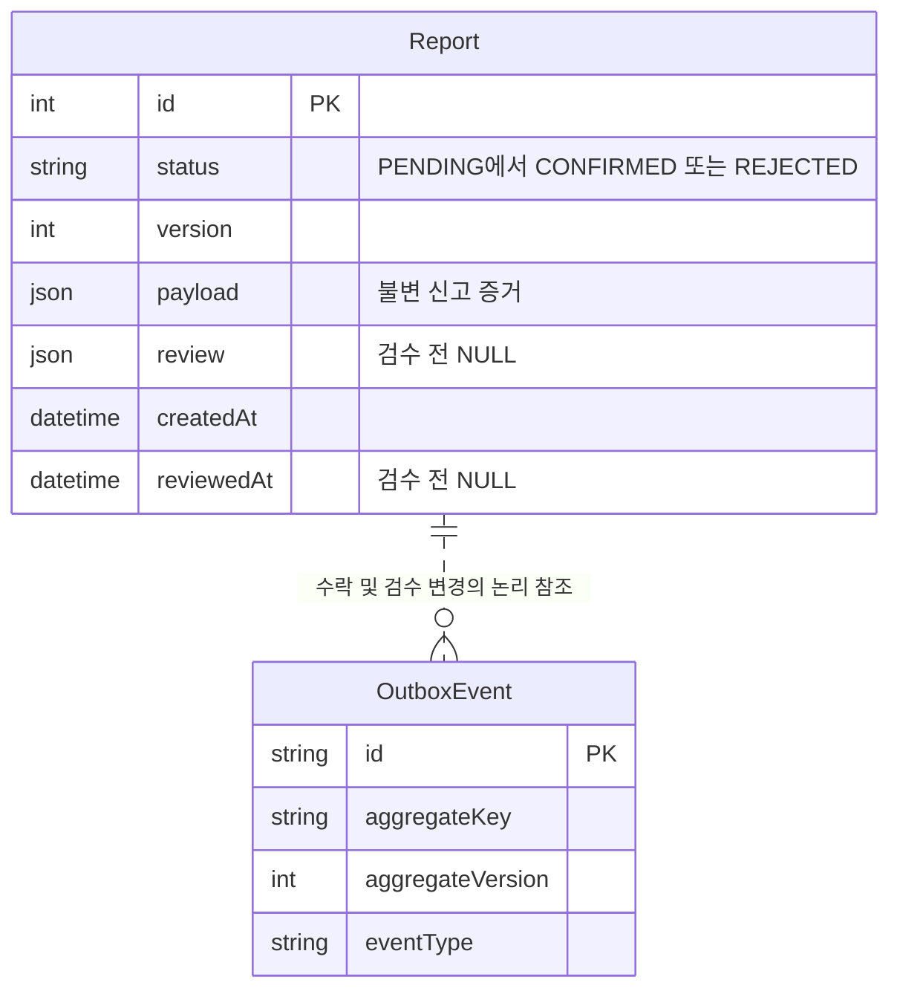
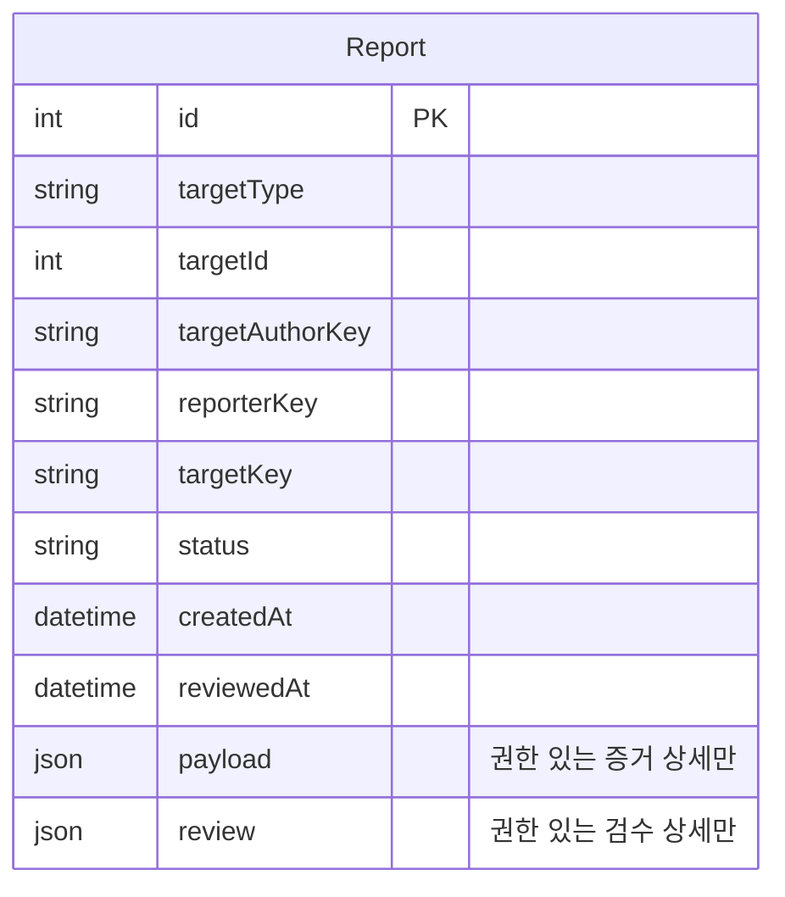
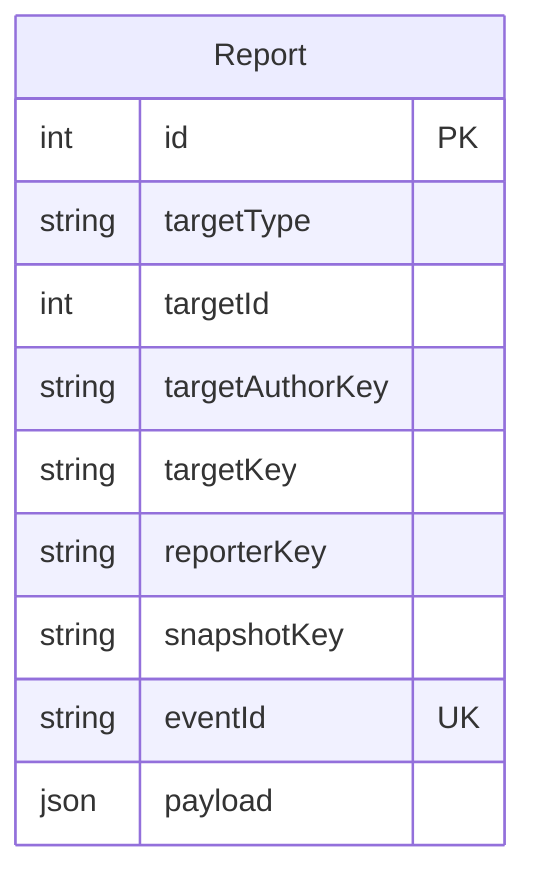
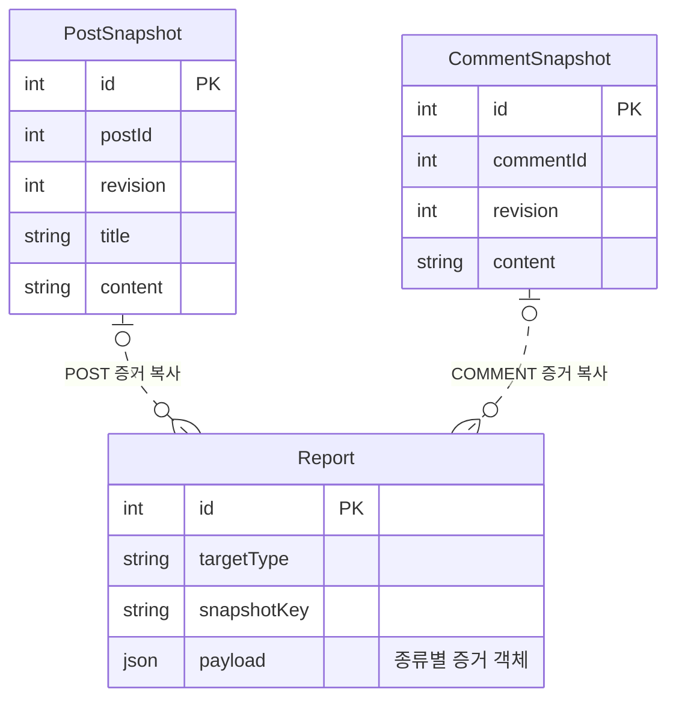

# 4. 신고 관리 테이블

회의 기록에 문제가 있어 신고했다고 생각해 봐요. 작성자가 글을 고친 뒤에도 신고 당시 내용을 판단할 수 있을까요? 이 문서는 대상 식별·증거 복사·중복 방지·검수·보존을 어떤 구조로 표현할지 설명해요.

- [출발 구조](#출발-구조)
- [신고 대상과 증거](#신고-대상과-증거)
- [중복 신고와 검수](#중복-신고와-검수)
- [신고 조회와 인덱스](#신고-조회와-인덱스)
- [검색 컬럼과 증거의 구분](#검색-컬럼과-증거의-구분)
- [파일 증거와 보존](#파일-증거와-보존)
- [정리](#정리)

## 출발 구조

신고 번호와 대상 ID만 저장하는 구조부터 시작해요. 숫자만 있으면 어느 종류의 대상인지, 지금 내용과 당시 내용이 같은지는 아직 알 수 없어요.

## 신고 대상과 증거

1. [과제] 게시물과 댓글의 ID가 같으면 어느 대상을 신고한 걸까요?

Post 12와 Comment 12는 숫자가 같아도 다른 대상이에요. targetId만 저장하면 어느 테이블을 읽어야 할지 알 수 없어요. **신고 대상은 종류와 ID를 함께 식별해야 합니다.**

종류에 따라 여러 테이블을 가리키는 방식을 다형 연관(polymorphic association)이라고 해요. targetType·targetId 조합은 대상 테이블이 하나로 정해지지 않으므로 한 개의 FK로 표현하기 어려워요.

대상마다 참조 컬럼을 따로 두거나 신고 테이블을 종류별로 나누는 방법도 있어요. 이 설계는 공통 Report에서 검수와 집계를 다루고, 대상 존재와 종류 일치는 서비스가 검사해요.

**설계 포인트:** 대상이 여러 종류일 때 식별 방법·NULL 조합·제약의 강제 주체를 비교한 뒤 구조를 선택해요.

2. [실무 기본] 작성자가 내용을 바꾸거나 삭제하면 무엇을 보고 검수할까요?

현재 본문과 연결해서 신고를 읽으면 수정 전 내용을 놓칠 수 있어요. 필요한 것은 지금의 본문이 아니라 신고자가 관찰했던 내용이에요. 이 설계는 그 내용을 Report.payload에 독립 증거로 복사해요.

원본 스냅샷의 내용을 다시 저장하면 중복처럼 보일 수 있어요. 같은 사실을 여러 곳에서 수정하다 어긋나는 문제를 줄이는 것이 정규화(normalization)의 목적이에요. 하지만 신고 증거는 원본과 별도로 보존해야 하는 과거 기록이에요.

**이 복사는 의도한 비정규화(denormalization)입니다.** 원본을 나중에 수정하거나 정리해도 증거를 그대로 읽기 위해 선택한 구조예요. 원본의 보존 정책과 증거의 보존 목적도 구분해야 해요.

**설계 포인트:** 현재 참조가 필요한지, 당시 내용을 복사해야 하는지 먼저 정해요. 복사본과 원본을 항상 같이 고치는 구조와는 달라요.

3. [실무 기본] 신고 직전에 글이 바뀌면 어떤 개정을 남길까요?

읽은 시점과 신고한 시점 사이에 글이 바뀔 수 있어요. 현재 개정만 복사하면 신고자가 관찰한 것과 다른 내용을 증거로 남길 수 있어요.

그래서 어떤 대상을 어느 개정에서 관찰했는지를 구분해야 해요. targetKey는 콘텐츠 전체, snapshotKey는 관찰한 정본을 나타내요. reporterKey는 신고한 방문을 구분하고 targetAuthorKey는 당시 최초 작성 방문을 나타내요.

이 키를 안다는 사실만으로 실제 관찰이나 권한이 증명되지는 않아요. ERD는 구분할 정보를 표현하고, 서비스는 어떤 증거를 받아들일지 판단해야 해요.

**설계 포인트:** 콘텐츠의 ID와 개정의 ID를 나누고, 신고 시점의 최신 내용과 관찰한 내용을 혼동하지 않아요.

## 중복 신고와 검수

4. [실무 기본] 응답이 끊겨 다시 보내는 신고와 반복 신고는 같은 문제일까요?

같은 요청의 재시도와 같은 대상의 반복 신고는 다른 중복이에요. 요청 키 하나로 두 문제를 모두 구분하려 하면 기준이 모호해질 수 있어요.

| 중복의 종류 | 이 설계의 구분 기준 |
| --- | --- |
| 같은 요청의 재시도 | eventId UNIQUE |
| 같은 방문·대상·개정의 반복 신고 | (reporterKey, targetKey, snapshotKey) 복합 UNIQUE |

Report.eventId는 신고 요청을 구분하는 값이고 OutboxEvent.id는 후속 처리 이벤트를 구분하는 값이에요. 이름이 비슷해도 책임이 달라요. 같은 요청 키인데 내용이 다르다면 단순 중복으로 받아들일 수 없다는 점도 고려해야 해요.

**설계 포인트:** 무엇을 같은 요청·같은 신고로 볼지 먼저 정한 뒤 각각의 중복 제약을 선택해요.

5. [과제] 신고한 사람에게만 숨길지 모두에게 숨길지는 어떻게 나눌까요?

개인 숨김은 어떤 방문이 어떤 대상을 신고했는지가 필요해요. 전체 숨김은 대상별 신고 집계와 콘텐츠의 노출 상태가 필요하고요. 두 판단이 사용하는 키와 상태를 구분해야 해요.

같은 방문이 여러 개정을 신고했다고 전체 집계에서도 여러 사람처럼 셀지 결정해야 해요. 이 설계는 targetKey별 서로 다른 reporterKey를 기준으로 생각해요. 방문 수가 실제 사람 수를 증명하는 것은 아니라는 한계도 있어요.

Report.status는 신고의 검수 상태, Post·Comment.status는 콘텐츠의 노출 상태예요. 신고가 생겼다는 사실과 검수가 끝났다는 사실도 다릅니다.

**설계 포인트:** 숨김의 범위·집계 단위·상태의 소유자를 따로 정해요. 게시물·댓글·파일을 서로 다른 경로로 읽을 때 어떤 상태가 필요한지도 고려해요.

6. [과제] 검수 결과를 기록하면서 신고 증거도 바꿔도 될까요?

증거와 판단을 같은 내용으로 덮어쓰면 신고 당시 자료와 검수 결과를 구분하기 어려워요. 그래서 payload에는 당시 증거를, review에는 검수 결과를 남겨요.

검수 전에는 review·reviewedAt이 비어 있고, 검수 후에는 판단과 시각이 필요해요. 상태에 따라 NULL의 의미가 달라지므로 컬럼의 선택 여부뿐 아니라 어떤 시점에 채워져야 하는지도 생각해야 해요.

동시에 같은 신고를 검수할 수 있다면 version 같은 충돌 구분값이 필요해요. 검수자의 신원도 비회원 작성 방문과 같은 대상으로 취급하지 않아요.

**설계 포인트:** 증거·결과·검수 시각·변경 버전의 역할을 나눠요. 검수 상태 변경이 증거 내용을 다시 쓰는 일이 되어서는 안 돼요.

## 신고 조회와 인덱스

7. [실무 기본] 신고 목록과 증거 상세를 같은 데이터로 읽을까요?

검수 목록에는 대상·상태·접수 시각 같은 요약이 필요해요. 매번 큰 증거까지 읽을 필요는 없을 수 있어요. 목록의 필터와 정렬을 먼저 정하면 필요한 컬럼과 인덱스를 고를 수 있어요.

| 조회 요구 | 고려할 인덱스 |
| --- | --- |
| 상태별 시간순 검수 목록 | (status, createdAt, id) |
| 최초 작성 방문별 신고 | (targetAuthorKey, createdAt, id) |
| 대상별 상태 집계 | (targetType, targetId, status) 또는 (targetKey, status) |

독립 증거를 저장했다면 원본 콘텐츠가 없어도 증거 상세를 읽을 수 있어야 해요. 다만 실제 파일 바이트까지 DB에 복사한 것은 아니에요. 그 차이는 아래 파일 보존 구조에서 살펴봐요.

**설계 포인트:** 검색·집계할 메타데이터와 큰 증거의 조회 요구를 구분해요. 공통 개념은 [조회와 인덱스 설계](post-management.md#조회와-인덱스-설계)를 참고해요.

## 검색 컬럼과 증거의 구분

8. [심화] 증거에 이미 있는 대상 정보를 별도 컬럼으로도 둘까요?

증거 안에 대상 정보가 있어도 매번 전체 내용을 읽어 집계하는 것은 적절하지 않을 수 있어요. 그래서 검색에 필요한 값을 별도 컬럼으로 꺼내 저장할 수 있어요. 이런 값을 투영(projection)한 값이라고 해요.

targetType·targetId·targetAuthorKey·targetKey·snapshotKey는 대상과 관찰 정본을 찾는 데 사용해요. 반면 payload는 당시 증거의 보존을 맡아요. 두 표현이 다른 대상을 가리키지 않도록 검사할 주체도 필요해요.

**설계 포인트:** 중복 저장은 목적이 있어야 해요. 검색·집계의 이익과 값의 일치를 유지하는 비용을 함께 고려해요.

9. [심화] 모든 증거 항목을 같은 컬럼으로 만들어야 할까요?

게시물 증거에는 제목·본문·첨부가 필요하지만 댓글에는 제목이나 첨부가 없어요. 모든 속성을 같은 테이블의 선택 컬럼으로 만들면 대상별로 어떤 값이 필요한지 불분명해질 수 있어요.

종류별 테이블로 나누면 고정된 구조와 제약을 표현하기 쉬워요. 공통 Report와 JSON 증거를 사용하면 종류마다 달라지는 내용을 담기 편하지만, 내부 형태와 일치 조건은 ERD만으로 모두 표현할 수 없어요.

이 설계는 공통 신고 메타데이터와 유연한 payload를 나누는 쪽을 택했어요. 검색할 값은 별도 컬럼으로 두고, 증거의 세부 항목을 API 명세로 정의하지는 않아요.

**설계 포인트:** 데이터가 고정적인지·종류마다 다른지·검색할 필요가 있는지를 기준으로 컬럼과 JSON의 역할을 선택해요.

## 파일 증거와 보존

10. [심화] 원문은 남아 있지만 당시 표시 결과나 파일이 달라지면요?

같은 Markdown도 가공 정책이 바뀌면 다른 표시 결과가 나올 수 있어요. 텍스트만 있으면 충분한지, 당시 렌더 결과와 사용 파일까지 확인해야 하는지 먼저 정해야 해요.

그런 요구가 있다면 PostSnapshotRender로 개정·정책별 결과를 구분하고 신고에 관찰 결과를 복사할 수 있어요. 파일의 표시명·크기·해시 같은 메타데이터 사본과 실제 바이트의 보존도 다른 문제예요.

**ReportStoredObject는 바이트 복사본이 아니라 객체의 보존 참조입니다.** 신고가 필요한 객체를 가리켜 정리 대상에서 제외하는 구조예요. 검수가 끝났다는 이유만으로 증거의 보존 목적까지 끝났다고 단정하지 않아요.

외부 이미지는 다른 소유자가 내용을 바꾸거나 지울 수 있어요. 주소를 기록했다고 당시 바이트까지 보존한 것은 아니에요. 관리하는 파일과 외부 주소의 증거 범위를 구분해야 해요.

**설계 포인트:** JSON 증거 복사·관리 파일의 보존 참조·외부 주소 기록은 보존 범위가 달라요. 다음 그림은 JSON 증거 복사와 실제 파일 객체의 보존 참조를 구분해요.

## 정리

- **다형 대상:** 종류와 ID를 함께 식별하고, 여러 테이블을 가리키는 제약의 한계를 이해해요.
- **독립 증거:** 현재 참조와 관찰 당시의 복사본을 구분해요.
- **중복의 기준:** 요청 재시도와 같은 대상·개정의 반복 신고를 나눠요.
- **상태의 책임:** 신고 검수 상태와 콘텐츠 노출 상태는 다른 모델의 책임이에요.
- **검색과 보존:** 검색용 컬럼·증거·파일 보존 참조를 역할별로 나눠요.
- **한계:** 방문 수는 실제 사람 수를 증명하지 않고, 메타데이터 사본은 파일 바이트의 보존을 대신하지 않아요.

### 최종 테이블 구조

다음 그림은 이 문서에서 다룬 테이블의 전체 컬럼과 논리 관계예요. 질문별 그림에서 생략한 컬럼도 모두 포함했고, 다른 문서의 테이블은 참조 키만 표시했어요. 신고 대상·작성자·관찰 정본은 키와 payload로만 남기므로 원본 콘텐츠와의 관계선은 그리지 않았어요.

키와 인덱스는 다음과 같아요.

| 테이블 | PK·UNIQUE | 인덱스 |
| --- | --- | --- |
| Report | id, eventId, (reporterKey, targetKey, snapshotKey) | (targetKey, status), (targetType, targetId, status), (status, createdAt, id), (targetAuthorKey, createdAt, id) |
| ReportStoredObject | (reportId, objectId) | objectId |

컬럼 설명과 데이터 흐름은 [Report](../erd.md#reports)·[ReportStoredObject](../erd.md#report_stored_objects)에서 확인해요. 참조와 역사적 식별 정보의 차이는 [관계 무결성과 삭제](post-management.md#관계-무결성과-삭제), 파일의 역할은 [파일 관리](file-management.md)를 참고해요.
