# 5. 요청 실패 관리 테이블

신고를 저장한 뒤 별도 작업으로 콘텐츠 상태를 반영한다고 생각해 봐요. 서버 종료·응답 유실·중복 실행이 생기면 무엇을 기록해야 할까요? 이 문서는 모든 HTTP 오류를 저장하는 로그가 아니라, 지속해야 하는 작업과 완료한 효과를 ERD로 구분하는 방법을 설명해요.

- [출발 구조](#출발-구조)
- [후속 작업의 저장](#후속-작업의-저장)
- [재시도와 중복 효과](#재시도와-중복-효과)
- [외부 작업의 한계](#외부-작업의-한계)
- [파일 변환 작업의 저장](#파일-변환-작업의-저장)
- [이벤트와 정본의 구분](#이벤트와-정본의-구분)
- [정리](#정리)

## 출발 구조

신고 한 행을 저장하는 가장 작은 구조부터 시작해요. 후속 작업이 필요하지 않다면 여기서 끝낼 수 있어요.

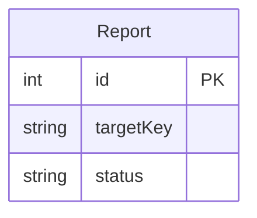

## 후속 작업의 저장

1. [실무 기본] 신고를 저장하면 필요한 처리가 모두 끝났을까요?

신고를 기록하는 기능만 필요하다면 다른 테이블이나 워커를 추가할 이유가 없어요. 검수하거나 노출 상태를 바꾸려면 신고 저장과 별도로 판단할 일이 생겨요.

그 일이 생겼다고 곧바로 비동기 구조가 필요한 것은 아니에요. 같은 DB의 짧은 트랜잭션에서 함께 끝내거나 조회 시점에 계산할 수도 있어요.

**설계 포인트:** 요청과 후속 작업을 분리해야 한다는 요구가 있을 때만 다음 구조를 고려해요. 신고 상태와 콘텐츠 상태는 서로 다른 책임이에요.

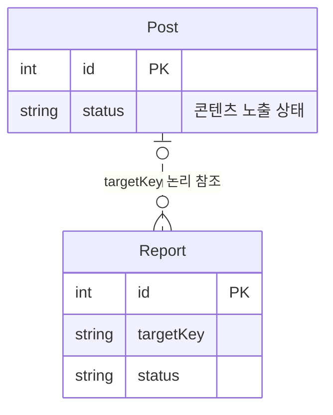

2. [심화] 신고는 저장됐는데 다음 처리를 알리기 전에 서버가 종료되면요?

신고를 저장한 뒤 메모리에서 작업을 예약하면 두 동작 사이에 서버가 종료될 수 있어요. 순서를 바꿔 먼저 알리면 신고 저장은 실패했는데 작업만 실행될 수도 있어요. 서로 다른 곳에 따로 쓰다 한쪽만 남는 이중 쓰기(dual write) 문제예요.

**OutboxEvent는 변경에 따른 후속 작업을 DB에 남기는 기록입니다.** 신고와 같은 트랜잭션에 저장하면 변경은 남았는데 작업 기록은 없는 상황을 피할 수 있어요. 이런 방식을 트랜잭셔널 아웃박스(transactional outbox)라고 해요.

이 설계는 MySQL에 남긴 미완료 작업을 주기적으로 확인하는 폴링(polling)을 생각해요. 별도 메시지 브로커인 MQ를 전제로 두지는 않아요.

**설계 포인트:** 작업의 ID·대상·내용·완료 시각을 보관해 재처리의 출발점을 만들어요. DB에 저장하지 못한 요청까지 Outbox가 복구하는 것은 아니에요.

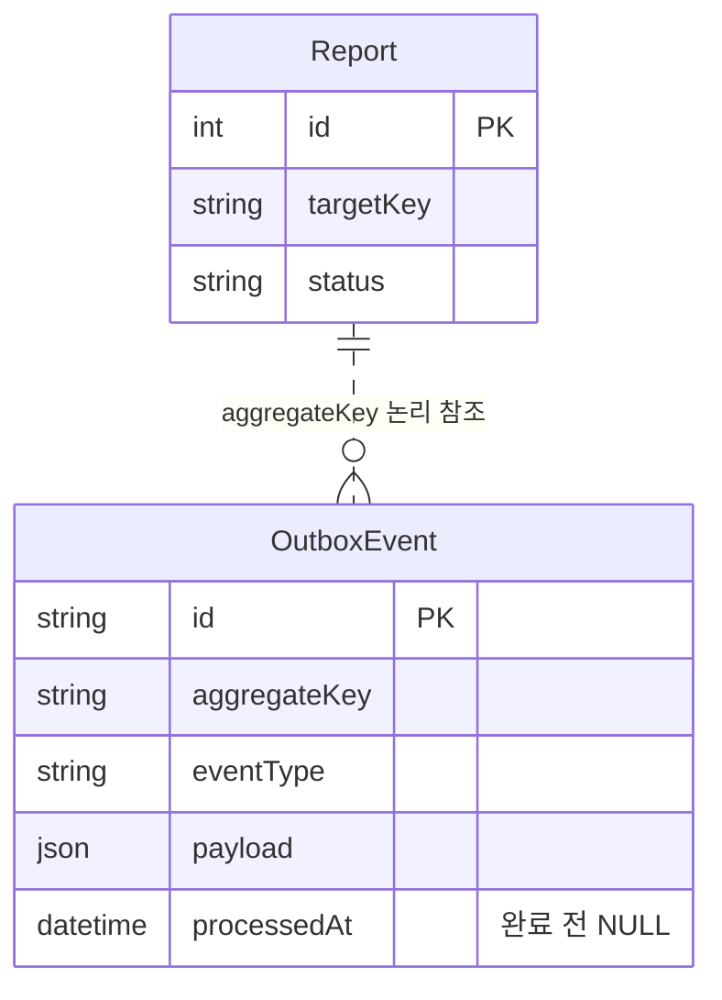

3. [실무 기본] 저장은 끝났는데 응답을 받기 전에 연결이 끊기면요?

응답이 없다고 저장도 실패했다고 단정할 수는 없어요. 같은 요청을 다시 보낼 때마다 새 ID를 만들면 신고와 후속 작업이 중복될 수 있어요.

같은 요청을 구분할 안정적인 값이 멱등 키(idempotency key)예요. 이 설계에서는 Report.eventId가 요청 재시도를 구분해요. 소비자가 처리한 이벤트를 구분하는 값과는 역할이 달라요.

**설계 포인트:** 결과를 확인할 수 없는 상황에서도 같은 요청을 다시 찾을 수 있도록 키를 설계해요. 신고 중복의 두 기준은 [신고 관리](report-management.md#중복-신고와-검수)에서 설명해요.

```mermaid
erDiagram
    Report {
        int id PK
        string eventId UK "신고 요청 재시도 키"
        string targetKey
        json payload
        string status
    }
    OutboxEvent {
        string id PK "처리 이벤트 ID"
        string aggregateKey
        string eventType
        json payload
        datetime processedAt "완료 전 NULL"
    }
    Report ||..o{ OutboxEvent : "aggregateKey 논리 참조"
```

## 재시도와 중복 효과

4. [심화] 작업이 실패했다면 무엇을 남겨야 할까요?

미완료라는 정보만 있으면 언제 다시 처리할지, 얼마나 실패했는지 알기 어려워요. availableAt·attempts·lastError로 다음 시도 시각·시도 수·원인을 나눠 표현할 수 있어요.

일시 오류와 입력 문제를 같은 방식으로 반복하면 불필요한 작업이 늘어요. 재시도 가능한 실패와 별도 판단이 필요한 실패를 어떻게 구분할지도 고려해야 해요. 구체적인 재시도 횟수나 대기 시간은 ERD가 정하는 대상이 아니에요.

**설계 포인트:** 작업이 남아 있다는 사실과 언젠가 성공한다는 보장은 달라요. 실패와 재처리를 설명할 수 있는 상태가 필요해요.

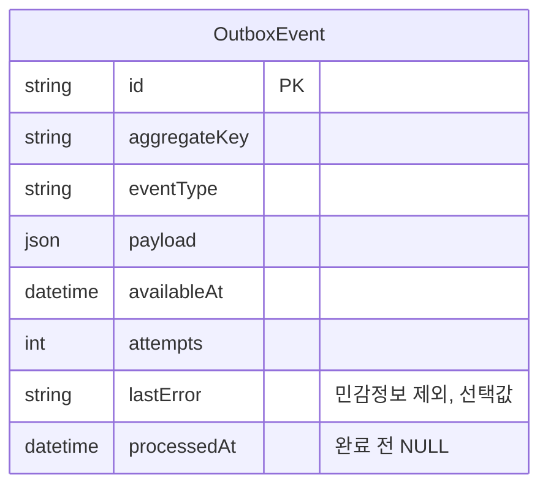

5. [심화] 작업은 끝났는데 완료 표시 전에 서버가 종료되면요?

DB 변경은 끝났지만 OutboxEvent.processedAt을 남기지 못하면 같은 작업을 다시 읽을 수 있어요. 재시도를 허용하는 구조에는 중복 효과를 구분할 기록도 필요해요.

**EventReceipt는 소비자별 DB 효과 완료 기록입니다.** (consumer, eventId)를 복합 PK로 두면 같은 이벤트를 각 소비자가 처리했는지 구분할 수 있어요. 이런 소비자를 멱등 소비자(idempotent consumer)라고 해요.

기록만 남고 실제 효과가 빠지거나, 효과만 남고 기록이 없으면 문제가 생겨요. 같은 DB의 효과와 완료 기록을 함께 저장할 수 있는지 확인해야 해요. 이벤트를 받은 것과 효과를 끝낸 것도 다른 상태예요.

**설계 포인트:** 작업 기록·소비자별 완료 기록·실제 변경을 구분해요. 외부 이벤트의 ID라고 해서 로컬 Outbox 행이 반드시 있어야 하는 것은 아니에요.

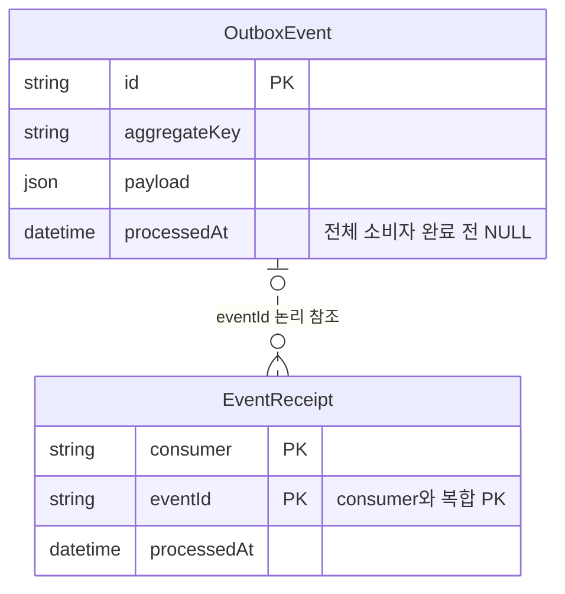

6. [심화] 다른 워커가 넘겨받은 작업을 이전 워커가 뒤늦게 끝내면요?

느린 워커와 멈춘 워커를 즉시 구분하기는 어려워요. 계속 기다리면 진행이 멈추고, 다른 워커에게 넘기면 이전 워커도 나중에 돌아올 수 있어요.

만료 시각까지 작업 권한을 주는 방식을 임대(lease)라고 해요. leaseUntil만 있으면 어느 할당의 결과인지 구분하기 어려우므로 leaseToken도 함께 둘 수 있어요.

만료됐다고 이전 워커가 자동으로 사라지는 것은 아니에요. 현재 임대인지 확인하는 것은 서비스의 책임이고, 컬럼은 그 판단에 필요한 정보를 보관해요.

**설계 포인트:** 안정적인 작업 ID와 매번 달라지는 할당 ID의 역할을 나눠요. 완료 기록은 임대 상태와 별개의 사실이에요.

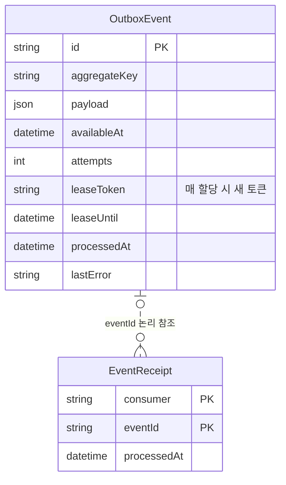

7. [심화] 늦게 도착한 이벤트가 최신 상태를 과거로 돌리면요?

재시도 때문에 이벤트가 발생 순서와 다르게 처리될 수 있어요. 발생 시각만으로 최신 변경을 판단하면 오래된 상태를 다시 적용할 수 있어요.

정본 메타데이터의 버전을 aggregateVersion으로 남기면 어느 변경을 알리는지 구분할 수 있어요. (aggregateKey, aggregateVersion) 복합 UNIQUE는 같은 변경의 중복 기록을 막는 데 사용할 수 있어요.

버전 없는 활동에는 NULL이 있을 수 있어요. 이때 복합 UNIQUE가 같은 방식으로 중복을 막는다고 가정해서는 안 돼요. 안정적인 이벤트 ID도 필요해요.

**설계 포인트:** 발생 시각·정본 버전·이벤트 ID는 서로 다른 역할이에요. 이벤트가 정본을 대신하는 데이터인지, 정본 변경을 알리는 기록인지도 정해야 해요.

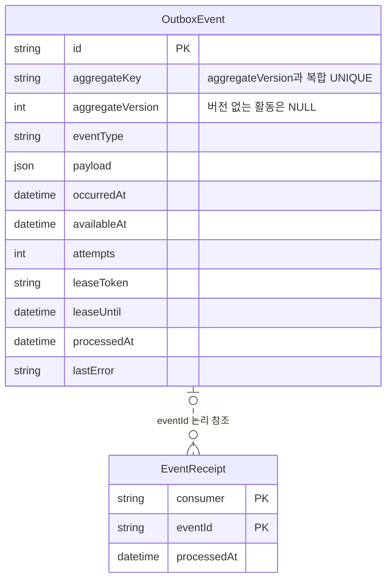

## 외부 작업의 한계

8. [심화] 외부 저장소에서는 성공했는데 응답만 유실되면요?

외부 시스템에서 작업은 끝났지만 DB에는 완료가 남지 않을 수 있어요. 로컬 작업이 미완료라는 이유만으로 다시 실행하면 외부 효과가 중복될 수 있어요.

**DB 트랜잭션은 DB 밖 효과를 함께 취소하지 못합니다.** Outbox는 해야 할 일을 남기지만 상대 시스템에서 실제로 무엇이 끝났는지까지 보여주지는 않아요. 외부 효과를 다시 식별하거나 결과를 확인할 수 있는지도 고려해야 해요.

**설계 포인트:** 로컬 완료 기록이 무엇을 증명하는지 범위를 정해요. 외부 시스템을 사용할 요구가 없다면 이 문제를 해결할 테이블부터 추가하지 않아요.

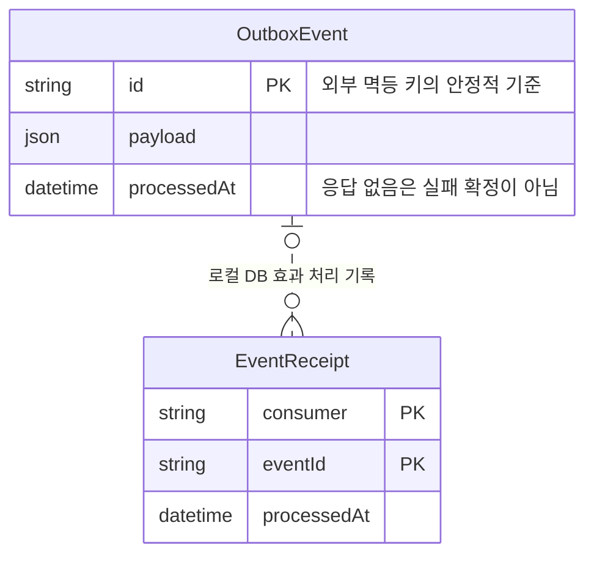

## 파일 변환 작업의 저장

9. [심화] 파일 변환이 끝났는데 결과를 등록하기 전에 서버가 종료되면요?

이미지 축소나 영상 변환은 DB 밖에서 실행돼요. 바이트 생성과 DB 결과 선택을 한 트랜잭션으로 묶을 수 없으므로 변환은 끝났는데 선택한 결과가 없는 상황이 생길 수 있어요.

이 설계는 MediaProcessingJob에 원본·변환 종류·정책 버전을 불변 입력으로 남겨요. (sourceObjectId, variant, policyVersion) 복합 UNIQUE로 같은 논리 작업을 구분하고 resultObjectId로 선택한 결과를 참조해요.

같은 논리 작업을 여러 번 실행하면 후보 객체가 여러 개 생길 수 있어요. 생성된 모든 객체와 실제 선택 결과를 구분해야 과거 개정이나 신고가 다른 결과로 바뀌지 않아요. 결과의 소유 첨부와 입력·정책 일치도 고려해야 해요.

**설계 포인트:** 작업의 존재·실행 시도·외부 바이트·선택 결과·DB 완료 기록은 서로 다른 사실이에요. 다음 그림은 작업 입력과 결과 포인터를 보여줘요.

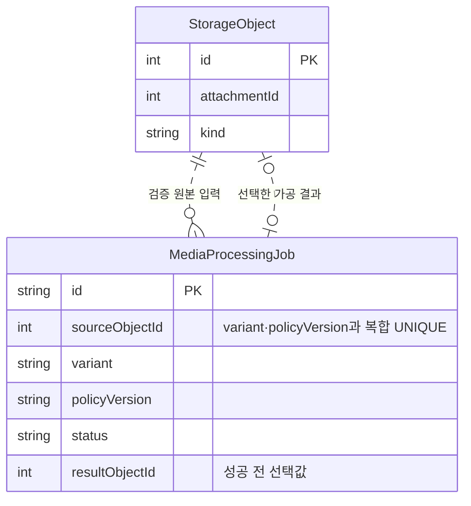

## 이벤트와 정본의 구분

10. [심화] 이벤트에도 증거 본문과 모든 정보를 복사해야 할까요?

이벤트에도 본문과 증거를 복사하면 같은 데이터의 정본이 여러 곳에 생길 수 있어요. 이 설계는 콘텐츠·스냅샷·Report를 정본으로 두고, OutboxEvent에는 후속 처리가 찾을 정본의 키를 담아요.

이벤트 종류·대상 키·정본 버전·발생 시각은 컬럼으로 구분해요. 가변적인 전달 내용이 필요하면 payload를 사용할 수 있지만, 자주 검색하거나 중복을 검사할 값까지 그 안에만 넣을지는 별도로 생각해야 해요.

실제 작업 주체도 작성 방문·검수자·시스템 중 무엇인지 구분할 수 있어야 해요. 그러나 그 표현이 인증이나 권한 검사를 대신하는 것은 아니에요.

**설계 포인트:** 작업에 필요한 정보를 남기되 정본과 중복되는 사본을 불필요하게 늘리지 않아요.

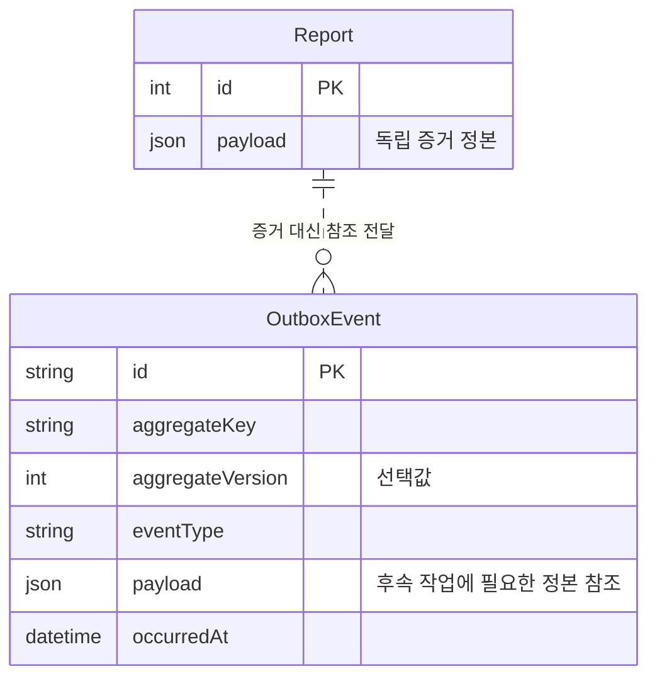

## 정리

- **도입 기준:** 같은 DB에서 함께 끝낼 수 있으면 비동기 구조가 꼭 필요한 것은 아니에요.
- **Outbox:** 변경과 후속 작업 기록을 함께 남겨요.
- **두 종류의 중복:** 요청 재시도와 소비자의 중복 효과를 구분해요.
- **임대와 버전:** 실행 권한과 변경 순서를 판단할 정보를 나눠요.
- **작업과 결과:** 변환의 불변 입력·실행 상태·선택 결과를 별도로 표현해요.
- **한계:** 로컬 완료 기록만으로 외부 효과가 정확히 한 번 일어났다고 보장할 수는 없어요.

### 최종 테이블 구조

다음 그림은 이 문서에서 다룬 테이블의 전체 컬럼과 논리 관계예요. 질문별 그림에서 생략한 컬럼도 모두 포함했고, 다른 문서의 테이블은 참조 키만 표시했어요.

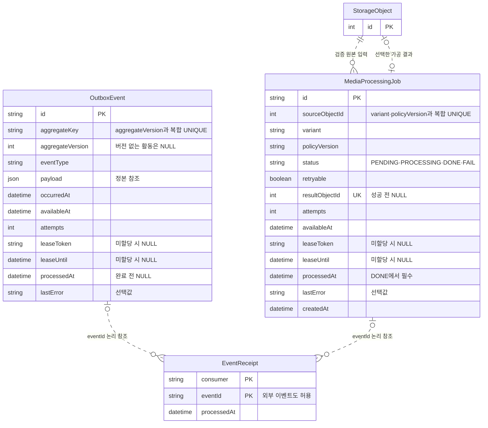

키와 인덱스는 다음과 같아요.

| 테이블 | PK·UNIQUE | 인덱스 |
| --- | --- | --- |
| OutboxEvent | id, (aggregateKey, aggregateVersion) | (processedAt, availableAt, leaseUntil) |
| EventReceipt | (consumer, eventId) | - |
| MediaProcessingJob | id, resultObjectId, (sourceObjectId, variant, policyVersion) | (status, retryable, availableAt, leaseUntil) |

컬럼 설명과 데이터 흐름은 [OutboxEvent](../erd.md#outbox_events)·[EventReceipt](../erd.md#event_receipts)·[MediaProcessingJob](../erd.md#media_processing_jobs)에서 확인해요. 파일의 상태·연결·보존을 나누는 이유는 [파일 관리](file-management.md)를 참고해요.
