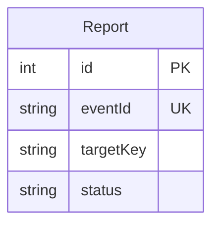
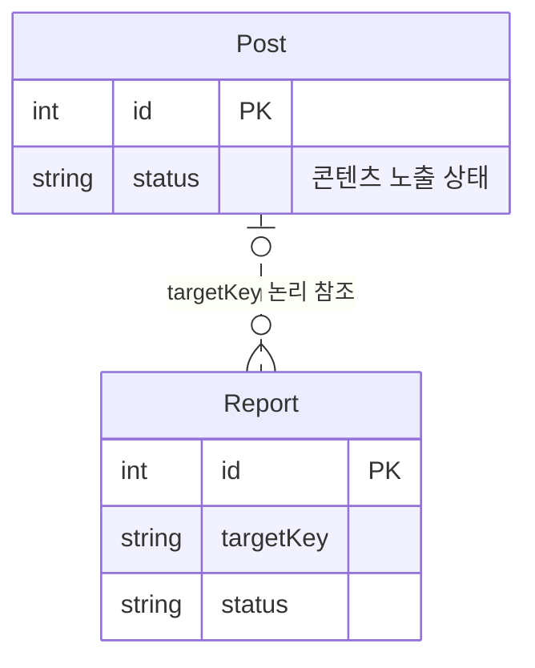
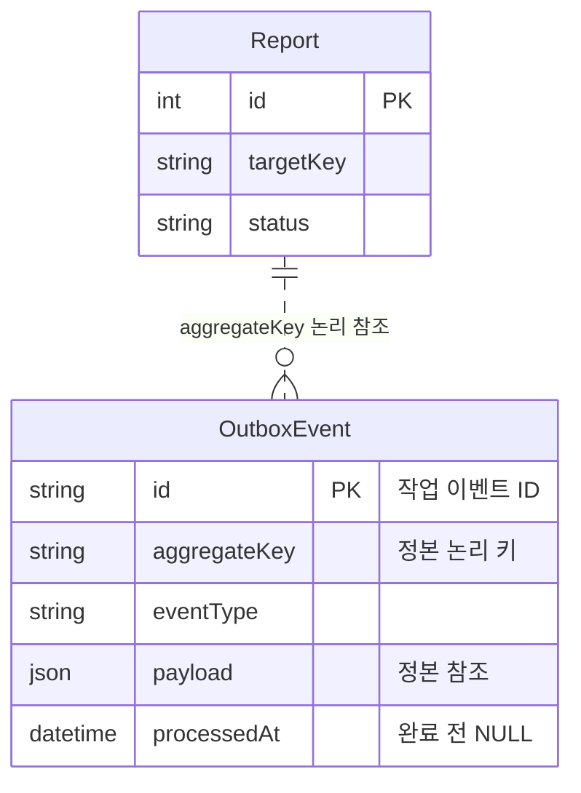
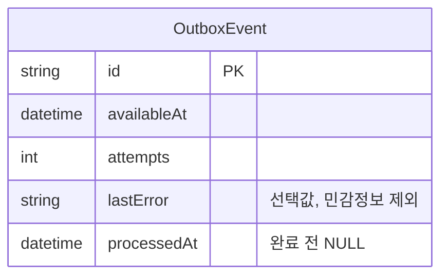
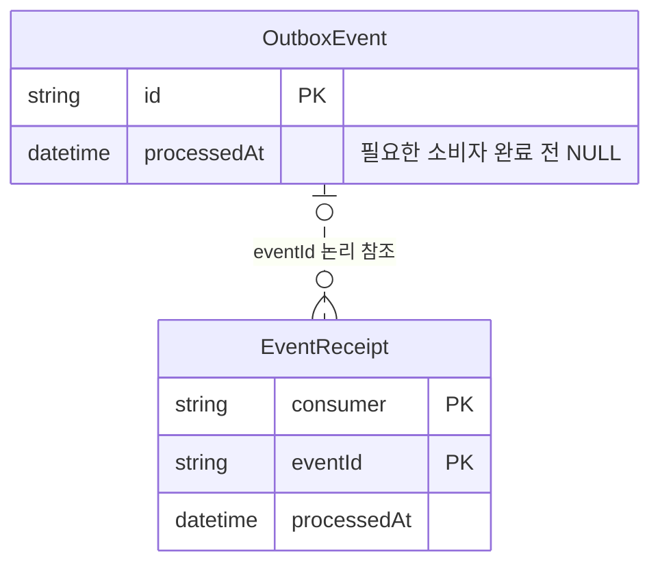
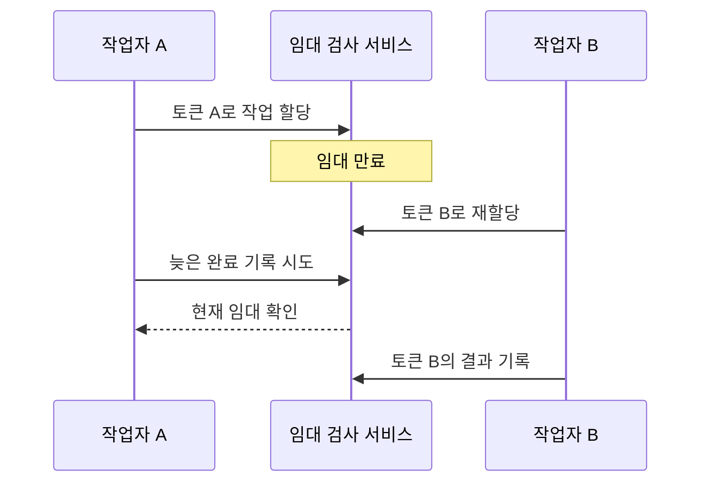
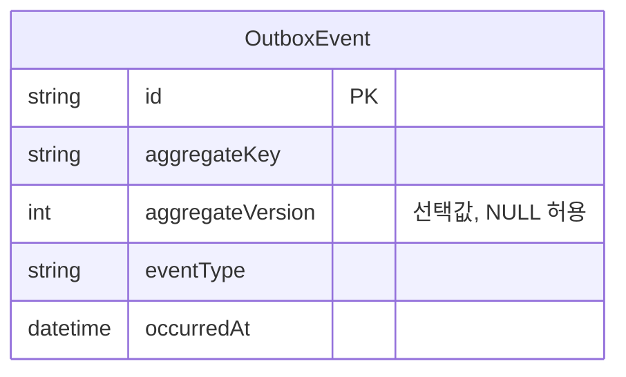
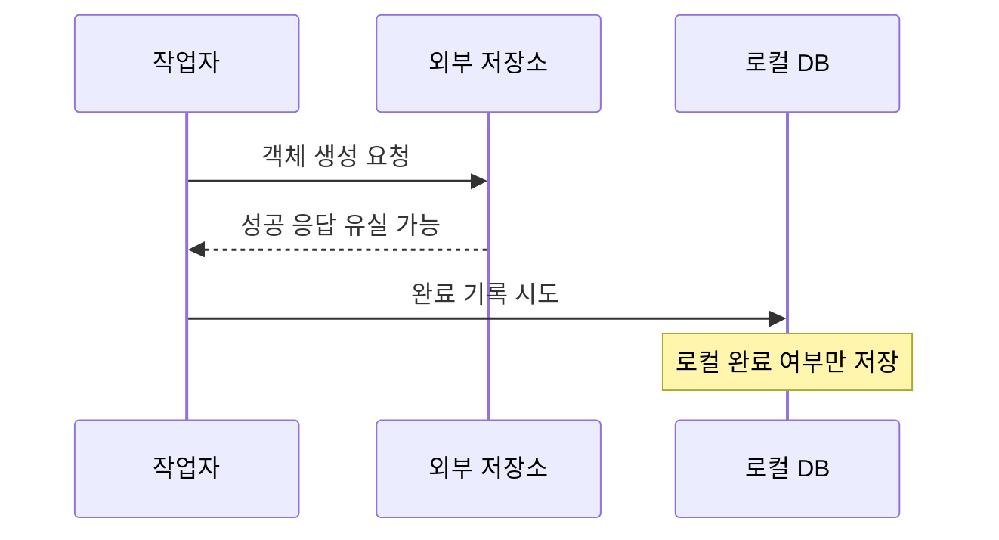
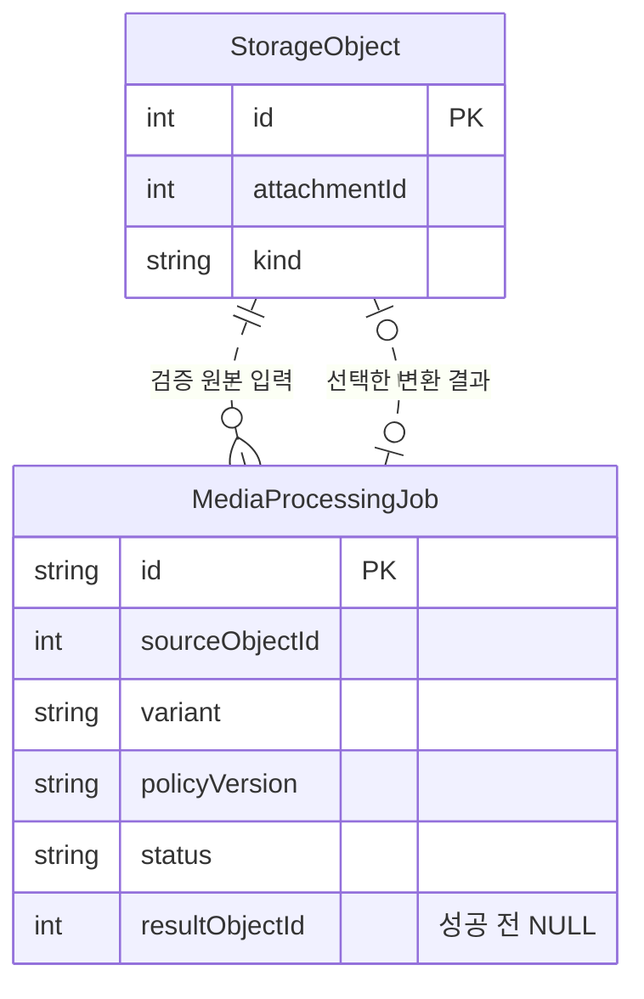
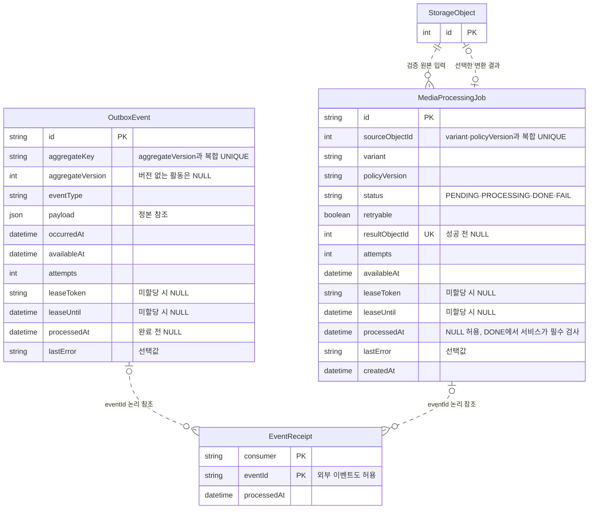

# 6. 저장 이후의 후속 작업과 실패

신고 저장 뒤 별도 처리가 필요하지 않다면 신고 테이블만으로 멈출 수 있어요. 이 문서는 추가 후속 작업이 필요한 경우에 읽는 확장입니다.

저장 성공과 응답 수신을 먼저 구분해요. 다음으로 별도 처리의 필요성을 판단하고 작업 유실·재시도·중복 효과를 살펴봐요. 신고 저장 전의 실패를 복구하거나 모든 HTTP 오류를 기록하지는 않아요. 구조는 다시 처리할 출발점을 만들 뿐, 모든 처리가 성공한다고 보장하지 않아요.

- [출발 구조](#출발-구조)
- [저장 성공과 응답 수신의 구분](#저장-성공과-응답-수신의-구분)
- [별도 후속 작업의 도입 조건](#별도-후속-작업의-도입-조건)
- [변경과 작업 기록의 원자 저장](#변경과-작업-기록의-원자-저장)
- [재시도와 효과 완료 기록](#재시도와-효과-완료-기록)
- [작업 할당과 이벤트 순서](#작업-할당과-이벤트-순서)
- [외부 작업과 파일 변환의 한계](#외부-작업과-파일-변환의-한계)
- [확장: 외부 작업의 한계](#외부-작업의-한계)
- [확장: 파일 변환 작업의 저장](#파일-변환-작업의-저장)
- [정리](#정리)

## 출발 구조

신고 기록만 필요하면 Report만 저장해도 돼요. 후속 작업이 필요하지 않다면 작업 테이블이나 워커를 추가하지 않아요.

## 저장 성공과 응답 수신의 구분

1. [확장] 응답이 없으면 신고 저장도 실패한 걸까요?

응답이 없다고 저장 실패를 확정할 수 없어요. 신고가 DB에 저장됐지만 응답 전에 연결이 끊길 수 있어요. 사용자가 다시 보내면 서버는 같은 요청인지 구분해야 해요.

`Report.eventId`는 신고 요청의 재시도 키예요. UNIQUE는 중복 값을 막지만 같은 키에 다른 내용이 온 경우의 충돌 판단까지 대신하지 않아요. 요청 중복과 반복 신고의 기준은 [재전송과 반복 신고](report-management.md#재전송과-반복-신고)에서 설명해요.

요청 재전송의 문제는 별도 후속 작업을 도입하지 않아도 생겨요. 같은 요청인지 구분하는 것만 필요하다면 이 문서의 작업 테이블을 추가하지 않아도 돼요.

## 별도 후속 작업의 도입 조건

2. [확장] 신고를 저장하면 필요한 처리가 모두 끝났을까요?

신고 상태와 콘텐츠 노출 상태는 다른 사실이에요. 신고 기록만으로 콘텐츠를 숨기거나 검수할 수는 없어요. 같은 DB 트랜잭션에서 상태를 함께 바꿀 수도 있어요. 조회할 때 계산할 수도 있어요. 비동기 처리가 꼭 필요한지 먼저 판단해요.

이 문서는 신고 저장 뒤 별도 후속 작업이 필요한 경우를 살펴봐요. 이후 예시는 신고 저장과 콘텐츠 상태 변경을 이어서 사용해요.

**설계 포인트:** 후속 작업이 필요할 때만 작업 기록을 추가해요. 신고 상태와 콘텐츠 상태는 각각의 정본에 남겨요.

## 변경과 작업 기록의 원자 저장

별도 처리가 필요하고 작업 유실을 막아야 할 때만 Outbox를 검토해요.

3. [확장] 신고는 저장됐는데 후속 처리를 알리기 전에 서버가 종료되면요?

신고를 DB에 저장한 뒤 메모리에만 작업을 예약했다고 가정해요. 서버가 예약 전에 종료되면 신고만 남아요. 작업을 먼저 알리면 반대 상황이 생겨요. 신고 저장은 실패했지만 작업은 실행될 수 있어요. 두 저장소에 나누어 기록해 한쪽만 남는 문제를 이중 쓰기(dual write)라고 해요.

이 설계는 Report 변경과 OutboxEvent 작업 기록을 같은 DB 트랜잭션에 저장해요. 둘 다 저장되거나 둘 다 저장되지 않아요. 트랜잭셔널 아웃박스(transactional outbox)는 이 작업 기록을 남기는 구조예요. 폴링(polling)은 DB에서 미완료 작업을 주기적으로 찾는 방식이에요. 별도 메시지 브로커(MQ)는 전제하지 않아요.

OutboxEvent는 후속 작업의 대상 키와 불변 내용을 보관해요. payload에는 정본 본문을 복사하지 않고, 후속 처리가 정본을 찾는 데 필요한 참조를 둬요. 작업 기록은 DB에 저장된 변경만 다뤄요. DB에 저장되지 않은 요청을 복구하지는 않아요.

이벤트마다 정본 본문과 증거를 복사하면 같은 정보의 사본이 늘어요. 사본이 달라지면 어느 내용을 기준으로 삼을지 불분명해져요. 이 설계는 콘텐츠·스냅샷·Report를 정본으로 두고, OutboxEvent에는 후속 처리가 정본을 찾을 참조를 둬요.

eventType, aggregateKey, 선택적 aggregateVersion, occurredAt은 이벤트의 종류·대상·정본 버전·발생 시각을 나타내요. payload에는 작업 주체와 정본 참조를 담아요. OutboxEvent의 ID·대상·본문·발생 시각은 불변이에요. 서비스는 이 불변성을 검사하고 전달 상태를 갱신해요.

작업 주체가 작성 방문·검수자·시스템 중 무엇인지 표현할 수 있어요. 그 값은 인증이나 권한 검사를 대신하지 않아요. Report.payload는 관찰 당시의 독립 증거 정본이에요. 이벤트 payload가 이 증거를 대체하지 않아요.

**설계 포인트:** 변경과 작업 기록을 한 트랜잭션에 저장해요. 서비스는 이 원자성을 보장해요. Outbox 자체는 작업 실행이나 성공을 보장하지 않아요.

## 재시도와 효과 완료 기록

4. [확장] 작업이 실패했다면 무엇을 남겨야 할까요?

작업이 미완료인지만 알면 언제 다시 시도할지 판단하기 어려워요. OutboxEvent.availableAt은 다음 전달 가능 시각을, attempts는 시도 수를 보관해요. lastError에는 민감정보를 제외한 실패 원인을 선택적으로 기록해요.

일시적인 실패와 입력 오류는 같은 방식으로 재시도할 필요가 없어요. 재시도 가능 여부를 판단하는 주체와 구체적인 횟수·대기 시간은 ERD가 정하지 않아요. 작업을 남겼다고 언젠가 성공하는 것도 아니에요.

**설계 포인트:** 실패 상태는 재처리 판단에 필요한 정보예요. 무한 재시도나 최종 성공을 보장하지 않아요.

5. [확장] DB 효과는 끝났는데 완료 표시 전에 서버가 종료되면요?

소비자가 DB 효과를 저장한 뒤 OutboxEvent.processedAt을 기록하기 전에 종료될 수 있어요. 시스템은 작업을 다시 전달할 수 있어요. 이때 효과가 이미 적용됐는지 식별할 기록이 필요해요.

EventReceipt는 소비자별 DB 효과 완료 기록이에요. `(consumer, eventId)` 복합 기본 키(PK)는 같은 소비자가 같은 이벤트에 대해 중복 영수증을 저장하지 못하게 해요. 서비스는 실제 DB 효과와 영수증을 같은 트랜잭션에 저장해요. 기존 영수증은 변경하거나 삭제하지 않아요.

효과만 저장하고 영수증이 없으면 재시도 때 효과가 중복될 수 있어요. 영수증만 저장하고 효과가 없으면 완료로 잘못 판단할 수 있어요. 효과와 영수증을 함께 커밋해야 해요. 이 보장은 같은 DB 안의 효과에 한정돼요.

Report.eventId는 신고 요청의 재시도 키예요. OutboxEvent.id는 후속 작업 이벤트의 안정적인 ID예요. EventReceipt.eventId는 소비자가 처리한 이벤트 ID를 가리켜요. 요청 키·작업 이벤트 ID·효과 기록 키는 역할이 다르며 같은 값이라고 단정하지 않아요. EventReceipt.eventId는 로컬 이벤트뿐 아니라 외부 이벤트도 가리킬 수 있어요.

| 값 | 식별 대상 | 데이터베이스 제약 |
| --- | --- | --- |
| `Report.eventId` | 신고 요청 재전송 | UNIQUE |
| `OutboxEvent.id` | 후속 작업 이벤트 | PK |
| `(EventReceipt.consumer, EventReceipt.eventId)` | 소비자별 DB 효과 기록 | 복합 PK |

**설계 포인트:** 작업 전달 완료와 소비자별 효과 완료는 다른 사실이에요. EventReceipt는 외부 API 성공이나 정확히 한 번 실행을 증명하지 않아요.

## 작업 할당과 이벤트 순서

6. [확장] 이전 작업자가 늦게 끝나 새 작업 결과를 덮으면요?

작업자가 응답하지 않을 때 느린 상태인지 종료한 상태인지 바로 알기 어려워요. 시스템이 기다리기만 하면 작업이 멈출 수 있어요. 새 작업자에게 넘긴 뒤 이전 작업자가 다시 실행될 수도 있어요.

임대(lease)는 정해진 기간 동안 작업을 맡는 할당이에요. leaseUntil은 현재 할당의 만료 시각을 보관해요. leaseToken은 매 할당을 구분하는 값이에요. 안정적인 작업 ID와 달리 할당이 바뀔 때 토큰도 바뀌어요.

만료 시각이 지나도 이전 작업자가 자동으로 멈추지는 않아요. 서비스는 작업 결과를 기록할 때 현재 임대인지 확인해야 해요. 컬럼은 그 판단에 필요한 값만 보관해요.

**설계 포인트:** 임대는 작업 권한의 유효기간을 표현해요. 이전 작업자의 종료나 외부 효과 취소를 보장하지 않아요. 소비자 효과의 완료 기록은 임대와 별개예요.

7. [확장] 늦게 온 이벤트가 최신 상태를 과거로 돌리면요?

재시도는 이벤트를 발생 순서와 다르게 전달할 수 있어요. occurredAt은 발생 시각을 기록하지만 정본의 최신 버전을 뜻하지 않아요. 이벤트가 어떤 정본 변경을 알리는지 식별하려면 aggregateVersion을 둘 수 있어요.

`(aggregateKey, aggregateVersion)`은 복합 UNIQUE예요. aggregateVersion은 선택값이라 NULL일 수 있어요. NULL 버전에서는 이 복합 키가 모든 중복을 막는다고 가정하지 않아요. 안정적인 OutboxEvent.id도 이벤트를 구분해요.

서비스는 적용할 버전이 최신인지 검사해요. 이벤트 시각·정본 버전·이벤트 ID는 서로 다른 값이에요.

**설계 포인트:** 이벤트는 정본을 대체하지 않고 변경을 알리는 기록이에요. 버전 없는 활동의 순서는 이 스키마만으로 정하지 않아요.

## 외부 작업과 파일 변환의 한계

파일 변환은 [원본과 파생 파일](file-management.md#원본과-파생-파일)을 읽은 뒤 살펴봐요.

### 외부 작업의 한계

8. [확장] 외부 저장소 작업은 성공했는데 응답이 유실되면요?

외부 저장소가 파일을 만들었지만 응답이 DB에 도착하지 않을 수 있어요. 로컬 작업은 미완료로 남아요. 같은 작업을 다시 실행하면 외부에 파일이 하나 더 생길 수 있어요.

DB 트랜잭션은 외부 저장소의 효과를 함께 취소하지 못해요. EventReceipt도 같은 DB 효과와 함께 저장한 기록이에요. 이 기록만으로 외부 작업의 성공 여부를 확인할 수 없어요. 응답 유실은 외부 작업의 실패를 확정하지 않아요.

**설계 포인트:** 외부 효과를 다시 찾을 키나 결과 확인 방법이 있는지 별도로 판단해요. 외부 시스템 요구가 없다면 이를 위한 테이블을 추가하지 않아요.

### 파일 변환 작업의 저장

9. [확장] 변환은 끝났는데 결과 선택 전에 서버가 종료되면요?

이미지나 영상을 변환하면 DB 밖에 새 파일 바이트가 생겨요. 파일 생성과 DB의 결과 선택을 한 트랜잭션으로 묶을 수 없어요. 변환이 끝난 뒤 DB에 결과를 선택하기 전에 서버가 종료될 수 있어요.

MediaProcessingJob은 원본 객체, 변환 종류, 정책 버전을 작업 입력으로 보관해요. `sourceObjectId`, `variant`, `policyVersion`은 생성 뒤 바꾸지 않는 논리 작업의 불변 입력이에요. 서비스는 이 입력의 변경을 거부해요. `(sourceObjectId, variant, policyVersion)` 복합 UNIQUE는 같은 입력 조합의 중복 작업을 막아요. 입력의 불변성까지 강제하지는 않아요.

MediaProcessingJob.id도 소비자별 영수증의 논리 eventId로 사용할 수 있어요. 작업의 ID와 소비자별 효과 완료 기록은 다른 사실입니다.

재시도는 후보 객체를 여러 개 만들 수 있어요. 성공 결과는 하나만 선택해요. `resultObjectId`는 선택한 결과를 가리키며 성공 전에는 NULL이에요.

DONE은 선택한 검증 결과와 소비자별 영수증을 확정한 상태예요. DB는 `resultObjectId`와 `processedAt`에 NULL을 허용해요. 서비스는 DONE을 확정할 때 두 값과 소비자별 완료 영수증이 있는지 확인해야 해요.

서비스는 선택한 객체의 검증 완료를 확인해요. 결과 객체가 원본과 같은 첨부에 속하는지, 입력과 정책이 작업과 일치하는지도 검사해요.

서비스는 같은 DB의 선택 결과와 소비자별 영수증을 한 트랜잭션에서 함께 커밋해야 해요. DONE의 완료 조건은 DB의 NOT NULL이나 CHECK 제약이 아니라 서비스가 검증해요.

FAIL의 자동 재시도 여부는 `retryable`에 기록해요. 영구 실패나 정리 취소는 재시도하지 않도록 표현할 수 있어요. 파일 상태와 객체 보존 기준은 [파일 관리](file-management.md)를 참고해요.

**설계 포인트:** 작업 입력, 변환 시도, 생성 객체, 선택 결과, 완료 기록은 서로 다른 사실이에요. 다음 그림은 입력 원본과 선택한 결과의 관계를 보여줘요. 선은 물리 FK가 아닌 논리 관계예요.

## 정리

- **도입 기준:** 같은 DB에서 함께 처리할 수 있으면 비동기 작업 테이블이 필요하지 않을 수 있어요.
- **OutboxEvent:** 정본 변경과 작업 기록을 같은 트랜잭션에 저장해요. 작업 ID와 내용은 불변이에요.
- **중복 구분:** Report.eventId는 요청 재시도를 식별해요. EventReceipt 복합 PK는 소비자별 DB 효과 기록을 식별해요.
- **영수증 범위:** EventReceipt는 효과와 함께 커밋할 때만 DB 효과 완료를 나타내요. 외부 성공이나 정확히 한 번 실행을 보장하지 않아요.
- **임대와 버전:** 임대 만료는 이전 작업자를 멈추지 않아요. aggregateVersion이 NULL이면 복합 UNIQUE만으로 중복을 막을 수 없어요.
- **파일 변환:** 서비스는 생성 뒤 작업 입력을 바꾸지 못하게 해요. 작업 입력·후보 객체·선택 결과·완료 기록을 구분해요. 서비스는 결과와 DONE 조건을 확인하고, 같은 DB의 선택 결과와 소비자별 영수증을 함께 커밋해야 해요.

### 최종 테이블 구조

다음 그림은 이 문서가 다룬 전체 컬럼과 논리 관계예요. 다른 문서의 테이블은 참조 키만 표시해요. 선은 물리 FK를 뜻하지 않아요.

| 테이블 | PK·UNIQUE | 인덱스 |
| --- | --- | --- |
| OutboxEvent | id, (aggregateKey, aggregateVersion) | (processedAt, availableAt, leaseUntil) |
| EventReceipt | (consumer, eventId) | - |
| MediaProcessingJob | id, resultObjectId, (sourceObjectId, variant, policyVersion) | (status, retryable, availableAt, leaseUntil) |

컬럼 설명과 데이터 흐름은 [OutboxEvent](../erd.md#outbox_events)·[EventReceipt](../erd.md#event_receipts)·[MediaProcessingJob](../erd.md#media_processing_jobs)에서 확인해요. 파일의 상태·연결·보존 기준은 [파일 관리](file-management.md)를 참고해요.
