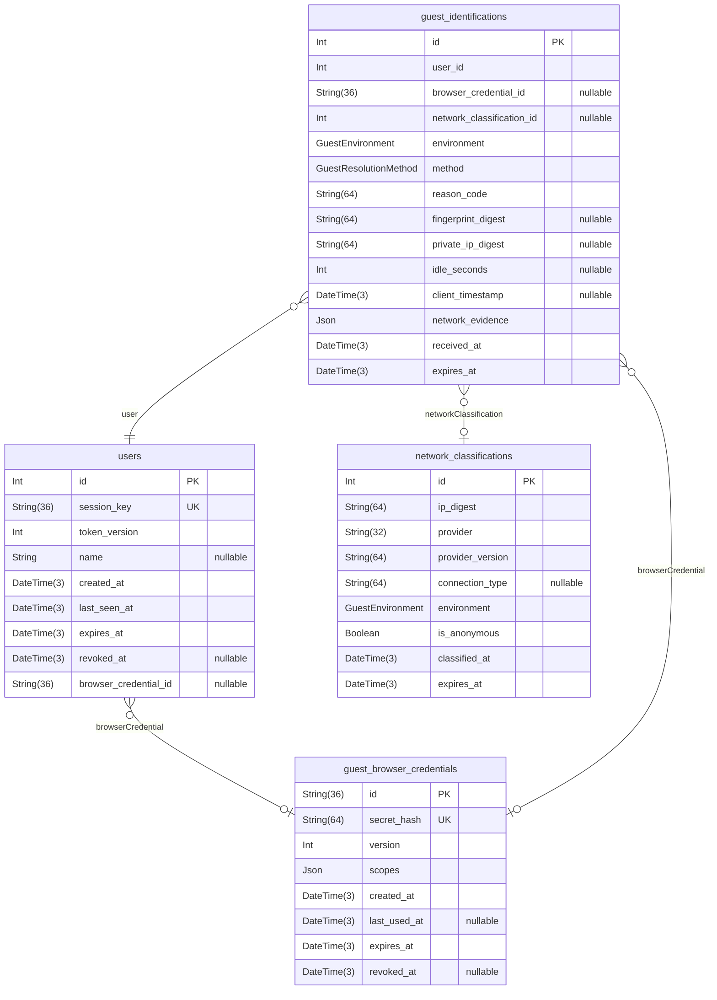
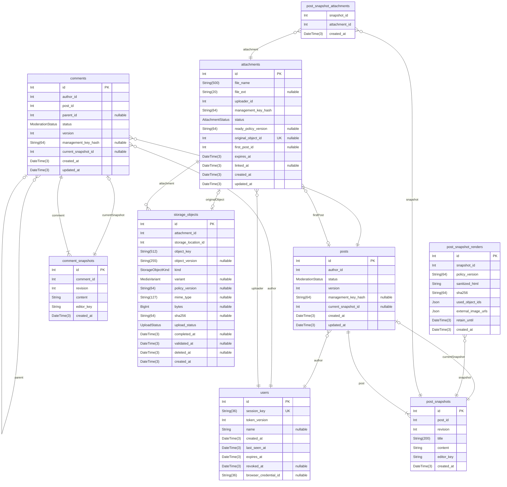
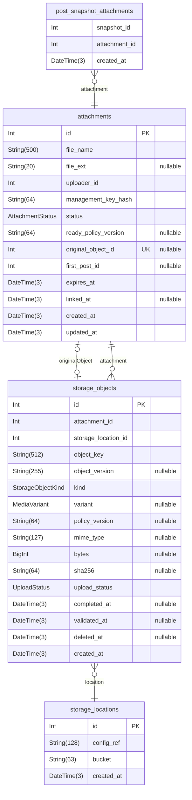
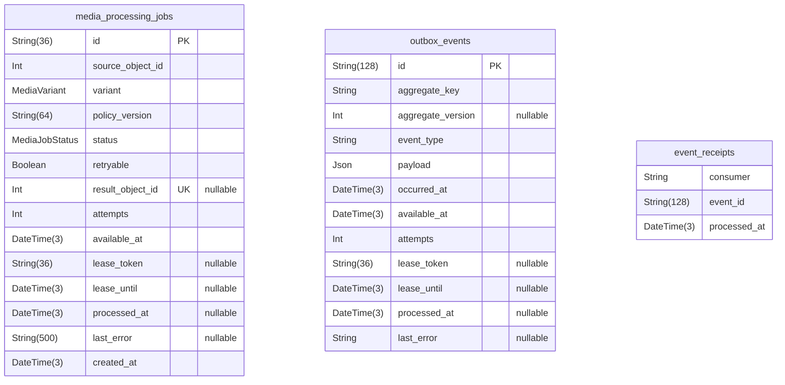
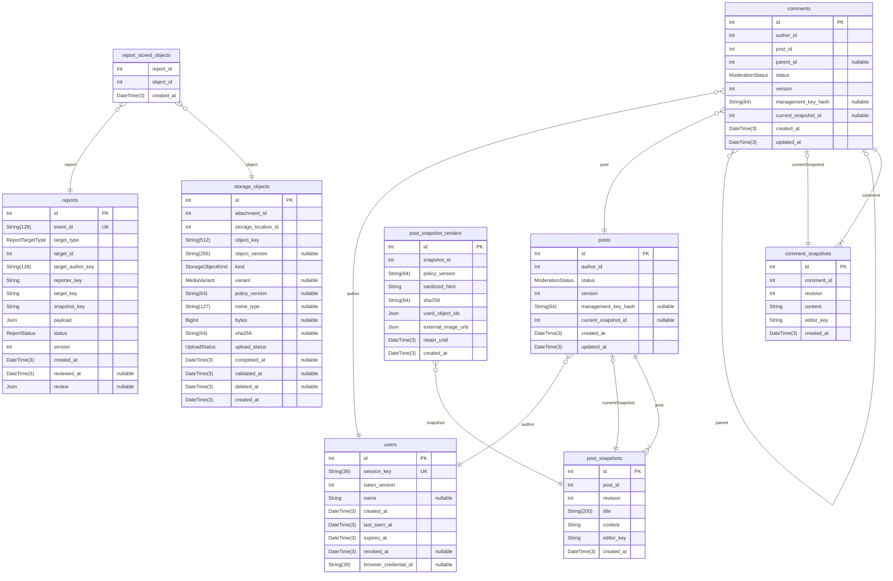
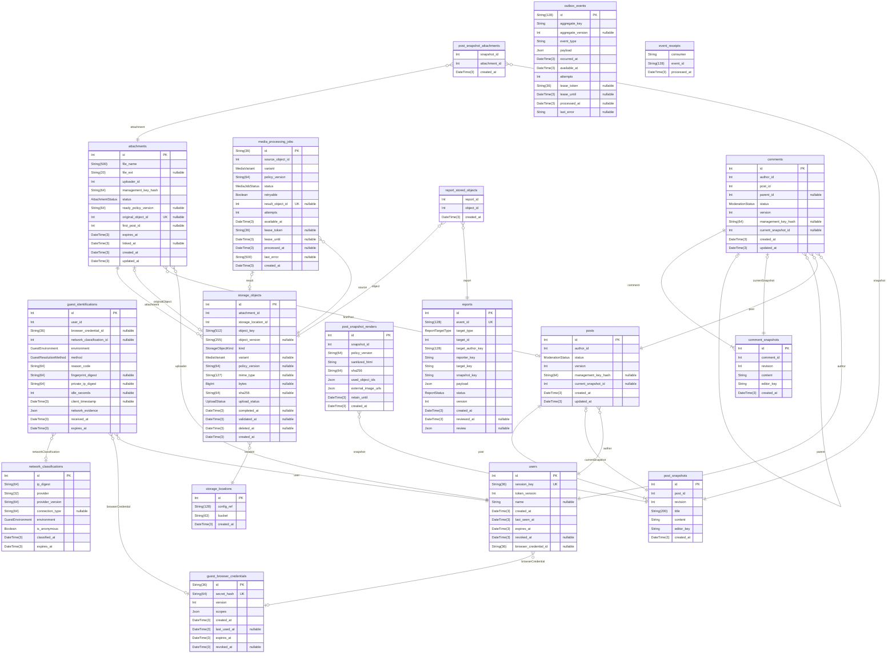

# 비회원 게시판 데이터 설계

> Generated by [`prisma-markdown`](https://github.com/samchon/prisma-markdown)

- [비회원](#비회원)
- [콘텐츠](#콘텐츠)
- [첨부](#첨부)
- [이벤트](#이벤트)
- [신고](#신고)
- [전체](#전체)

## 비회원

### `users`

User는 독립 방문 한 건의 식별·만료·활동 시각을 저장하는 기록입니다. 실제 사람의 신원을 나타내지 않아요.

#### 데이터 흐름·제약

GuestBrowserCredential을 선택적 N:1로 참조하고, 판정·최초 작성 콘텐츠·업로드 첨부는 0:N으로 연결해요.
브라우저 키 참조는 비민감 환경설정 연결이며 콘텐츠 관리 권한을 넘기지 않아요.
만료·철회와 행 삭제는 구분하고, 보존할 필수 역참조가 있으면 물리 삭제를 거부해요.
관계의 존재·소유자·삭제 정책은 서비스가 검사해요. PK·UNIQUE·NOT NULL·인덱스는 DB에 유지해요.

[전체 관계도](#전체)의 선은 Prisma에 선언한 논리 관계이며 물리 FK가 아니에요.
각 모델의 설명에서 해당 데이터의 저장·참조·증거 복사 흐름을 확인할 수 있어요.

상세 설계: [비회원 관리](docs/guest-management.md), [관계 무결성](docs/post-management.md#관계-무결성과-삭제), [저장 정책](docs/post-management.md#저장-타입과-제약).

Properties as follows:

- `id`: 독립 방문 세션의 DB 식별자.
- `session_key`: 방문 UUID, UNIQUE. 이 값만으로 인증하지 않아요.
- `token_version`: 서명 토큰과 대조하는 세션 버전.
- `name`: 비회원 표시명. 신원이나 권한을 확인하는 값은 아니에요.
- `created_at`: 방문 시작 서버 시각.
- `last_seen_at`: 마지막 성공 활동 서버 시각. 유휴 만료 기준.
- `expires_at`: 절대 세션 만료 시각.
- `revoked_at`: 선택적 세션 철회 시각.
- `browser_credential_id`: [브라우저 키](#guest_browser_credentials)의 선택적 논리 참조.

### `guest_browser_credentials`

GuestBrowserCredential은 비민감 환경설정만 연결하는 브라우저 키입니다. 사람의 신원이나 콘텐츠 관리 권한을 나타내지 않아요.

#### 데이터 흐름·제약

여러 독립 User와 판정 기록이 이 키를 선택적으로 참조해요. secretHash는 UNIQUE이고 키 원문은 저장하지 않아요.
키의 유효 기간·철회와 환경설정 전용 사용 범위는 서비스가 검사해요.

상세 설계: [비회원 관리](docs/guest-management.md), [방문 식별과 권한](docs/guest-management.md#방문-식별과-권한).

Properties as follows:

- `id`: 브라우저 키 검색용 UUID.
- `secret_hash`: 브라우저 키 비밀의 해시, UNIQUE. 원문은 저장하지 않아요.
- `version`: 브라우저 키 검증 버전.
- `scopes`: 환경설정 연결 권한 범위를 담은 JSON.
- `created_at`: 키 발급 서버 시각.
- `last_used_at`: 마지막 검증 사용 시각.
- `expires_at`: 고정 만료 시각.
- `revoked_at`: 선택적 철회 시각.

### `network_classifications`

NetworkClassification은 공급자별 접속 IP 위험 분류를 보관하는 갱신 가능한 캐시입니다. 신원이나 장소의 증명은 아니에요.

#### 데이터 흐름·제약

(ipDigest, provider)는 복합 UNIQUE예요. 캐시는 갱신하고, 방문에 적용한 판정은 GuestIdentification에 따로 보관해요.
판정 시 분류는 GuestIdentification.networkEvidence에 복사해요.
만료 인덱스는 정리에 사용해요. 분류의 유효성과 보존 기간은 서비스가 검사해요.

상세 설계: [환경 판정](docs/guest-management.md), [증거 설계](docs/guest-management.md#접속-환경과-판정).

Properties as follows:

- `id`: 갱신 가능한 분류 캐시 행의 ID.
- `ip_digest`: 접속 IP의 목적별 HMAC digest.
- `provider`: 분류 공급자. ipDigest와 복합 UNIQUE.
- `provider_version`: 공급자·정책·HMAC 키 식별값.
- `connection_type`: 선택적 공급자 원래 연결 유형.
- `environment`: 캐시의 환경 분류.
- `is_anonymous`: 공급자의 익명 연결 신호.
- `classified_at`: 서버 분류 시각.
- `expires_at`: 캐시 만료 시각.

### `guest_identifications`

GuestIdentification은 방문에 적용한 환경·처리 방법·사유와 당시 분류 증거를 저장하는 불변 판정 기록입니다.

#### 데이터 흐름·제약

User는 필수 N:1이고, 브라우저 키·분류 캐시는 선택적 N:1 논리 관계예요. 물리 FK는 없어요.
networkEvidence는 판정 당시 캐시의 복사본이며 캐시와 별개로 보관해요.
불변성·환경과 키의 일치·보존 만료는 서비스가 검사해요.
digest는 인증이나 자동 복구 키로 사용하지 않아요.

상세 설계: [비회원 판정](docs/guest-management.md), [증거 설계](docs/guest-management.md#접속-환경과-판정).

Properties as follows:

- `id`: 판정 기록 ID.
- `user_id`: [방문 세션](#users)의 필수 논리 참조.
- `browser_credential_id`: 판정에 사용한 브라우저 키의 선택적 논리 참조.
- `network_classification_id`: 판정에 사용한 분류 캐시의 선택적 논리 참조.
- `environment`: 방문에 실제 적용한 환경 분류.
- `method`: 방문 처리 방법.
- `reason_code`: 서버 판정 사유 코드.
- `fingerprint_digest`: 선택적 목적별 지문 HMAC. 방문을 유일하게 식별하는 값은 아니에요.
- `private_ip_digest`: 선택적 사설 IP HMAC.
- `idle_seconds`: 선택적 서버 계산 유휴 초.
- `client_timestamp`: 선택적 클라이언트 관측 시각, 참고값.
- `network_evidence`: 판정 당시 분류 캐시를 복사한 JSON 증거.
- `received_at`: 서버 판정 수신 시각.
- `expires_at`: 판정 기록 보존 만료 시각.

## 콘텐츠

### `posts`

Post는 최초 작성자·상태·관리 키 해시·최신 정본 포인터를 저장하는 게시물 메타데이터입니다. 내용은 PostSnapshot에 저장해요.

#### 데이터 흐름·제약

제목·GFM 본문은 PostSnapshot에 누적하고 첨부는 개정별 사용 관계로 연결해요. 현재 내용은 currentSnapshot으로 읽어요.
author는 필수 N:1, snapshots는 1:N, comments는 0:N이에요.

(id, currentSnapshotId) → (postId, id)의 소유자 일치는 서비스가 검사해요.
최소 스냅샷·최대 revision 포인터·최초 작성자 불변성 검사는 서비스의 책임입니다. NULL 포인터는 생성 트랜잭션 안에서만 허용해요.
변경은 새 정본·메타데이터·OutboxEvent에 함께 남기고, 삭제 후에도 정본과 신고 증거는 보존해요.

상세 설계: [게시물 관리](docs/post-management.md), [게시물 조회](docs/post-management.md#게시물-조회).

Properties as follows:

- `id`: 게시물 전체의 논리 리소스 ID.
- `author_id`: [최초 작성 방문](#users)의 필수 논리 참조.
- `status`: 콘텐츠 노출·삭제 상태.
- `version`: 수정 충돌을 확인하는 메타데이터 버전.
- `management_key_hash`: 해당 콘텐츠 관리 키의 해시. 원문은 저장하지 않아요.
- `current_snapshot_id`: [최신 정본](#post_snapshots)의 선택적 포인터. 소유자 복합 논리 관계.
- `created_at`: 게시물 최초 생성 시각.
- `updated_at`: 게시물 메타데이터 변경 시각.

### `post_snapshots`

PostSnapshot은 게시물의 각 수정 시점에 해당하는 제목·GFM 원문 정본을 저장하는 불변 스냅샷입니다.

#### 데이터 흐름·제약

Post와 필수 N:1 논리 관계이고, (postId, revision)·(postId, id)는 UNIQUE예요.
현재 포인터의 역참조는 0:1이에요. 과거 정본에는 이 역참조가 없어요.
서비스는 수정 시 새 행을 추가하고 기존 정본의 변경·삭제를 거부해요.

첨부는 PostSnapshotAttachment에, 정제 HTML은 PostSnapshotRender에 저장해요. 바이트는 비공개 객체 저장소에 있어요.
신고는 관찰 정본·렌더·파일 메타데이터를 독립 JSON 증거로 복사하고 ReportStoredObject로 바이트 보존을 참조해요.

상세 설계: [게시물 스냅샷](docs/post-management.md#게시물-변경-설계), [본문·첨부 설계](docs/post-management.md#본문과-첨부).

Properties as follows:

- `id`: 수정 시점별 정본 ID.
- `post_id`: [소유 게시물](#posts)의 필수 논리 참조.
- `revision`: 게시물별 개정 번호. postId와 복합 UNIQUE.
- `title`: 해당 시점 제목 정본.
- `content`: 해당 시점 GFM 원문. 첨부 설명과 배치 순서도 원문에 보관해요.
- `editor_key`: 실제 작성·수정 방문의 논리 키. FK 아님.
- `created_at`: 정본 기록 서버 시각.

### `post_snapshot_renders`

PostSnapshotRender는 개정·렌더 정책 버전별 정제 HTML과 해시·사용 객체 목록의 불변 결과입니다.

#### 데이터 흐름·제약

usedObjectIds는 StorageObject의 논리 ID JSON 집합이에요. 목록과 실제 HTML·첨부 사용의 일치는 서비스가 검사해요.
retainUntil은 렌더 결과의 최소 보존 종료 시각이에요. 서비스는 결과와 참조 객체의 보존을 함께 검사해요.

상세 설계: [원문과 렌더 결과](docs/post-management.md#본문과-첨부), [관찰 증거](docs/report-management.md#파일-증거와-보존).

Properties as follows:

- `id`: 불변 렌더 결과 ID.
- `snapshot_id`: 렌더한 개정의 필수 논리 참조.
- `policy_version`: 파서·정제·URL·파생 선택을 묶은 불변 정책 버전.
- `sanitized_html`: 정제한 HTML. 접근 권한을 대신하지 않아요.
- `sha256`: 정제 HTML UTF-8 바이트의 SHA-256.
- `used_object_ids`: 렌더·다운로드 링크가 사용하는 검증 객체 ID 집합.
- `external_image_urls`: 당시 외부 이미지 URL 집합. 외부 바이트 보존을 뜻하지 않아요.
- `retain_until`: 렌더 결과의 최소 보존 종료 시각.
- `created_at`: 렌더 생성 시각.

### `comments`

Comment는 최초 작성자·소속 게시물·부모·상태·최신 정본 포인터를 저장하는 댓글 메타데이터입니다. 내용은 CommentSnapshot에 저장해요.

#### 데이터 흐름·제약

본문은 CommentSnapshot에 누적하고 currentSnapshot으로 현재 정본을 읽어요.
parentId가 NULL이면 일반 댓글이고 값이 있으면 대댓글이에요. replies는 자기참조 0:N이에요.

서비스가 (parentId, postId) → (id, postId)의 게시물 일치와 (id, currentSnapshotId) → (commentId, id)의 정본 소유자 일치를 검사해요.
최초 작성자·부모·소속은 불변입니다. 자기 부모 금지와 최소·최신 정본은 서비스가 확인해요.
변경은 정본·메타데이터·이벤트에 함께 남기고, 삭제 후에도 신고 증거를 보존해요.

상세 설계: [댓글 관리](docs/comment-management.md), [댓글 조회](docs/comment-management.md#댓글-조회와-인덱스).

Properties as follows:

- `id`: 댓글 전체의 논리 리소스 ID.
- `author_id`: 최초 작성 방문의 필수 논리 참조.
- `post_id`: [소속 게시물](#posts)의 필수 논리 참조.
- `parent_id`: [부모 댓글](#comments)의 선택적 ID. postId와 복합 논리 관계.
- `status`: 댓글 노출·삭제 상태.
- `version`: 댓글 수정 충돌을 확인하는 메타데이터 버전.
- `management_key_hash`: 해당 댓글 관리 키의 해시.
- `current_snapshot_id`: 같은 댓글 최신 정본의 선택적 복합 논리 포인터.
- `created_at`: 댓글 최초 생성 시각.
- `updated_at`: 댓글 메타데이터 변경 시각.

### `comment_snapshots`

CommentSnapshot은 댓글의 각 수정 시점에 해당하는 본문 정본을 저장하는 불변 스냅샷입니다.

#### 데이터 흐름·제약

Comment와 필수 N:1 논리 관계이고, (commentId, revision)·(commentId, id)는 UNIQUE예요.
현재 포인터의 역참조는 0:1이에요. 수정은 새 행을 추가하고, 기존 정본의 변경·삭제는 서비스가 거부해요.
신고는 관찰한 정본을 독립 JSON 증거로 복사해요.

상세 설계: [댓글 스냅샷](docs/comment-management.md), [신고 증거 설계](docs/report-management.md#신고-대상과-증거).

Properties as follows:

- `id`: 댓글 수정 시점별 정본 ID.
- `comment_id`: [소유 댓글](#comments)의 필수 논리 참조.
- `revision`: 댓글별 개정 번호. commentId와 복합 UNIQUE.
- `content`: 해당 시점 댓글 본문 정본.
- `editor_key`: 실제 작성·수정 방문의 논리 키. FK 아님.
- `created_at`: 정본 기록 서버 시각.

## 첨부

### `attachments`

Attachment는 파일 표시 메타데이터·업로드 주체·관리 키 해시·사용 준비 상태와 최초 연결 게시물을 저장해요.

#### 데이터 흐름·제약

원본과 파생본 바이트는 StorageObject가 가리키는 비공개 저장소에 있어요. 파일명은 형식·경로의 근거가 아니에요.
최초 연결 게시물과 원본 포인터는 확정 후 불변이고, 같은 게시물의 여러 개정만 재사용해요.
READY의 원본·필수 파생본 완결성과 연결·보존 상태는 서비스가 검사해요. 업로드 완료와 사용 준비는 구분해요.

상세 설계: [본문·첨부](docs/post-management.md#본문과-첨부), [정리](docs/file-management.md#파일-접근과-보존).

Properties as follows:

- `id`: 첨부 ID. URL 소지만으로 권한을 주지 않아요.
- `file_name`: 표시용 원본 파일명. 저장 경로에 사용하지 않아요.
- `file_ext`: 선택적 표시용 확장자. 실제 형식은 바이트로 검증해요.
- `uploader_id`: 최초 업로드 방문의 필수 논리 참조.
- `management_key_hash`: 독립 업로드 관리 키의 SHA-256 해시. 키 원문은 저장하지 않아요.
- `status`: 검증·변환을 포함한 연결 준비 및 정리 상태.
- `ready_policy_version`: READY를 확정한 변환 정책 버전. 확정 전 NULL.
- `original_object_id`: 검증된 정본 원본의 선택적 포인터. 서비스가 같은 첨부의 ORIGINAL인지 검사해요.
- `first_post_id`: 최초 연결 게시물. 미연결 때만 NULL, 연결 후 불변.
- `expires_at`: 미연결 첨부의 고정 업로드 만료. 연결 후에는 보존 참조를 우선해요.
- `linked_at`: 최초 연결 시각. firstPostId와 함께 확정해요.
- `created_at`: 첨부 생성 시각.
- `updated_at`: 상태 변경 시각.

### `storage_locations`

StorageLocation은 S3 호환 저장소의 설정 참조와 비공개 버킷을 저장해요. 접근 비밀은 외부 설정에 있어요.

#### 데이터 흐름·제약

참조 중인 설정·버킷의 의미를 변경하지 않고 새 위치 행을 만들어요. 실제 접근과 비공개 설정은 서비스·운영이 검사해요.

상세 설계: [저장 위치](docs/file-management.md#파일-메타데이터와-저장-위치).

Properties as follows:

- `id`: 저장 위치 ID.
- `config_ref`: 비밀이 아닌 외부 S3 호환 설정 식별자.
- `bucket`: 비공개 버킷 이름.
- `created_at`: 저장 위치 생성 시각.

### `storage_objects`

StorageObject는 임시 업로드·검증 원본·파생본을 각각 독립 객체로 저장하는 메타데이터입니다. 바이트를 저장하지 않아요.

#### 데이터 흐름·제약

(storageLocationId, objectKey)는 UNIQUE이며 키·선택적 버전은 확정 후 불변이에요. 덮어쓰기와 키 재사용을 금지해요.
DONE은 전송 완료일 뿐이에요. 정본 사용에는 MIME·크기·해시·완료 시각·validatedAt을 서비스가 확인해요.
크기·해시·완료 시각은 전송 중 NULL 가능하며 원본과 파생본의 완결성·보존·삭제는 서비스가 검사해요.

상세 설계: [파일 메타데이터](docs/file-management.md#파일-메타데이터와-저장-위치), [파일 변환 작업](docs/request-failure-management.md#파일-변환-작업의-저장).

Properties as follows:

- `id`: 객체 메타데이터 ID.
- `attachment_id`: 소유 첨부의 필수 논리 참조.
- `storage_location_id`: 저장 위치의 필수 논리 참조.
- `object_key`: 서버가 생성한 불변 객체 키. 원본 파일명과 분리해요.
- `object_version`: 저장소가 버전 기능을 제공할 때 확정한 객체 버전. 없으면 NULL.
- `kind`: 임시·정본 원본·파생본 구분.
- `variant`: 파생 종류. DERIVED에서만 필수이며 서비스가 검사해요.
- `policy_version`: 파생 정책 버전. DERIVED에서만 필수예요.
- `mime_type`: 실제 바이트로 확인한 MIME. 검증 전 NULL.
- `bytes`: 실제 바이트 크기. 전송 중 NULL 가능, 검증된 사용 객체는 양수 필수.
- `sha256`: 실제 바이트 SHA-256 소문자 hex. 전송 중 NULL 가능.
- `upload_status`: 객체 전송 상태. DONE만으로 사용 가능하지 않아요.
- `completed_at`: 전송 완료 시각. DONE에서 필수.
- `validated_at`: 실제 바이트 검증 완료 시각. 사용 확정 전 NULL.
- `deleted_at`: 정리 확인 시각. 보존 참조가 있으면 설정을 거부해요.
- `created_at`: 객체 등록 시각.

### `post_snapshot_attachments`

PostSnapshotAttachment는 개정별 첨부 사용의 집합입니다. 파일 설명과 배치 순서는 원문에만 있어요.

#### 데이터 흐름·제약

복합 PK가 같은 개정의 중복 첨부를 막아요. 서비스는 본문·사용 관계의 일치와 첨부 준비·게시물 소유를 검사해요.

상세 설계: [본문 참조와 연결](docs/post-management.md#본문과-첨부).

Properties as follows:

- `snapshot_id`: 사용 개정 ID.
- `attachment_id`: 사용 첨부 ID.
- `created_at`: 개정별 사용 생성 시각.

## 이벤트

### `media_processing_jobs`

MediaProcessingJob은 원본·변환 종류·정책 버전별 작업의 불변 입력과 폴링·실패·재시도·임대를 저장해요.

#### 데이터 흐름·제약

복합 UNIQUE로 논리 작업 중복을 막고 성공 결과는 하나만 선택해요. 외부 작업은 DB 트랜잭션 밖에서 실행해요.
임대 필드는 만료된 작업자와 현재 작업자를 구분해요. 결과 소유자·완료 상태의 일치는 서비스가 검사해요.

상세 설계: [파일 변환 작업](docs/request-failure-management.md#파일-변환-작업의-저장).

Properties as follows:

- `id`: 안정적 논리 작업 UUID. 처리 영수증의 논리 eventId로 사용해요.
- `source_object_id`: 검증된 정본 원본의 필수 논리 참조.
- `variant`: 요청한 파생 종류.
- `policy_version`: 불변 변환 정책 버전.
- `status`: 변환 처리 상태. FAIL의 자동 재시도 여부는 서비스 정책으로 구분해요.
- `retryable`: FAIL의 자동 재시도 허용 여부. 영구 실패·정리 취소는 false.
- `result_object_id`: 선택한 검증 결과 객체. 성공 전 NULL.
- `attempts`: 실행 시도 횟수.
- `available_at`: 최초 실행·재시도 가능 시각.
- `lease_token`: 매 할당 시 새로 발급하는 임대 토큰.
- `lease_until`: 현재 임대 만료 시각.
- `processed_at`: DB 결과 확정 시각. DONE에서 필수.
- `last_error`: 민감정보를 제외한 실패 원인.
- `created_at`: 작업 생성 시각.

### `outbox_events`

OutboxEvent는 정본 변경과 함께 저장하는 후속 처리 이벤트입니다. 불변 이벤트 내용과 전달·재시도·완료 상태를 보관해요.

#### 데이터 흐름·제약

대상은 aggregateKey로 논리 참조하며 콘텐츠·신고 FK는 없어요. 본문에는 정본 참조만 담고 전체 증거는 복제하지 않아요.
EventReceipt는 이 행의 ID를 논리 참조해 소비자별 처리 기록을 보관해요.

(aggregateKey, aggregateVersion)는 UNIQUE예요. aggregateVersion이 NULL이면 이 키로 중복을 막을 수 없어 안정적 이벤트 ID를 사용해요.
ID·대상·본문·발생 시각의 불변성은 서비스가 확인해요. 전달 상태만 갱신해요.

상세 설계: [요청 실패 관리](docs/request-failure-management.md), [이벤트와 정본](docs/request-failure-management.md#이벤트와-정본의-구분).

Properties as follows:

- `id`: 안정적 이벤트 ID. 영수증·외부 효과의 논리 참조 기준.
- `aggregate_key`: 이벤트 대상 정본의 논리 키, FK 아님.
- `aggregate_version`: 선택적 정본 메타데이터 버전 투영.
- `event_type`: 후속 처리에 사용할 이벤트 종류.
- `payload`: 작업 주체와 정본 참조를 담은 불변 JSON.
- `occurred_at`: 이벤트 발생 서버 시각.
- `available_at`: 전달·재시도 가능 시각.
- `attempts`: 전달 시도 수.
- `lease_token`: 현재 작업을 맡은 워커의 임대 토큰. 미할당 상태는 NULL.
- `lease_until`: 워커의 작업 권한이 끝나는 시각. 미할당 상태는 NULL.
- `processed_at`: 필요한 모든 소비자의 처리를 마친 시각. 완료 전에는 NULL.
- `last_error`: 민감정보를 제외한 실패 원인. 실패 기록이 없으면 NULL.

### `event_receipts`

EventReceipt는 소비자별 이벤트·미디어 작업의 DB 효과 처리 완료 기록입니다. DB 효과와 함께 저장해요.

#### 데이터 흐름·제약

(consumer, eventId)가 복합 PK이며 같은 소비자·이벤트 조합의 중복 행을 막아요.
eventId는 OutboxEvent·MediaProcessingJob 또는 외부 이벤트의 논리 참조이고 FK는 없어요.

효과와 영수증을 함께 저장하는 원자성은 서비스가 보장합니다. 기존 기록은 변경·삭제하지 않아요.
외부 API의 성공 여부까지 이 행만으로 보장할 수는 없어요.

상세 설계: [요청 실패·처리 기록](docs/request-failure-management.md).

Properties as follows:

- `consumer`: 소비자 식별자. eventId와 복합 PK.
- `event_id`: 처리한 이벤트의 논리 ID. FK 아님.
- `processed_at`: 효과와 영수증을 함께 기록한 서버 시각.

## 신고

### `report_stored_objects`

ReportStoredObject는 독립 신고 증거가 사용하는 관리 객체의 보존 참조입니다. 바이트나 메타데이터 복사본이 아니에요.

#### 데이터 흐름·제약

복합 PK로 중복을 막아요. 서비스는 증거 JSON과 객체 집합 일치·검수 권한·삭제 전 역참조를 검사해요.
신고 종료만으로 삭제하지 않으며 증거 보존 정책이 끝날 때까지 원본과 파생본을 유지해요.

상세 설계: [파일 증거·보존](docs/report-management.md#파일-증거와-보존).

Properties as follows:

- `report_id`: 파일 증거를 소유한 신고 ID.
- `object_id`: 보존할 원본·파생 객체 ID.
- `created_at`: 보존 참조 생성 시각.

### `reports`

Report는 검색용 대상 키·관찰 당시의 독립 JSON 증거·검수 상태를 저장하는 신고 기록입니다.

#### 데이터 흐름·제약

User·Post·Comment·Snapshot에 FK가 없어요. 대상 종류와 ID는 논리 참조이고, 관찰 정본은 payload에 복사해요.
같은 숫자 ID여도 POST와 COMMENT는 다른 대상이에요. 원본이 바뀌거나 없어져도 증거를 독립적으로 읽을 수 있어요.
eventId는 UNIQUE이고, (reporterKey, targetKey, snapshotKey)는 복합 UNIQUE예요.

증거·대상 키의 불변성과 JSON 일치는 서비스가 검사해요.
검수 결과는 따로 기록하고 신고·검수 변경은 OutboxEvent와 함께 저장해요. 관리자 증거 조회에는 원본 JOIN이 필요하지 않아요.

상세 설계: [신고 관리](docs/report-management.md), [증거 설계](docs/report-management.md#신고-대상과-증거), [신고 조회](docs/report-management.md#신고-조회와-인덱스).

Properties as follows:

- `id`: 신고 리소스 ID. 원본 테이블에 FK로 연결하지 않아요.
- `event_id`: 신고 요청 멱등 키, UNIQUE.
- `target_type`: 신고 대상 종류 POST / COMMENT.
- `target_id`: 종류별 대상 리소스 ID, 논리 참조.
- `target_author_key`: 당시 최초 작성 방문의 논리 키.
- `reporter_key`: 신고 방문의 논리 키.
- `target_key`: 콘텐츠 전체 집계용 논리 키.
- `snapshot_key`: 관찰 정본의 논리 키.
- `payload`: 관찰 당시 대상·정본·사유를 보존한 불변 JSON 증거.
- `status`: 신고 검수 상태.
- `version`: 검수 메타데이터 동시성 버전.
- `created_at`: 신고 수락 서버 시각.
- `reviewed_at`: 선택적 검수 종료 서버 시각.
- `review`: 증거와 별도로 저장한 검수 결과 JSON.

## 전체

