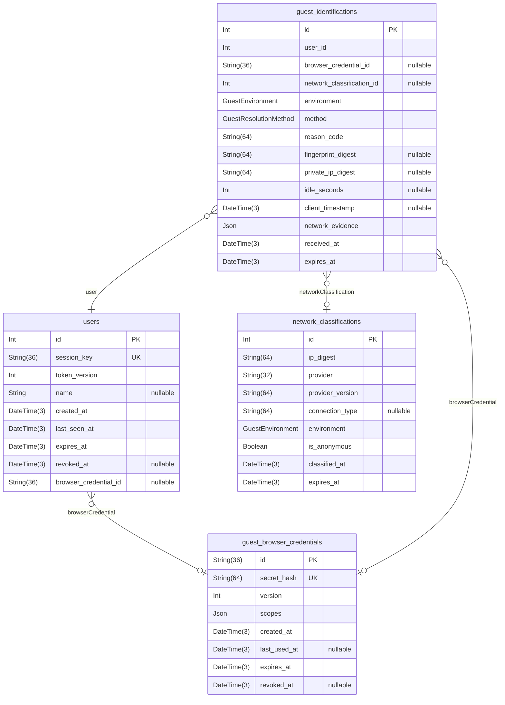
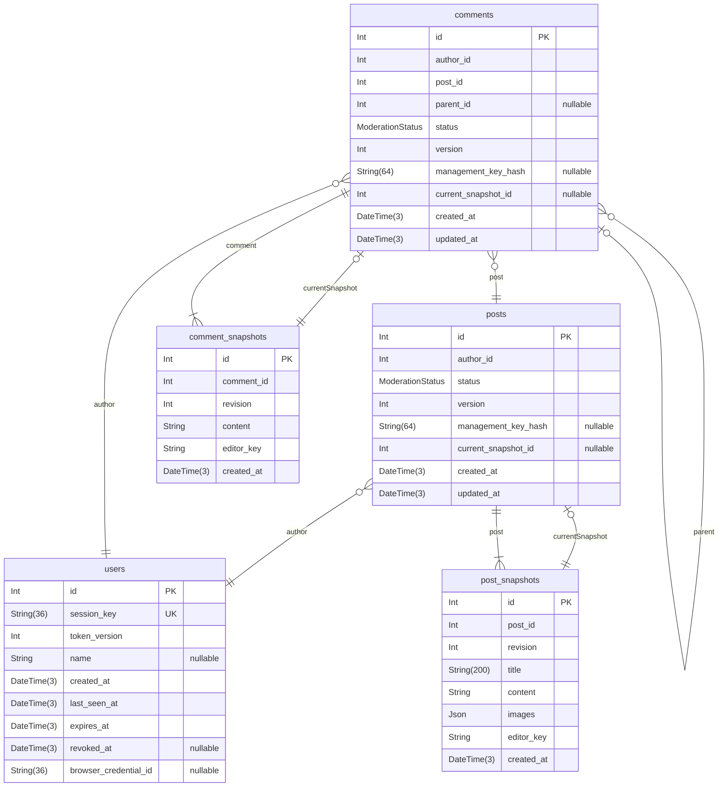
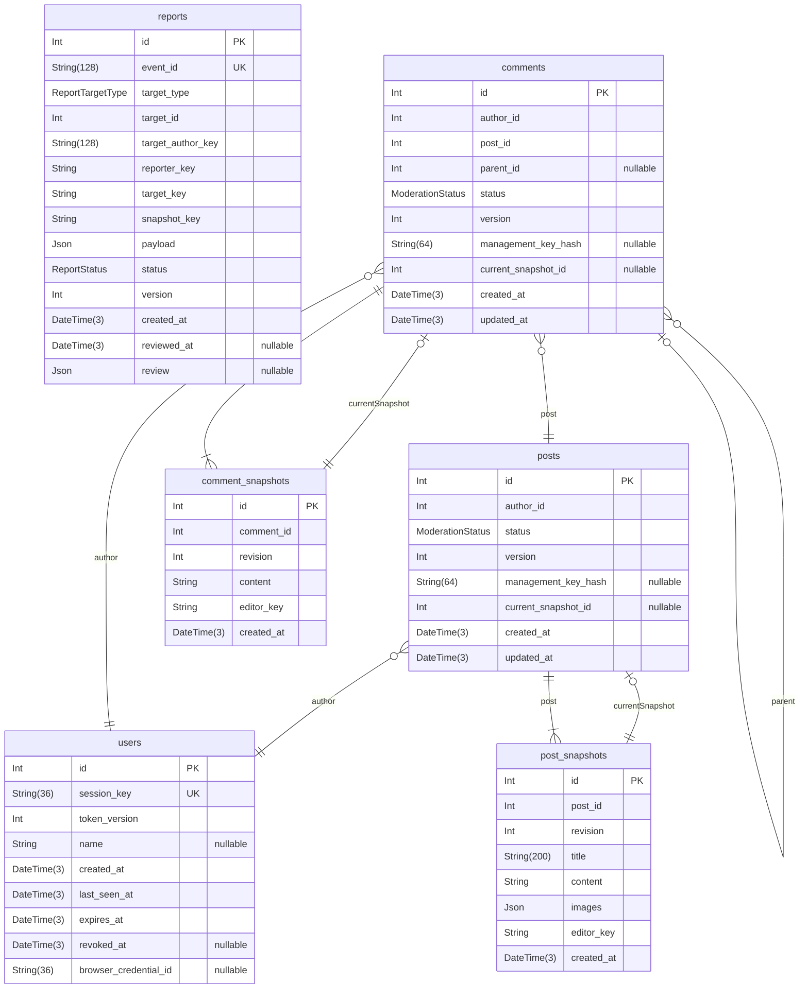
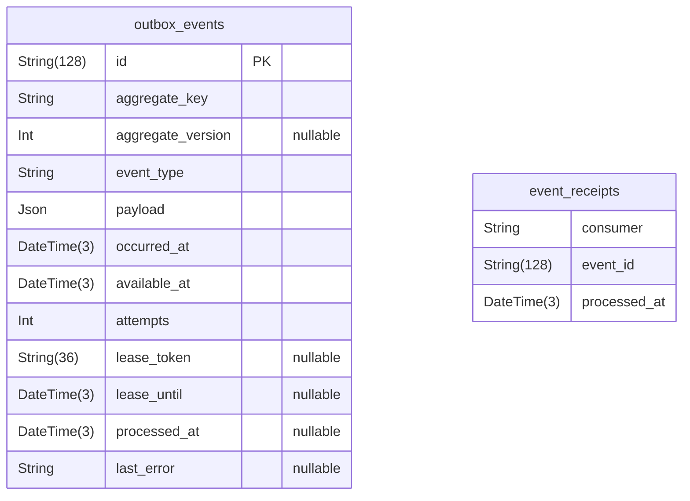
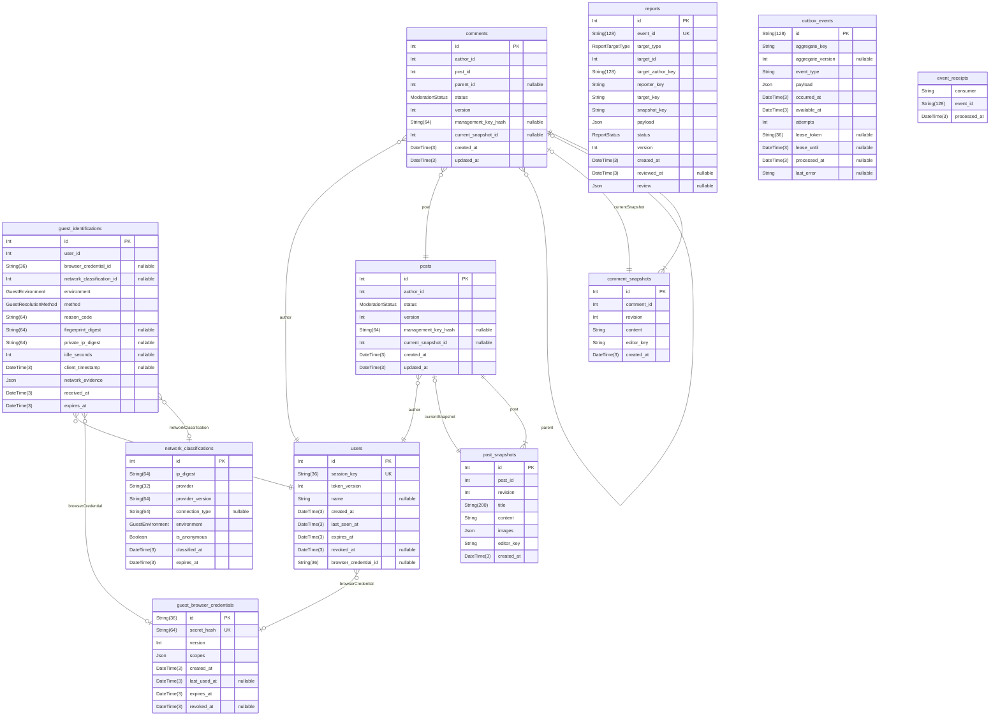

# 비회원 게시판 데이터 설계

> Generated by [`prisma-markdown`](https://github.com/samchon/prisma-markdown)

- [비회원](#비회원)
- [콘텐츠](#콘텐츠)
- [신고](#신고)
- [이벤트](#이벤트)
- [전체](#전체)

## 비회원

### `users`

비회원 방문 한 건의 식별·만료·활동 시각을 저장한다. 회원 계정이나 실제 사람의 신원이 아니다.

#### 데이터 흐름

| 저장·참조 흐름 | 연결 방식 | 데이터 역할 |
| --- | --- | --- |
| GuestBrowserCredential → User | 선택적 논리 관계 | 하나의 브라우저 키를 참조하는 독립 방문들 |
| NetworkClassification → GuestIdentification | 선택적 논리 관계 + JSON 복사 | 캐시 참조와 판정 당시 분류 증거를 구분 |
| User → Post·Comment | 필수 논리 관계 | 최초 작성 방문을 고정 |
| Post·Comment → Snapshot | 소유자 논리 관계, 1:N | 수정 시점별 정본을 추가 보존 |
| Post·Comment → currentSnapshot | 복합 논리 관계 | 같은 콘텐츠의 최신 정본을 참조 |
| Snapshot → Report | JSON 증거 복사, FK 아님 | 관찰 당시 내용을 원본과 독립적으로 보존 |
| 콘텐츠·신고 → OutboxEvent | 논리 키, FK 아님 | 정본 변경과 이벤트를 함께 저장 |
| OutboxEvent → EventReceipt | eventId 논리 참조, FK 아님 | 소비자별 처리 기록 |

본문·제목·이미지는 스냅샷이 정본이며 Post·Comment는 메타데이터와 최신 포인터를 저장한다.
모든 테이블에 물리 FK를 설정하지 않는다. [전체 관계도](#전체)의 선은 Prisma에 선언한 논리 관계다.
Report·OutboxEvent·EventReceipt의 논리 키와 증거 복사는 관계선과 별도로 위 표에 표현한다.

#### 관계·보존

브라우저 키는 선택적 N:1, 판정·최초 작성 콘텐츠는 0:N이다. 관계의 존재·소유자·삭제 정책은 서비스가 검증한다.
PK·UNIQUE·NOT NULL·인덱스는 유지한다. Prisma 관계 선언은 사람의 동일성을 보장하지 않는다.

상세 설계: [문서 목록](docs/README.md), [비회원 세션](docs/guest-session.md), [관계 무결성](docs/relation-integrity.md), [저장 정책](docs/storage-policy.md).

Properties as follows:

- `id`: 독립 방문 세션의 DB 식별자.
- `session_key`: 방문 UUID, UNIQUE. 단독 인증 수단이 아니다.
- `token_version`: 서명 토큰과 대조하는 세션 버전.
- `name`: 비회원 표시명. 신원이나 권한 식별자가 아니다.
- `created_at`: 방문 시작 서버 시각.
- `last_seen_at`: 마지막 성공 활동 서버 시각. 유휴 만료 기준.
- `expires_at`: 절대 세션 만료 시각.
- `revoked_at`: 선택적 세션 철회 시각.
- `browser_credential_id`: [브라우저 키](#guest_browser_credentials)의 선택적 논리 참조.

### `guest_browser_credentials`

비민감 환경설정 연결용 브라우저 키 한 건을 저장한다. 콘텐츠 관리 권한이나 사람 식별자가 아니다.

#### 데이터 흐름·제약

여러 독립 User와 판정 기록이 이 키를 선택적으로 참조한다. secretHash는 UNIQUE이고 키 원문은 저장하지 않는다.
해시·scope·발급·고정 만료의 불변성과 철회 규칙은 서비스가 검증한다.

상세 설계: [비회원 세션](docs/guest-session.md), [JSON 계약](docs/data-contracts.md#scopes).

Properties as follows:

- `id`: 브라우저 키 검색용 UUID.
- `secret_hash`: 브라우저 키 비밀의 해시, UNIQUE. 원문은 저장하지 않는다.
- `version`: 브라우저 키 검증 버전.
- `scopes`: 환경설정 연결 권한 범위를 담은 JSON.
- `created_at`: 키 발급 서버 시각.
- `last_used_at`: 마지막 검증 사용 시각.
- `expires_at`: 고정 만료 시각.
- `revoked_at`: 선택적 철회 시각.

### `network_classifications`

공급자별 접속 IP 분류 캐시 한 건을 저장한다. 위험 분류이며 신원이나 장소의 증명이 아니다.

#### 데이터 흐름·제약

(ipDigest, provider)는 복합 UNIQUE다. 캐시는 갱신 가능하며 참조한 판정은 GuestIdentification에 별도로 보존한다.
판정 당시 분류를 networkEvidence에 복사하므로 이후 캐시 변경이 과거 판정 증거를 바꾸지 않는다.
만료 인덱스는 캐시 정리용이며 분류 유효성·보존 기간은 서비스가 검증한다.

상세 설계: [환경 판정](docs/guest-session.md), [증거 계약](docs/data-contracts.md#network-evidence).

Properties as follows:

- `id`: 갱신 가능한 분류 캐시 행의 ID.
- `ip_digest`: 접속 IP의 목적별 HMAC digest.
- `provider`: 분류 공급자. ipDigest와 복합 UNIQUE.
- `provider_version`: 공급자·정책·HMAC 키 식별값.
- `connection_type`: 선택적 공급자 원래 연결 유형.
- `environment`: 캐시의 환경 분류.
- `is_anonymous`: 공급자의 익명 연결 신호.
- `classified_at`: 서버 분류 시각.
- `expires_at`: 캐시 만료 시각.

### `guest_identifications`

한 방문에 적용한 환경·처리 방법·사유와 당시 분류 증거를 저장한다.

#### 데이터 흐름·제약

User는 필수 N:1, 브라우저 키와 분류 캐시는 선택적 N:1 논리 관계다. 물리 FK는 없다.
networkEvidence는 판정 당시 캐시의 복사본이며 캐시와 별개로 보존한다.
판정 불변성·환경과 키의 일치·보존 만료는 서비스가 검증한다. digest는 인증이나 자동 복구 키가 아니다.

상세 설계: [비회원 판정](docs/guest-session.md), [JSON 계약](docs/data-contracts.md#network-evidence).

Properties as follows:

- `id`: 판정 기록 ID.
- `user_id`: [방문 세션](#users)의 필수 논리 참조.
- `browser_credential_id`: 판정에 사용한 브라우저 키의 선택적 논리 참조.
- `network_classification_id`: 판정에 사용한 분류 캐시의 선택적 논리 참조.
- `environment`: 방문에 실제 적용한 환경 분류.
- `method`: 방문 처리 방법.
- `reason_code`: 서버 판정 사유 코드.
- `fingerprint_digest`: 선택적 목적별 지문 HMAC. UNIQUE 식별자가 아니다.
- `private_ip_digest`: 선택적 사설 IP HMAC.
- `idle_seconds`: 선택적 서버 계산 유휴 초.
- `client_timestamp`: 선택적 클라이언트 관측 시각, 참고값.
- `network_evidence`: 판정 당시 분류 캐시를 복사한 JSON 증거.
- `received_at`: 서버 판정 수신 시각.
- `expires_at`: 판정 기록 보존 만료 시각.

## 콘텐츠

### `posts`

포스트 한 건의 최초 작성자·상태·관리 키 해시·최신 정본 포인터를 저장한다.

#### 데이터 흐름·제약

제목·본문·이미지는 PostSnapshot에 누적하고 현재 내용은 currentSnapshot으로 참조한다.
author는 필수 N:1, snapshots는 1:N, comments는 0:N이다.
(id, currentSnapshotId) → (postId, id)는 복합 논리 관계이며 정본 소유자 일치는 서비스가 검증한다.
최소 스냅샷·최대 revision 포인터·최초 작성자 불변성은 서비스가 검증한다. nullable 포인터는 생성 중 임시 상태다.
콘텐츠 변경은 새 정본·메타데이터·OutboxEvent로 저장하며 삭제 후에도 정본과 신고 증거를 보존한다.

상세 설계: [콘텐츠 수명주기](docs/content-lifecycle.md), [조회 계약](docs/query-contracts.md).

Properties as follows:

- `id`: 포스트 전체의 논리 리소스 ID.
- `author_id`: [최초 작성 방문](#users)의 필수 논리 참조.
- `status`: 콘텐츠 노출·삭제 상태.
- `version`: 메타데이터 동시성 버전.
- `management_key_hash`: 해당 콘텐츠 관리 키의 해시. 원문은 저장하지 않는다.
- `current_snapshot_id`: [최신 정본](#post_snapshots)의 선택적 포인터. 소유자 복합 논리 관계.
- `created_at`: 포스트 최초 생성 시각.
- `updated_at`: 포스트 메타데이터 변경 시각.

### `post_snapshots`

포스트의 한 수정 시점에 해당하는 제목·본문·이미지 메타데이터 정본을 저장한다.

#### 데이터 흐름·제약

Post와 필수 N:1 논리 관계이고 (postId, revision)·(postId, id)는 UNIQUE다.
현재 포인터의 역참조는 0:1이며 과거 정본에는 이 역참조가 없다.
수정은 새 행을 추가하고 기존 정본을 변경·삭제하지 않는 서비스 저장 규칙이다.
신고는 이 정본을 JSON 증거로 복사한다. 이미지 바이너리는 객체 저장소에 있고 이 행은 참조 메타데이터만 보존한다.

상세 설계: [스냅샷·이미지 보존](docs/content-lifecycle.md), [이미지 계약](docs/data-contracts.md#images).

Properties as follows:

- `id`: 수정 시점별 정본 ID.
- `post_id`: [소유 포스트](#posts)의 필수 논리 참조.
- `revision`: 포스트별 개정 번호. postId와 복합 UNIQUE.
- `title`: 해당 시점 제목 정본.
- `content`: 해당 시점 본문 정본.
- `images`: 순서 있는 이미지 참조 메타데이터 JSON.
- `editor_key`: 실제 작성·수정 세션의 논리 키. FK 아님.
- `created_at`: 정본 기록 서버 시각.

### `comments`

댓글 한 건의 최초 작성자·소속 포스트·부모 댓글·상태·최신 정본 포인터를 저장한다.

#### 데이터 흐름·제약

본문은 CommentSnapshot에 누적하고 currentSnapshot으로 현재 정본을 참조한다.
parentId가 NULL이면 일반 댓글이고 값이 있으면 대댓글이다. replies는 자기참조 0:N이다.
(parentId, postId) → (id, postId)는 복합 논리 관계이며 부모·자식의 포스트 일치를 서비스가 검증한다.
(id, currentSnapshotId) → (commentId, id)의 정본 소유자 일치도 서비스가 검증한다.
최초 작성자·부모·소속의 불변성, 자기 부모 금지, 최소·최신 정본은 서비스가 검증한다.
댓글 변경도 정본·메타데이터·이벤트로 저장하고 삭제 후 신고 증거를 보존한다.

상세 설계: [콘텐츠 수명주기](docs/content-lifecycle.md), [조회 계약](docs/query-contracts.md).

Properties as follows:

- `id`: 댓글 전체의 논리 리소스 ID.
- `author_id`: 최초 작성 방문의 필수 논리 참조.
- `post_id`: [소속 포스트](#posts)의 필수 논리 참조.
- `parent_id`: [부모 댓글](#comments)의 선택적 ID. postId와 복합 논리 관계.
- `status`: 댓글 노출·삭제 상태.
- `version`: 댓글 메타데이터 동시성 버전.
- `management_key_hash`: 해당 댓글 관리 키의 해시.
- `current_snapshot_id`: 같은 댓글 최신 정본의 선택적 복합 논리 포인터.
- `created_at`: 댓글 최초 생성 시각.
- `updated_at`: 댓글 메타데이터 변경 시각.

### `comment_snapshots`

댓글의 한 수정 시점에 해당하는 본문 정본을 저장한다.

#### 데이터 흐름·제약

Comment와 필수 N:1 논리 관계이고 (commentId, revision)·(commentId, id)는 UNIQUE다.
현재 포인터 역참조는 0:1이다. 수정은 새 행을 추가하며 기존 정본은 서비스에서 변경·삭제하지 않는다.
신고 증거는 이 정본의 복사본이므로 이후 댓글 변경과 독립적으로 보존한다.

상세 설계: [콘텐츠 수명주기](docs/content-lifecycle.md), [신고 증거 계약](docs/data-contracts.md#report-payload).

Properties as follows:

- `id`: 댓글 수정 시점별 정본 ID.
- `comment_id`: [소유 댓글](#comments)의 필수 논리 참조.
- `revision`: 댓글별 개정 번호. commentId와 복합 UNIQUE.
- `content`: 해당 시점 댓글 본문 정본.
- `editor_key`: 실제 작성·수정 세션의 논리 키. FK 아님.
- `created_at`: 정본 기록 서버 시각.

## 신고

### `reports`

신고 한 건의 대상 투영 키·당시 JSON 증거·검수 상태를 저장한다.

#### 데이터 흐름·제약

User·Post·Comment·Snapshot에 FK가 없다. 대상 종류와 ID는 논리 참조이며 관찰 정본은 payload에 복사한다.
같은 숫자 ID도 POST와 COMMENT는 다른 대상이다. 원본 수정·삭제와 독립적으로 증거를 읽을 수 있다.
eventId는 UNIQUE, (reporterKey, targetKey, snapshotKey)는 복합 UNIQUE다.
증거·대상 투영 키의 불변성과 JSON 정합성은 서비스가 검증하고 검수 결과만 별도로 기록한다.
신고·검수 변경은 OutboxEvent와 함께 저장한다. 관리자 증거 조회는 원본 JOIN이 필요하지 않다.

상세 설계: [신고·검수](docs/report-moderation.md), [JSON 계약](docs/data-contracts.md#report-payload), [조회 계약](docs/query-contracts.md).

Properties as follows:

- `id`: 신고 리소스 ID. 원본 테이블 FK는 없다.
- `event_id`: 신고 요청 멱등 키, UNIQUE.
- `target_type`: 신고 대상 종류 POST / COMMENT.
- `target_id`: 종류별 대상 리소스 ID, 논리 참조.
- `target_author_key`: 당시 최초 작성 방문의 논리 키.
- `reporter_key`: 신고 방문의 논리 키.
- `target_key`: 콘텐츠 전체 집계용 논리 키.
- `snapshot_key`: 관찰 정본의 논리 키.
- `payload`: 관찰 당시 대상·정본·사유를 보존한 불변 JSON 증거.
- `status`: 신고 검수 상태.
- `version`: 검수 메타데이터 동시성 버전.
- `created_at`: 신고 수락 서버 시각.
- `reviewed_at`: 선택적 검수 종료 서버 시각.
- `review`: 증거와 별도로 저장한 검수 결과 JSON.

## 이벤트

### `outbox_events`

정본 변경과 함께 생성한 후속 처리 이벤트 한 건과 전달 상태를 저장한다.

#### 데이터 흐름·제약

대상은 aggregateKey의 논리 참조이며 콘텐츠·신고 FK가 없다. 본문에는 정본 참조를 담고 전체 증거를 복제하지 않는다.
EventReceipt는 이 행의 ID를 논리적으로 참조하고 소비자별 처리 기록을 보존한다.
(aggregateKey, aggregateVersion)는 UNIQUE다. NULL aggregateVersion에는 이 UNIQUE가 중복을 막지 않으므로 안정적 이벤트 ID를 사용한다.
이벤트 ID·대상·본문·발생 시각의 불변성은 서비스가 검증하고 전달 상태만 갱신한다.

상세 설계: [이벤트 처리](docs/event-processing.md), [JSON 계약](docs/data-contracts.md#outbox-payload).

Properties as follows:

- `id`: 안정적 이벤트 ID. 영수증·외부 효과의 논리 참조 기준.
- `aggregate_key`: 이벤트 대상 정본의 논리 키, FK 아님.
- `aggregate_version`: 선택적 정본 메타데이터 버전 투영.
- `event_type`: 이벤트 종류별 계약 식별자.
- `payload`: 작업 주체와 정본 참조를 담은 불변 JSON.
- `occurred_at`: 이벤트 발생 서버 시각.
- `available_at`: 전달·재시도 가능 시각.
- `attempts`: 전달 시도 수.
- `lease_token`: 선택적 처리 임대 식별자.
- `lease_until`: 선택적 처리 임대 만료 시각.
- `processed_at`: 선택적 전체 소비 효과 완료 시각.
- `last_error`: 선택적 비민감 실패 원인.

### `event_receipts`

소비자가 이벤트의 DB 효과를 완료한 처리 기록 한 건을 저장한다.

#### 데이터 흐름·제약

(consumer, eventId)가 복합 PK이며 같은 소비자·이벤트 조합의 중복 행을 막는다.
eventId는 OutboxEvent 또는 외부 이벤트의 논리 참조이고 FK가 없다.
서비스는 효과와 영수증을 함께 저장하고 기존 영수증을 변경·삭제하지 않는다. 외부 효과 완료를 이 행만으로 보장하지 않는다.

상세 설계: [이벤트·영수증 처리](docs/event-processing.md).

Properties as follows:

- `consumer`: 소비자 식별자. eventId와 복합 PK.
- `event_id`: 처리한 이벤트의 논리 ID. FK 아님.
- `processed_at`: 효과와 영수증을 함께 기록한 서버 시각.

## 전체

